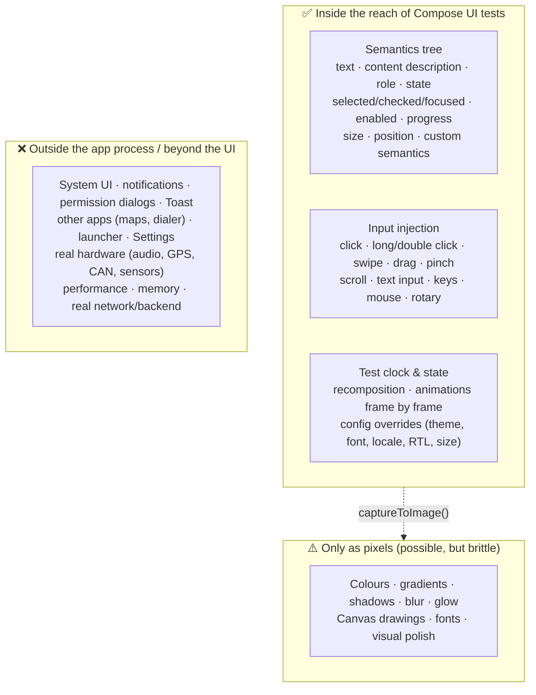
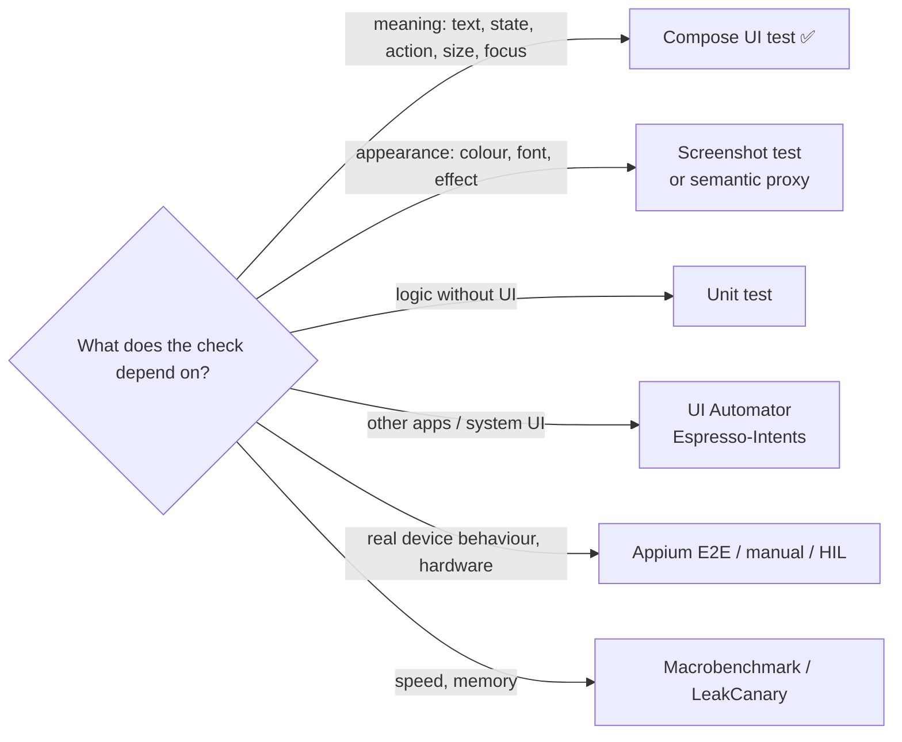

# What Compose UI Tests Can and Cannot Test

A practical reference for deciding **what to automate with Compose UI tests**, what needs a
different tool, and what stays manual. Examples come from this project.

> **One-sentence model:** a Compose UI test runs *inside the app process*, drives the UI through
> **synthesized input**, and observes it through the **semantics tree** (meaning: text, labels,
> state, size, position). Anything that is part of that tree can be tested reliably. Anything that
> is only pixels, or lives outside the app process, cannot, or only with workarounds.
> (Mechanism: [HOW_COMPOSE_TESTING_WORKS.md](HOW_COMPOSE_TESTING_WORKS.md).)



Legend used below: ✅ supported and reliable · ⚠️ possible with a workaround or extra artifact ·
❌ not possible, so use another tool.

---

## 1. What Compose UI tests CAN test

### 1.1 Finding UI elements

| Capability | API | Used in this project |
|---|---|---|
| ✅ By test tag | `onNodeWithTag("action_mute")` | Everywhere, through robots |
| ✅ By text / content description | `onNodeWithText`, `onNodeWithContentDescription` | Navigation placeholders |
| ✅ By role, state or any combination | `onNode(hasClickAction() and isSelected())` | Contract tests: all clickables |
| ✅ All matching nodes | `onAllNodes(...)`, `fetchSemanticsNodes()` | Spot filtering, touch-target sweep |
| ✅ Relative to other nodes | `hasParent`, `hasAnyAncestor`, `hasAnyDescendant`, `onChildren()` | — |
| ✅ Inside dialogs and popups | Compose dialogs/popups are separate windows but still searched; `isDialog()`, `isPopup()` | — |
| ✅ Custom matchers | `SemanticsMatcher("…") { node -> … }` | `hasTestTagPrefix("spot_card_")` |

### 1.2 Automating user interaction

| Capability | API | Used in this project |
|---|---|---|
| ✅ **Clicking UI** | `performClick()` | Mute, theme, SOS, chips, Navigate… |
| ✅ Long press, double tap | `performTouchInput { longClick(); doubleClick() }` | — |
| ✅ Swipe and drag gestures | `performTouchInput { swipeRight(); swipe(start, end) }` | Media progress slider drag |
| ✅ Tap at a precise spot | `performTouchInput { click(percentOffset(0.8f, 0.5f)) }` | Slider tap-to-seek |
| ✅ Multi-touch (pinch / zoom) | `performMultiModalInput`, `pinch(...)` | — |
| ✅ Scrolling, including lazy lists | `performScrollTo()`, `performScrollToNode(...)`, `performScrollToIndex/Key` | Scroll to the farthest spot |
| ✅ Typing text | `performTextInput("abc")`, `performTextReplacement`, `performTextClearance`, `performImeAction()` | — (no text fields yet) |
| ✅ Keyboard / D-pad keys | `performKeyInput { pressKey(Key.DirectionCenter) }` | Rotary knob "press" |
| ✅ Focus traversal (rotary / D-pad / Tab) | `requestFocus()`, `FocusManager.moveFocus(Next)` | Rotary reachability contract |
| ✅ Rotary encoder scroll events | `performRotaryScrollInput { rotateToScrollVertically(…) }` | — |
| ✅ Mouse (hover, wheel, right click) | `performMouseInput { … }` | — |
| ✅ Accessibility actions | `performSemanticsAction(SemanticsActions.OnClick)`, custom actions | — |

### 1.3 Verifying UI state and content

| Capability | API | Used in this project |
|---|---|---|
| ✅ Exists / not exists / is displayed | `assertExists()`, `assertDoesNotExist()`, `assertIsDisplayed()` | Critical controls, empty state |
| ✅ Text content | `assertTextEquals`, `assertTextContains` | Speed "88", times "1:05" |
| ✅ Accessibility labels | `hasContentDescription`, `hasStateDescription` | "Unmute audio", "Muted" |
| ✅ Selected / checked / toggled | `assertIsSelected`, `assertIsOn`, `assertIsToggleable` | Category chips |
| ✅ Enabled / focused | `assertIsEnabled`, `assertIsFocused` | Rotary focus tests |
| ✅ Progress value | `hasProgressBarRangeInfo(...)` | — |
| ✅ **Custom app state** (anything you publish) | `SemanticsMatcher.expectValue(Key, value)` | `SpeedKmh`, `SpeedAlert`, `GlowActive`, `RotaryFocused` |
| ✅ Reaction to state changes | change state, then assert (auto-sync) | Speed 0 → 88 |
| ✅ Callbacks / ViewModel calls | record lambdas; MockK `verify { }` | `verify { repository.play() }` |

### 1.4 Layout, size and position

| Capability | API | Used in this project |
|---|---|---|
| ✅ Exact or minimum size | `assertWidthIsAtLeast(64.dp)`, `assertHeightIsEqualTo(…)`, `node.size` | 64dp touch-target contract |
| ✅ Position | `assertLeftPositionInRootIsEqualTo`, `getBoundsInRoot()` | — |
| ✅ Relative layout (A is left of / above B) | compare `boundsInRoot` | — |
| ✅ Touch target size (including expanded touch area) | `assertTouchWidthIsEqualTo`, `touchBoundsInRoot` | — |
| ⚠️ Overlap between elements | compute from `boundsInRoot` yourself | — |
| ⚠️ **Text truncated or overflowing** | `SemanticsActions.GetTextLayoutResult` → `hasVisualOverflow` (§3.2) | — |

### 1.5 Time, animation and asynchronous work

| Capability | API | Used in this project |
|---|---|---|
| ✅ Wait automatically for recomposition / animations | built-in `waitForIdle()` | Animated speed settles before assert |
| ✅ Control time frame by frame | `mainClock.autoAdvance = false; advanceTimeBy(250)` | — |
| ✅ Assert mid-animation values | manual clock + assertions | — |
| ✅ Wait for a condition | `waitUntil(timeoutMillis) { … }`, `waitUntilExactlyOneExists` | — |
| ✅ Work outside Compose | Espresso `IdlingResource` | — |
| ⚠️ Infinite animations | not waited for; inspect them with the manual clock | Breathing glow ignored correctly |

### 1.6 Environment and configuration variants

| Capability | API | Used in this project |
|---|---|---|
| ✅ Dark / light theme | render with theme parameter, or `DeviceConfigurationOverride.DarkMode(true)` | Contract: both themes |
| ✅ Font scale | `LocalDensity` override or `DeviceConfigurationOverride.FontScale(1.3f)` | Fixed 1.0 + max 1.3× contract |
| ✅ Screen size / density | `DeviceConfigurationOverride.ForcedSize(DpSize(…))` | — |
| ✅ Locale and right-to-left layout | `DeviceConfigurationOverride.Locales(…)`, `.LayoutDirection(Rtl)` | — |
| ✅ Saved-state restoration (rotation, process recreation of state) | `StateRestorationTester`, `ActivityScenario.recreate()` | — |

### 1.7 Architecture-level testing

| Capability | How | Used in this project |
|---|---|---|
| ✅ A single composable in isolation | `createComposeRule()` + fake state | All screen tests |
| ✅ Screen + real ViewModel (fake data layer) | construct ViewModel with fakes/MockK | `MediaCompanionTest`, `FavoriteSpotsTest` |
| ✅ Navigation graph | `NavHost` + `navController` in the test | `NavigationTest` |
| ⚠️ Whole app with real DI | `createAndroidComposeRule<MainActivity>()` + `HiltAndroidRule` + test runner | — (Hilt test setup not added) |
| ✅ Android Views inside Compose and vice versa | Espresso and Compose tests interoperate | — |

### 1.8 Accessibility

| Capability | How | Used in this project |
|---|---|---|
| ✅ Every control has a label | iterate clickables, check `ContentDescription` / `Text` | Contract test |
| ✅ Touch target size | node size | Contract test (64dp) |
| ✅ Focus order / reachability | `moveFocus` traversal | Contract test (rotary) |
| ✅ Roles and states announced | `Role`, `stateDescription`, `selected` | Chips (Tab role), toggles |
| ⚠️ Automated accessibility scan (incl. **colour contrast**) | Accessibility Test Framework checks (`enableAccessibilityChecks()` in recent Compose test libraries, extra artifact) | Not enabled yet |
| ❌ What TalkBack actually *says* | semantics are the input to TalkBack, not its speech | Manual |

---

## 2. What Compose UI tests CANNOT test (or not well)

### 2.1 Visual appearance

The semantics tree records *what* an element means, not *how it looks*. These properties are
invisible to normal assertions:

| Not visible in semantics | Example in this project | Better approach |
|---|---|---|
| ❌/⚠️ **Colours** (text, background, icon tint) | Champagne accent, red speed when over the limit | Screenshot tests; or a semantic proxy (`SpeedAlert = true`); or pixel sampling (§3.1) |
| ❌/⚠️ Gradients, shadows, blur, glow, transparency | Glass panels, gauge comet tail, button halo | Screenshot tests |
| ❌/⚠️ Canvas drawings | The gauge arc and ticks | Publish values as custom semantics (`SpeedKmh`); screenshot tests for the drawing |
| ❌ Font family, weight, letter spacing | Thin numerals, tracked labels | Screenshot tests / design review |
| ❌ "Does it look right / premium?" | Overall visual polish | Human review (the contract test screenshot gallery helps) |
| ❌ Smoothness of animations | Gauge sweep, press springs | Macrobenchmark / manual |

> Rule used in this project: **if a visual change carries meaning, publish the meaning as
> semantics** (`SpeedAlert`, `GlowActive`) and test that. Check the pixels themselves with
> screenshot tests or by eye.

### 2.2 Anything outside the app process

| Not reachable | Example in this project | Use instead |
|---|---|---|
| ❌ Other apps opened by intents | Maps for Navigate/Home, dialer for SOS | Espresso-Intents (`intended(hasData(...))`) to verify the intent, or UI Automator |
| ❌ System UI: status bar, notifications, quick settings | Immersive mode hiding the bars | UI Automator |
| ❌ Runtime permission dialogs | — | UI Automator / `GrantPermissionRule` |
| ❌ `Toast` (system window) | — | UI Automator (a Compose `Snackbar` **is** testable) |
| ❌ Launcher, recent apps, Settings app | — | UI Automator |
| ❌ The real `MainActivity` + Hilt graph, unless set up | Real repositories, `AudioManager` | Hilt test setup, Robot + Appium E2E, manual checklist |

### 2.3 Real hardware and the outside world

| Not verifiable | Example in this project | Use instead |
|---|---|---|
| ❌ Audio actually muted / sound output | Mute button → `STREAM_MUSIC` | `adb shell dumpsys audio` (manual check M3), instrumented test of the repository |
| ❌ GPS, CAN bus, vehicle signals, sensors | Speed (mocked here) | Fake repositories in tests; hardware-in-the-loop rigs |
| ❌ Real network / backend correctness | Weather (mocked here) | Fakes / MockWebServer; contract tests at the API layer |
| ❌ Real touchscreen hardware (latency, ghost touches) | Pi touchscreen | Manual |
| ❌ Physical rotary encoder wiring | — | Manual (the *software* side is tested) |

### 2.4 Non-functional qualities

| Not measurable | Use instead |
|---|---|
| ❌ Frame rate, jank, startup time | Jetpack Macrobenchmark, JankStats, Perfetto |
| ❌ Memory leaks | LeakCanary |
| ❌ Battery, CPU and thermal behaviour on the Pi | Android Studio profilers, `dumpsys` |
| ❌ Security | Static analysis, security review |

### 2.5 Practical limitations to know about

| Limitation | Consequence / workaround |
|---|---|
| Lazy lists only compose visible items | Off-screen items "don't exist" until you `performScrollToNode` |
| Touch input mode by default | Clickables aren't focusable; call `enableRotaryInput()` first |
| One `setContent` per test | Switch content through state inside one composition |
| Coroutine work Compose doesn't know about | Use `runOnIdle`, `waitUntil` or an `IdlingResource` |
| Device settings leak into tests (font scale 1.8× on the Pi) | Pin them (`piDashComposeRule()` fixes font scale to 1.0) |
| Runs on a device or emulator, not the JVM | Slower than unit tests (≈2.5 min for 40 tests on the Pi); Robolectric can run some Compose tests on the JVM |

---

## 3. "Cannot" made possible: advanced techniques

### 3.1 Checking a colour (pixel sampling) ⚠️

```kotlin
val pixels = rule.onNodeWithTag(TestTags.SPEED_LIMIT).captureToImage().toPixelMap()
val ring = pixels[2, pixels.height / 2]        // a pixel on the badge's red ring
assertTrue(ring.red > 0.8f && ring.green < 0.5f)
```

This works, but it breaks with anti-aliasing, theme tweaks, density and GPU differences. Use it
only for a critical colour signal (e.g. "warning is red"). For general visual checks use
**screenshot tests** (Roborazzi, Paparazzi, or Compose Preview Screenshot Testing), which compare
whole images against approved "golden" images and show a visual diff.

### 3.2 Detecting truncated text ⚠️

```kotlin
val layouts = mutableListOf<TextLayoutResult>()
rule.onNodeWithTag(TestTags.WEATHER_LOCATION)
    .performSemanticsAction(SemanticsActions.GetTextLayoutResult) { it(layouts) }
assertFalse("Location is truncated", layouts.first().hasVisualOverflow)
```

### 3.3 Testing configurations without changing the device ✅

```kotlin
rule.setRawContent {
    DeviceConfigurationOverride(
        DeviceConfigurationOverride.Locales(LocaleList("vi")) then
            DeviceConfigurationOverride.LayoutDirection(LayoutDirection.Rtl),
    ) { DashboardScreen(TestData.dashboard, DashboardActions()) }
}
```

### 3.4 Testing pixel-only state through semantics ✅ (preferred)

```kotlin
// App: publish the meaning of the visual
Modifier.semantics { speedAlert = trip.isSpeeding }      // gauge turns red
// Test: assert the meaning
assertSemantics(TestTags.SPEED_GAUGE, DashSemantics.SpeedAlert, true)
```

---

## 4. Choosing the right tool

| I want to check… | Tool |
|---|---|
| Clicking a button triggers the right action | **Compose UI test** ✅ |
| The UI updates when state changes | **Compose UI test** ✅ |
| Gestures: swipe, drag, scroll, pinch | **Compose UI test** ✅ |
| Labels, roles, touch size, focus order | **Compose UI test** ✅ (contract tests) |
| Layout in dark/light, large fonts, RTL, other sizes | **Compose UI test** ✅ (+ screenshots for looks) |
| Colours, fonts, shadows, "looks right" | **Screenshot tests** (Roborazzi / Paparazzi) + human review |
| ViewModel / business logic | **Unit tests** (JVM, Turbine, MockK) |
| Intent sent to maps / dialer | **Espresso-Intents** |
| System dialogs, notifications, other apps | **UI Automator** |
| Full app on the head unit, black-box | **Robot Framework + Appium**, or manual checklist |
| Smoothness, startup, jank | **Macrobenchmark** |
| Memory leaks | **LeakCanary** |
| Real audio, GPS, CAN, touchscreen | **Manual / hardware-in-the-loop** |



---

## 5. How this project covers each area today

| Area | Covered by | Status |
|---|---|---|
| Click and gesture behaviour | 22 behaviour tests | ✅ Automated |
| Accessibility labels, 64dp targets, rotary reach | 18 contract tests | ✅ Automated |
| Theme and large-font rendering (no crash, labelled) | Contract tests | ✅ Automated |
| Visual look of each screen | Contract screenshot gallery (`screens/*.png`) | ⚠️ Captured, reviewed by a human (no golden comparison yet) |
| Colours (e.g. red when speeding) | `SpeedAlert` semantic proxy | ⚠️ Meaning tested, pixels not |
| Real mute, maps/dialer intents, Hilt wiring | [Manual checklist](TEST_INSTRUCTIONS.md#5-manual-test-checklist-on-the-head-unit) M3, M9, M11 | ❌ Manual |
| Performance on the Pi | — | ❌ Not covered |

**Natural next steps:** screenshot tests with golden images (turns the gallery into automatic
visual regression), Espresso-Intents for the Navigate/SOS intents, and the Accessibility Test
Framework checks for colour contrast.
