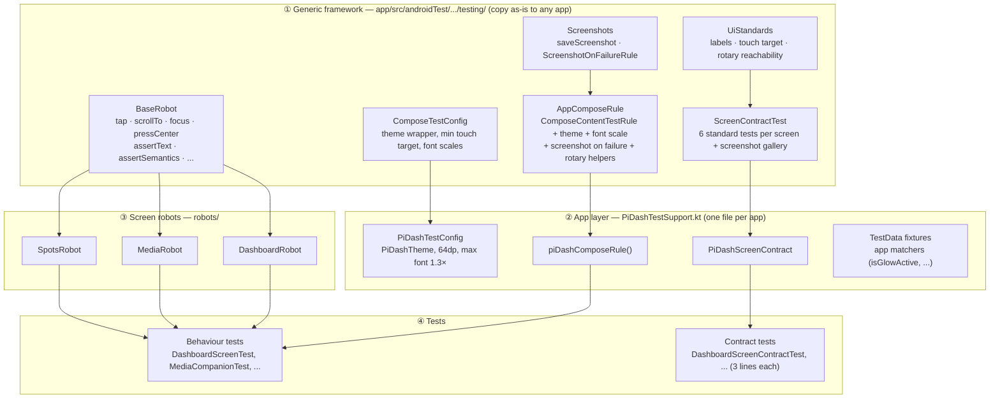
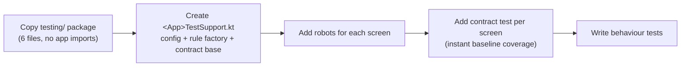

# Compose UI Test Standard

A reusable template for writing Compose UI tests the same way across every screen, and across apps.
It has four layers. Only the bottom one is specific to a screen.



## 1. The standard test method

Every behaviour test has the same shape:

```kotlin
@RunWith(AndroidJUnit4::class)
class DashboardScreenTest {

    @get:Rule
    val rule = piDashComposeRule()                         // ① the one rule

    @Test
    fun muteAndTheme_toggled_reflectNewSettingsState() =  // ② subject_condition_expectedResult
        rule.dashboard {                                   // ③ robot DSL
            // Given
            var settings by mutableStateOf(SystemSettings())
            launch(DashboardActions(onToggleMute = { settings = settings.copy(isMuted = !settings.isMuted) })) {
                TestData.dashboard.copy(settings = settings)
            }
            assertMuted(false)

            // When
            tapMute()

            // Then
            assertMuted(true)
        }
}
```

| Rule | Standard |
|---|---|
| **Rule** | `@get:Rule val rule = piDashComposeRule()`. Never call `createComposeRule()` directly |
| **Name** | `subject_condition_expectedResult`, e.g. `speedometer_overSpeedLimit_raisesAlert` |
| **Body** | Given / When / Then comments; one behaviour per test |
| **Selectors** | Only inside robots. Tests never call `onNodeWithTag` or use `TestTags` for interaction |
| **Robot verbs** | `launch(...)`, `tapX()`, `selectX()`, `dragXTo()` for actions; `assertX(...)` for checks. A check verifies *all* aspects of one state (e.g. `assertMuted` checks description, state description and glow) |
| **State** | The robot's `launch { }` lambda is `@Composable`: return a `mutableStateOf` value or `viewModel.uiState.collectAsState().value` |
| **Fixtures** | Reuse `TestData`; add new representative data there, not inline |
| **Callbacks** | Record into a local list or counter and assert *after* the robot block |
| **Async** | Values written by coroutines (e.g. slider drag end) are read inside `rule.runOnIdle { }` |
| **Focus** | `rule.enableRotaryInput()` before any focus action; `rule.rotate(n)` to move |
| **Generic checks** | Not written per test: they come from the screen's contract test |

## 2. The screen contract (applied to every screen)

Subclass `PiDashScreenContract` with sample content and the screen gets these tests:

| Contract test | Checks |
|---|---|
| `contract_rendersInDarkTheme` | Renders without error in the night theme; saves `screens/<Screen>_dark.png` |
| `contract_rendersInLightTheme` | Same in the day theme; saves `screens/<Screen>_light.png` |
| `contract_rendersAtMaxFontScale` | Renders at the largest supported font scale (1.3×) and controls stay labelled; saves `_maxFont.png` |
| `contract_clickablesHaveAccessibleLabels` | Every clickable has a label; icon-only controls have a `contentDescription` |
| `contract_clickablesMeetMinimumTouchTarget` | Every clickable is ≥ `minTouchTarget` (64dp for Pi-Dash) |
| `contract_clickablesReachableByRotary` | Rotating the knob (focus traversal) reaches every clickable |

The checks are generic: they inspect every clickable node, so a control added later is covered
without editing any test. The screenshot gallery appears in
`app/build/outputs/connected_android_test_additional_output/debugAndroidTest/connected/<device>/screens/`.

Verified with a deliberately bad screen (a 32dp, unlabelled, non-focusable button). The label,
max-font, touch-target and rotary contracts failed with messages naming the element and its
bounds; the theme renders passed.

## 3. Adding a new screen (checklist)

Templates are in [`doc/templates/`](templates/). Replace `__Screen__` / `__screen__`.

1. **Tags:** add the screen's test tags to `ui/components/TestTags.kt` and apply them in the composable.
2. **Robot:** copy [`ScreenRobot.kt.template`](templates/ScreenRobot.kt.template) to
   `androidTest/.../robots/<Screen>Robot.kt`; add `launch`, verbs and checks.
3. **Contract:** copy [`ScreenContractTest.kt.template`](templates/ScreenContractTest.kt.template). It is
   three lines plus sample data, and it gives you the 6 standard tests immediately.
4. **Behaviour tests:** copy [`ScreenTest.kt.template`](templates/ScreenTest.kt.template) and write one
   Given/When/Then test per user-visible behaviour.
5. **Fixtures:** add representative sample state to `TestData`.
6. Run `.\gradlew :app:connectedDebugAndroidTest` and check the new screenshots in `screens/`.

## 4. Applying the template to another app



1. Copy `app/src/androidTest/java/<pkg>/testing/` and change the package name.
2. Add the dependencies (all standard):
   ```kotlin
   androidTestImplementation(platform(libs.androidx.compose.bom))
   androidTestImplementation("androidx.compose.ui:ui-test-junit4")
   androidTestImplementation("androidx.test.services:storage:1.6.0")
   androidTestUtil("androidx.test.services:test-services:1.6.0")
   debugImplementation("androidx.compose.ui:ui-test-manifest")
   // defaultConfig: testInstrumentationRunnerArguments["useTestStorageService"] = "true"
   ```
3. Create the app layer (about 20 lines):
   ```kotlin
   val MyAppTestConfig = ComposeTestConfig(
       minTouchTarget = 48.dp,                   // phone apps: Material minimum
       maxFontScale = 2f,                        // whatever the app supports
       themeWrapper = { dark, content -> MyAppTheme(darkTheme = dark) { Surface { content() } } },
   )
   fun myAppComposeRule() = createAppComposeRule(MyAppTestConfig)
   abstract class MyAppScreenContract : ScreenContractTest(MyAppTestConfig)
   ```
4. Without rotary support, override `contract_clickablesReachableByRotary` in your contract base, or
   keep it: D-pad, keyboard and Switch Access users rely on the same focus traversal.

## 5. Where each concern lives

| Concern | File |
|---|---|
| Theme, font scale, min target | `PiDashTestSupport.kt` → `PiDashTestConfig` |
| Rule, screenshot on failure, rotary | `testing/AppComposeRule.kt`, `testing/Screenshots.kt` |
| Generic UI standards | `testing/UiStandards.kt` |
| Robot primitives | `testing/BaseRobot.kt` |
| Contract template | `testing/ScreenContractTest.kt` |
| Generic matchers | `testing/Matchers.kt` |
| App matchers and fixtures | `PiDashTestSupport.kt` (`isGlowActive`, `isRotaryFocused`, `TestData`) |
| Screen knowledge (tags, gestures) | `robots/*Robot.kt` |

## 6. Known follow-up

`AppComposeRule` still uses the v1 `createComposeRule()` (unconfined test dispatcher), which is
deprecated in the current Compose BOM in favour of `androidx.compose.ui.test.junit4.v2.createComposeRule`
(standard dispatcher). Because every test gets its rule from this one class, the migration is a
one-line change, followed by a full run to catch timing assumptions.
