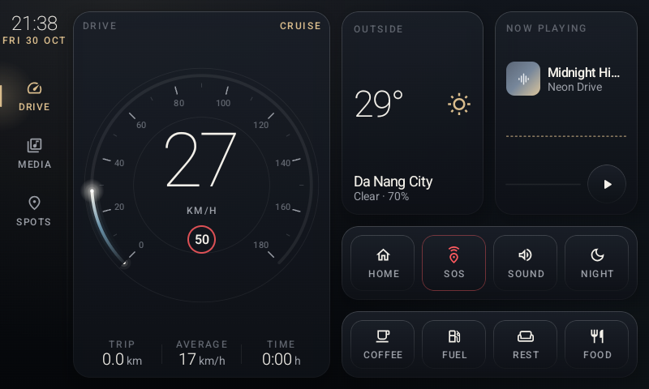
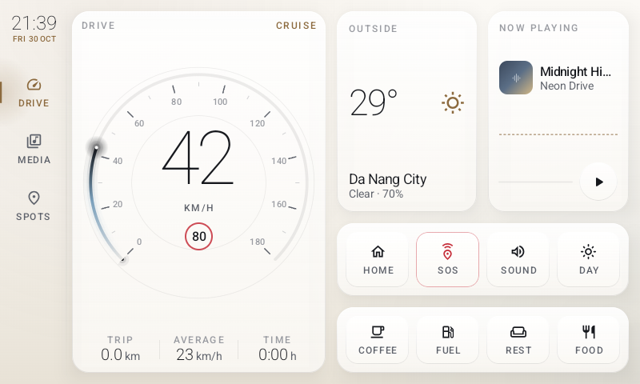
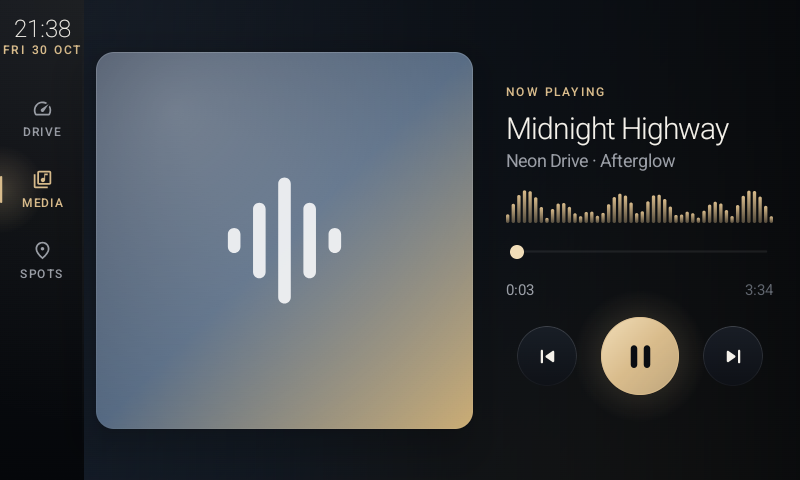
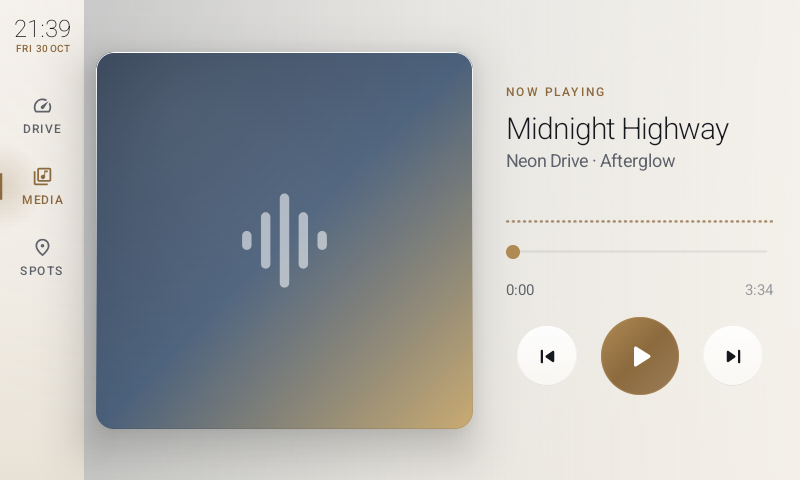
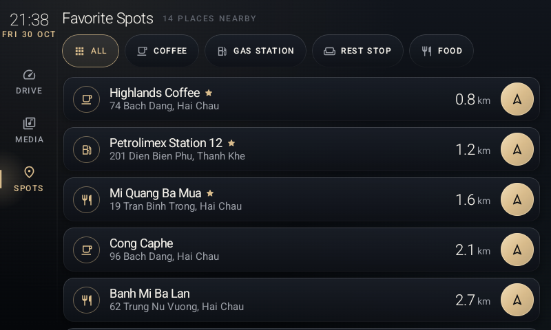

# Pi-Dash — Design

## 1. Goals and constraints

| Goal | How it shows up in the design |
|---|---|
| Glanceable while driving | Oversized thin numerals, few elements per screen, high contrast, no dense text |
| Safe touch targets | Every clickable element is at least **64dp × 64dp** (checked by an automated test) |
| Premium look | "Midnight & Champagne" design system modelled on luxury-car interiors (section 4) |
| Testable UI | Screens are stateless composables driven by a UI state object plus callbacks; all logic sits in ViewModels |
| Runs on a Raspberry Pi 4 | Cheap effects only: layered strokes in place of blur, numerals measured once, few infinite animations |
| Rotary-controller ready | Focus state is drawn as an accent ring and exposed through custom semantics |

**Target device:** Raspberry Pi 4 Model B, Android 16 (API 36), 800×480 px at 120 dpi (≈1067×640 dp), landscape.

## 2. Tech stack

| Area | Choice |
|---|---|
| Language / UI | Kotlin, Jetpack Compose (BOM 2026.09.00), Material 3 |
| Architecture | MVVM + clean architecture layers, `StateFlow` |
| Async | Kotlin Coroutines and Flow |
| DI | Hilt 2.60.1 (KSP) |
| Navigation | Navigation Compose 2.10 (string routes) |
| Build | Gradle 9.4.1, AGP 9.2.1 (built-in Kotlin), Kotlin 2.4.21, compileSdk 37, minSdk 28, targetSdk 36 |
| Tests | JUnit4, Compose UI Test (`ui-test-junit4`), MockK, Turbine, kotlinx-coroutines-test, Espresso 3.7.0 |

## 3. Architecture

```
app/src/main/java/com/pidash/companion/
├── domain/                 Pure Kotlin: no Android types
│   ├── model/              TripData, Weather, Track, MediaState, Spot, SpotCategory, SystemSettings
│   ├── repository/         Repository interfaces (TripRepository, MediaRepository, …)
│   └── usecase/            ObserveTripData, ObserveWeather, ObserveMediaState, MediaControl,
│                           FilterSpots, ToggleTheme, ToggleMute
├── data/
│   ├── source/             MockSpeedGenerator (drive simulation), MockMediaCatalog
│   └── repository/         Mock* repositories, AudioSettingsRepository (real AudioManager mute)
├── di/                     Hilt modules: repository bindings, application CoroutineScope
├── ui/
│   ├── theme/              Theme.kt: palettes, typography, dimensions, ambient background
│   ├── components/         PremiumGlassCard, GlowButton, NeonArcGauge, media visuals,
│   │                       TestTags, DashSemantics (custom semantics keys)
│   ├── dashboard/          DashboardScreen + DashboardViewModel
│   ├── media/              MediaScreen + MediaViewModel
│   ├── spots/              SpotsScreen + SpotsViewModel
│   └── navigation/         PiDashApp (shell, rail, NavHost), Routes, ExternalActions
├── MainActivity.kt         Theme switching, immersive mode, external intents
└── PiDashApplication.kt    @HiltAndroidApp
```

### 3.1 Data flow

```
Mock generator / AudioManager
        │  Flow / StateFlow
        ▼
Repository (data)  ──implements──▶  Repository interface (domain)
        │
        ▼
Use case (domain)            e.g. FilterSpotsUseCase combines spots + selected category
        │
        ▼
ViewModel (ui)               combine(...).stateIn(viewModelScope, WhileSubscribed(5s), initial)
        │  StateFlow<UiState>
        ▼
Route in PiDashApp           collectAsStateWithLifecycle(), wires callbacks to the ViewModel
        │  UiState + Actions
        ▼
Stateless Screen composable  DashboardScreen(state, actions) — the unit the UI tests render
```

Key rules:

- **Screens never see a ViewModel.** `DashboardScreen`, `MediaScreen` and `SpotsScreen` take a plain
  state object and callback lambdas (`DashboardActions`, `MediaActions`). Tests render them directly
  with `createComposeRule()`, so no Hilt or Activity is needed.
- **Side effects that leave the app** (maps, dialer) go through the `ExternalActions` interface,
  implemented in `MainActivity`. When no app can handle the intent (common on a DIY head unit), a
  snackbar explains this instead of the app crashing.
- **Theme and mute** are app-wide settings in `SettingsRepository`. `MainActivity` observes them to
  switch between `PiDashTheme(darkTheme = …)` values. Mute calls `AudioManager.adjustStreamVolume`
  on `STREAM_MUSIC`, so it really mutes the head unit.

### 3.2 Mock data

| Source | Behaviour |
|---|---|
| `MockSpeedGenerator` | Every 500 ms it picks a scenario (stop / city / highway), accelerates (≤3.5 km/h per tick) or brakes (≤6 km/h per tick) toward a target speed, and integrates trip distance, average speed and elapsed time. Random source is injectable for deterministic tests. |
| `MockWeatherRepository` | Cycles through 5 Da Nang-area locations every 30 s. |
| `MockMediaRepository` | 5-track queue. While playing, position advances 1 s per tick and moves to the next track at the end. "Previous" restarts the track when more than 3 s in. Seek and wrap-around are supported. |
| `MockSpotsRepository` | 14 Da Nang spots in 4 categories (coffee, gas station, rest stop, food). Names are real places; addresses, coordinates and distances are approximate demo values. |

To use real data, implement the domain repository interface and change the binding in
`di/AppModule.kt`. Nothing in the UI layer needs to change.

### 3.3 Navigation

Three destinations live in the left rail: **Drive** (`dashboard`, start destination), **Media** (`media`)
and **Spots** (`spots?category={category}`). Quick-stop buttons on the dashboard open Spots with a
category pre-selected. `SpotsViewModel` reads the category from `SavedStateHandle`.

Rail navigation uses `NavHostController.navigateToTopLevel(route)`, which pops to the start
destination and uses `launchSingleTop`. It deliberately does **not** use
`saveState`/`restoreState`. The start destination is itself a rail item, and restoring its saved
stack re-pushed the screen that had just been popped, so the rail appeared frozen. `NavigationTest`
guards against this regression.

## 4. Visual design system — "Midnight & Champagne"

The visual language is modelled on luxury-car interiors (Mercedes MBUX, Porsche Taycan,
Bentley/Rolls-Royce). The principle is restraint: dark materials, platinum text, **one warm metal
accent**, and colour used only to signal state.

### 4.1 Palette

| Token | Night (default) | Day ("Ivory & Bronze") | Use |
|---|---|---|---|
| Background | `#11151C → #0A0D12 → #05070A` vertical gradient | `#FBF9F5 → #F5F2EC → #E8E2D6` | Cabin base |
| Ambient light | Champagne 7 % (top-left), ice blue 5 % (bottom-right) | Bronze 8 %, steel blue 5 % | Soft light pools, like interior ambient lighting |
| Panel fill | Smoked glass `#1A1F28 → #0E1117` at 90 % | White 92 % → ivory 85 % | Cards |
| Panel border | Hairline white 16 % → 3 % (top → bottom) | White → ink 10 % | Specular top edge |
| Accent | Champagne `#D9BC8C` (light `#F1DDB8`) | Bronze `#8C6A3E` | Selected/active states, labels, primary button |
| Secondary | Ice blue `#9ADCFF` | Steel blue `#2F6F9F` | Gauge comet tail at normal speed |
| Warning | Soft amber `#FFB547` | `#B86E00` | Near limit, muted audio |
| Danger | Soft red `#FF5A5F` | `#C62E3A` | Over limit, SOS |
| Text | Platinum `#F4F1EA` / silver `#9A9EA6` / graphite `#5F646D` | Ink `#16181D` / `#5E626B` / `#9A9CA2` | Primary / secondary / tertiary |

All tokens live in `ui/theme/Theme.kt` (`DashColors`) and are read with `DashTheme.colors`.

### 4.2 Typography

Roboto (the system sans-serif) in very light weights for numbers, with tracked uppercase captions,
as in modern instrument clusters.

| Style | Spec | Used for |
|---|---|---|
| `displayLarge` | Thin 124sp, tracking −5 | Speed |
| `displayMedium` | ExtraLight 60sp | Outside temperature |
| `displaySmall` | Light 40sp | Track title |
| `headlineMedium/Small` | Light 28 / 24sp | Screen titles, distances, trip values |
| `titleLarge/Medium` | Regular 20 / Medium 17sp | Names, locations |
| `labelLarge` | Medium 12sp, tracking 1.8 | Button labels (UPPERCASE) |
| `labelMedium` | Medium 12sp, tracking 2.6 | Section captions (`SectionLabel`) |

The app caps the system font scale at **1.3×** (`MainActivity.MAX_FONT_SCALE`). The type is already
oversized, and the test Pi runs at 1.8×, which truncated labels.

### 4.3 Shape, depth and light

- Corner radius 28dp for panels and 20dp for buttons and list cards. Controls are circular where natural.
- Depth comes from a neutral black shadow plus a **hairline border that is brighter at the top
  edge**. There are no coloured drop shadows.
- Light comes from the accent: an active control gets a soft radial halo that extends past its
  bounds. Active media playback "breathes" (1.8 s cycle).
- Press feedback uses a spring scale to 0.92–0.97.
- True backdrop blur is too expensive on a Pi 4. The only real blur is behind the album art on the
  Media screen.

### 4.4 Components (`ui/components`)

| Component | Description |
|---|---|
| `PremiumGlassCard` | Smoked-glass panel with specular hairline and deep shadow. Optional `onClick` makes it a focusable, tactile surface. |
| `GlowButton` | ≥64dp control. At rest: hairline outline. `active`: lights up in `activeColor` with a halo (optional `pulse`). `filled`: brushed champagne face for primary actions (Play, Navigate). `tintIcon`: keeps a semantic colour without "active" (SOS). Exposes `GlowActive`, `RotaryFocused` and `stateDescription`. |
| `NeonArcGauge` | Canvas gauge: 270° sweep, bezel ring, graduated ticks (minor every 10 km/h, major every 20) with numerals, inner depth ring, and a thin value arc with a luminous comet tail and glowing head. Tail/head colours: ice/platinum → champagne/amber (≥85 % of limit) → amber/red (over limit). Numerals are measured once with `TextMeasurer`. |
| `SectionLabel` | Tracked uppercase caption ("OUTSIDE", "NOW PLAYING"). |
| `AlbumArtwork`, `WaveVisualizer` | Generated gradient artwork (no network images) and an animated bar visualizer that goes flat when paused. |
| `DashSemantics` | Custom semantics keys: `SpeedKmh`, `SpeedAlert`, `RotaryFocused`, `GlowActive`. |
| `TestTags` | Every tag used by tests, in one place. |

### 4.5 Screens

**Dashboard** — gauge panel on the left; on the right, the weather and now-playing panels, a row of
quick controls (Home, SOS, Sound/Muted, Night/Day) and a row of quick stops (Coffee, Fuel, Rest,
Food).

| Night | Day |
|---|---|
|  |  |

**Media** — large artwork whose colours bleed into the background, thin title, gold visualizer,
custom hairline slider with a champagne thumb, and a brushed-metal play button.

| Night | Day |
|---|---|
|  |  |

**Favorite Spots** — hairline category pills (the selected pill lights up in champagne), a lazy list
of cards showing distance, and a circular champagne Navigate button.



**Navigation rail** — thin clock and date, then items without boxes. The selected item turns
champagne and gets a light bar on its edge.

### 4.6 Rotary controller / D-pad support

- The root intercepts `onRotaryScrollEvent` and maps it to `FocusManager.moveFocus(Next/Previous)`.
- Every control draws a 2dp accent ring when focused and sets `DashSemantics.RotaryFocused`.
- D-pad centre / Enter activates the focused control (standard `clickable` behaviour).
- Clickables only become focusable in **keyboard input mode**, which real rotary or D-pad hardware
  switches to automatically.

## 5. Accessibility

- Every icon-only button has an explicit `contentDescription`. Toggles also set a `stateDescription`
  ("Muted", "Night theme", "Playing").
- Category chips use `selectable(role = Tab)`, so the selected state is announced.
- The speed gauge's `contentDescription` is "Speed N kilometers per hour". The speed-limit badge reads
  "Speed limit N".
- Decorative elements (artwork glyph, chip icons) have `contentDescription = null`.

## 6. Known limitations

- All data is mocked. The Pi has no GPS, and weather is not fetched.
- The theme choice is held in memory and resets on restart.
- Navigate, Home and SOS need a maps or dialer app. Without one, a snackbar is shown.
