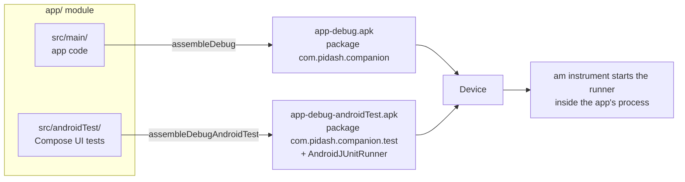

# Pi-Dash — Configure Gradle to Build and Run Compose UI Tests

This guide explains how to set up Gradle so that it builds the **Compose test APK**, and every way to
run it on a device. It uses the real configuration of this project, so you can copy it into another
Compose app.

| You want to… | Go to |
|---|---|
| Understand what gets built | [1. What Gradle builds](#1-what-gradle-builds) |
| Configure a project from scratch | [2. Configure Gradle step by step](#2-configure-gradle-step-by-step) |
| Build the APKs | [3. Build the APKs](#3-build-the-apks) |
| Run the tests | [4. Run the tests](#4-run-the-tests) |
| Find the results | [5. Where the results go](#5-where-the-results-go) |
| Fix a problem | [6. Troubleshooting](#6-troubleshooting) |
| Set up another app quickly | [7. Checklist for a new app](#7-checklist-for-a-new-app) |

---

## 1. What Gradle builds

Compose UI tests are **instrumented tests**: they run on a device, inside the app's process. Gradle
builds **two APKs** from one module:



| APK | Contents | Gradle task | Output |
|---|---|---|---|
| App APK | the app, plus test-only debug pieces (see `ui-test-manifest` below) | `:app:assembleDebug` | `app/build/outputs/apk/debug/app-debug.apk` |
| Test APK | the test classes, test libraries and the test runner; its manifest says *instrument `com.pidash.companion`* | `:app:assembleDebugAndroidTest` | `app/build/outputs/apk/androidTest/debug/app-debug-androidTest.apk` |

The test APK does not contain the app. At run time Android loads both into **one process**, so the
tests can call app code directly and drive its UI.

> "Compose test", "Android test", "instrumented test" and "connected test" all mean these same tests
> in `src/androidTest/`. Tests in `src/test/` are JVM unit tests: they need no device and no APK.

---

## 2. Configure Gradle step by step

Files involved:

```text
settings.gradle.kts          repositories
gradle/libs.versions.toml    versions and library names (version catalog)
build.gradle.kts             plugins (declared, not applied)
app/build.gradle.kts         android { … } and dependencies { … }   ← most of the setup
app/src/androidTest/java/…   the tests
```

### 2.1 Repositories — `settings.gradle.kts`

All test libraries come from Google's Maven repository and Maven Central:

```kotlin
dependencyResolutionManagement {
    repositoriesMode.set(RepositoriesMode.FAIL_ON_PROJECT_REPOS)
    repositories {
        google()
        mavenCentral()
    }
}
```

### 2.2 Versions — `gradle/libs.versions.toml`

The test entries of this project's version catalog:

```toml
[versions]
composeBom = "2026.09.00"     # one version for every Compose library, including ui-test
junit = "4.13.2"
androidxJunit = "1.3.0"       # AndroidJUnit4 runner class + JUnit extensions
androidxTestRunner = "1.7.0"  # AndroidJUnitRunner (the instrumentation)
espresso = "3.7.0"            # 3.7.0 or newer is required on Android 16
testServices = "1.6.0"        # TestStorage: tests save screenshots the host can pull
coroutines = "1.10.2"
mockk = "1.14.11"
turbine = "1.2.1"

[libraries]
androidx-compose-bom = { group = "androidx.compose", name = "compose-bom", version.ref = "composeBom" }
androidx-compose-ui-test-junit4 = { group = "androidx.compose.ui", name = "ui-test-junit4" }       # version from the BOM
androidx-compose-ui-test-manifest = { group = "androidx.compose.ui", name = "ui-test-manifest" }   # version from the BOM
androidx-test-ext-junit = { group = "androidx.test.ext", name = "junit", version.ref = "androidxJunit" }
androidx-test-runner = { group = "androidx.test", name = "runner", version.ref = "androidxTestRunner" }
androidx-test-espresso-core = { group = "androidx.test.espresso", name = "espresso-core", version.ref = "espresso" }
androidx-test-services = { group = "androidx.test.services", name = "test-services", version.ref = "testServices" }
androidx-test-storage = { group = "androidx.test.services", name = "storage", version.ref = "testServices" }
kotlinx-coroutines-test = { group = "org.jetbrains.kotlinx", name = "kotlinx-coroutines-test", version.ref = "coroutines" }
mockk-android = { group = "io.mockk", name = "mockk-android", version.ref = "mockk" }
turbine = { group = "app.cash.turbine", name = "turbine", version.ref = "turbine" }
```

### 2.3 Plugins

Nothing test-specific is needed. Compose needs the Kotlin Compose compiler plugin, and the Android
application plugin already knows how to build test APKs:

```kotlin
// app/build.gradle.kts
plugins {
    alias(libs.plugins.android.application)
    alias(libs.plugins.kotlin.compose)   // Compose compiler (Kotlin 2.x)
    // project-specific: ksp, hilt, jacoco
}
```

### 2.4 The `android { }` block — `app/build.gradle.kts`

```kotlin
android {
    namespace = "com.pidash.companion"
    compileSdk = 37

    defaultConfig {
        applicationId = "com.pidash.companion"
        minSdk = 28
        targetSdk = 36

        // (1) The instrumentation that runs the tests. Required.
        testInstrumentationRunner = "androidx.test.runner.AndroidJUnitRunner"

        // (2) Optional runner arguments, passed to every run (like `-e key value`).
        //     Here: tests can save screenshots through TestStorage, and Gradle pulls them afterwards.
        testInstrumentationRunnerArguments["useTestStorageService"] = "true"
    }

    buildTypes {
        debug {
            // (3) Optional: JaCoCo coverage of the app while the UI tests run.
            enableAndroidTestCoverage = true
            enableUnitTestCoverage = true
        }
    }

    buildFeatures {
        compose = true          // (4) Compose in the app
    }

    packaging {
        resources {
            // (5) Test libraries ship duplicate license files; without this the test APK fails to package.
            excludes += setOf("/META-INF/{AL2.0,LGPL2.1}", "META-INF/LICENSE*.md")
        }
    }
}
```

| # | Setting | Why |
|---|---|---|
| 1 | `testInstrumentationRunner` | Written into the test APK's manifest. `am instrument` starts this class, and it finds and runs the JUnit tests. |
| 2 | `testInstrumentationRunnerArguments` | Default arguments for every run. Your own keys are read in tests with `InstrumentationRegistry.getArguments()`. This project's `observeStepMs` and `evidenceScreenshots` work this way. |
| 3 | `enableAndroidTestCoverage` | Instruments the debug app so the run writes `coverage.ec`. Leave it out if you don't need coverage, because it makes the app slightly slower. |
| 4 | `buildFeatures.compose` | Needed by the app, and therefore by its tests. |
| 5 | `packaging.excludes` | Avoids "2 files found with path META-INF/…" errors when packaging the test APK. |

Defaults you usually keep:

- **Tests are built against the `debug` build type.** To use another one, set `testBuildType = "staging"`.
- **Test source folder:** `src/androidTest/java` (or `kotlin`). Use the same package as the app, for
  example `com.pidash.companion`.
- **Test APK package:** `<applicationId>.test`, for example `com.pidash.companion.test`.

### 2.5 Dependencies — `app/build.gradle.kts`

```kotlin
dependencies {
    // … app dependencies, including:
    implementation(platform(libs.androidx.compose.bom))

    // ---- Compose UI tests (go into the TEST APK) ----
    androidTestImplementation(platform(libs.androidx.compose.bom))     // (a) same Compose versions as the app
    androidTestImplementation(libs.androidx.compose.ui.test.junit4)    // (b) createComposeRule, onNode…, performClick…
    androidTestImplementation(libs.androidx.test.ext.junit)            // (c) @RunWith(AndroidJUnit4::class)
    androidTestImplementation(libs.androidx.test.runner)               // (d) AndroidJUnitRunner
    androidTestImplementation(libs.androidx.test.espresso.core)        // (e) pinned to 3.7.0 for Android 16
    androidTestImplementation(libs.kotlinx.coroutines.test)            // optional: runTest, test dispatchers
    androidTestImplementation(libs.mockk.android)                      // optional: mocks on device
    androidTestImplementation(libs.turbine)                            // optional: Flow assertions
    androidTestImplementation(libs.androidx.test.storage)              // optional: TestStorage (screenshots)
    androidTestUtil(libs.androidx.test.services)                       // optional: installs the test-services APK

    // ---- Goes into the APP APK, debug only ----
    debugImplementation(libs.androidx.compose.ui.test.manifest)        // (f) REQUIRED for createComposeRule()
    debugImplementation(libs.androidx.compose.ui.tooling)              // previews / Layout Inspector
}
```

| | Dependency | Why |
|---|---|---|
| a | Compose BOM for `androidTestImplementation` | The BOM must be added to **each** configuration. Without it, `ui-test-junit4` has no version. |
| b | `ui-test-junit4` | The Compose test API: rules, finders, actions, assertions, `mainClock`. |
| c | `androidx.test.ext:junit` | `AndroidJUnit4` runner class, `ActivityScenario` integration. |
| d | `androidx.test:runner` | The `AndroidJUnitRunner` named in `testInstrumentationRunner`. |
| e | `espresso-core` | Compose testing uses Espresso internally for idling. Versions below 3.7.0 crash on Android 16 (`InputManager.getInstance` no longer exists), so pin the version explicitly. |
| f | `ui-test-manifest` as **`debugImplementation`** | `createComposeRule()` starts an empty `ComponentActivity` to host your composable. That activity is declared by this library, and it must be in the **app** APK, which is why it is `debug…` and not `androidTest…`. Without it, tests fail with *"Unable to resolve activity for Intent"*. |

> **Hilt apps:** this project tests composables with fakes, so the standard runner is enough. To
> inject real Hilt graphs into tests, add `androidTestImplementation(libs.hilt.android.testing)`,
> `kspAndroidTest(libs.hilt.compiler)`, and a custom runner that uses `HiltTestApplication`
> (set it in `testInstrumentationRunner`).

### 2.6 Optional settings

```kotlin
android {
    defaultConfig {
        // Run each test in its own process (isolation like ATR's per-test runs), then clear app data:
        testInstrumentationRunnerArguments["clearPackageData"] = "true"
    }
    testOptions {
        execution = "ANDROIDX_TEST_ORCHESTRATOR"
        animationsDisabled = true            // turn off system animations during connected tests
    }
}
dependencies {
    androidTestUtil("androidx.test:orchestrator:1.6.1")
}
```

This project does **not** use the Orchestrator. Tests stay fast (one process), and ATR provides
per-test isolation when it's needed (see [`report-tool/`](../report-tool/README.md)).

### 2.7 A minimal test, to check the setup

`app/src/androidTest/java/com/pidash/companion/SetupCheckTest.kt`:

```kotlin
@RunWith(AndroidJUnit4::class)
class SetupCheckTest {
    @get:Rule val rule = createComposeRule()

    @Test
    fun text_isDisplayed() {
        rule.setContent { Text("Hello head unit") }
        rule.onNodeWithText("Hello head unit").assertIsDisplayed()
    }
}
```

If this test passes, the Gradle setup is correct. Project tests use `piDashComposeRule()`, which wraps
`createComposeRule()` with the app theme and test settings
(see [COMPOSE_TEST_STANDARD.md](COMPOSE_TEST_STANDARD.md)).

---

## 3. Build the APKs

```powershell
# Both APKs
.\gradlew :app:assembleDebug :app:assembleDebugAndroidTest
```

| Output | Path |
|---|---|
| App APK | `app\build\outputs\apk\debug\app-debug.apk` |
| Test APK | `app\build\outputs\apk\androidTest\debug\app-debug-androidTest.apk` |

Check what the test APK will instrument:

```powershell
adb install -r -t app\build\outputs\apk\debug\app-debug.apk
adb install -r -t app\build\outputs\apk\androidTest\debug\app-debug-androidTest.apk
adb shell pm list instrumentation
# instrumentation:com.pidash.companion.test/androidx.test.runner.AndroidJUnitRunner (target=com.pidash.companion)
```

`-r` replaces an installed version and `-t` allows test packages. Only `connectedDebugAndroidTest`
builds, installs and runs in one step. You need the separate APKs for adb, ATR and CI pipelines that
build on one machine and test on another.

---

## 4. Run the tests

Connect the head unit first: `adb connect <ip>:<port>`, then `adb devices`.

### 4.1 Gradle (builds, installs and runs)

```powershell
# All tests
.\gradlew :app:connectedDebugAndroidTest

# One test case / one class / several (fully-qualified names, comma-separated)
.\gradlew :app:connectedDebugAndroidTest "-Pandroid.testInstrumentationRunnerArguments.class=com.pidash.companion.NavigationTest#railReturnsToDashboard_afterQuickStopOpenedSpots"
.\gradlew :app:connectedDebugAndroidTest "-Pandroid.testInstrumentationRunnerArguments.class=com.pidash.companion.NavigationTest"
.\gradlew :app:connectedDebugAndroidTest "-Pandroid.testInstrumentationRunnerArguments.class=com.pidash.companion.NavigationTest,com.pidash.companion.MediaCompanionTest"

# By annotation (tag)
.\gradlew :app:connectedDebugAndroidTest "-Pandroid.testInstrumentationRunnerArguments.annotation=com.pidash.companion.Smoke"

# Any runner argument, e.g. slow the tests down to watch them
.\gradlew :app:connectedDebugAndroidTest "-Pandroid.testInstrumentationRunnerArguments.observeStepMs=1500"
```

Other filters: `notClass`, `package`, `notAnnotation`, `size` (`small` / `medium` / `large`).
Names must be fully-qualified, wildcards are not supported, and `--tests` works only for unit tests.

> **Several devices?** `connectedDebugAndroidTest` runs on **every** connected device. The Pi can show
> up twice (by IP and through mDNS, both the same device), so choose one:
> `$env:ANDROID_SERIAL = "192.168.1.140:35381"`.

### 4.2 Script: `scripts\run_composet_test.bat`

The script wraps 4.1. It accepts short names, selects the device, and copies the results to
`test-run-report\`.

```bat
scripts\run_composet_test.bat                         :: all tests
scripts\run_composet_test.bat test NavigationTest#railReturnsToDashboard_afterQuickStopOpenedSpots
scripts\run_composet_test.bat test DashboardScreenTest MediaCompanionTest#playPause_tapped_togglesStateAndCallsViewModel
scripts\run_composet_test.bat tag Smoke --open        :: @Smoke tests, then open the report
scripts\run_composet_test.bat all --serial emulator-5554
scripts\run_composet_test.bat help
```

| Exit code | Meaning |
|---|---|
| 0 | all selected tests passed |
| 1 | test failures or build error (see the report / Gradle output) |
| 2 | wrong arguments |
| 3 | device not connected |
| 4 | no test matched the names (check spelling: `Class#method`) |

### 4.3 adb only (APKs already installed, no Gradle)

The fastest way to rerun something:

```powershell
$runner = "com.pidash.companion.test/androidx.test.runner.AndroidJUnitRunner"
adb shell am instrument -w $runner                                                          # all
adb shell am instrument -w -e class com.pidash.companion.NavigationTest#railReturnsToDashboard_afterQuickStopOpenedSpots $runner
adb shell am instrument -w -e annotation com.pidash.companion.Smoke $runner
adb shell am instrument -w -r -e log true $runner                                           # list tests without running
```

### 4.4 Android Studio

Click the green ▶ next to a test class or method, or right-click `src/androidTest` and choose
**Run 'All Tests'**. This is the only way that gives you the debugger.

### 4.5 ATR (report with video, screenshots, Robot Framework)

```powershell
.\gradlew :app:assembleDebug :app:assembleDebugAndroidTest     # ATR uses the prebuilt APKs
atr run                       # all tests, per-test video + report → atr-results\report.html
atr run -t "*mute*"           # Robot-style selection
atr run -i Smoke --robot results\android.xml                   # for a merged Robot Framework report
```

See [report-tool/README.md](../report-tool/README.md) and the user guide in the ATR zip.

### Which one to use

| Situation | Use |
|---|---|
| Writing or debugging a test | Android Studio ▶ |
| Quick rerun of one test | adb (4.3) or the script (4.2) |
| Full local run with a report | the script (4.2) |
| Coverage | Gradle: `.\gradlew :app:jacocoMergedReport` |
| CI, regression, release, evidence, Robot report | ATR (4.5) |

---

## 5. Where the results go

| Run with | Results |
|---|---|
| Gradle | `app\build\reports\androidTests\connected\debug\index.html` (HTML)<br>`app\build\outputs\androidTest-results\connected\debug\` (JUnit XML, per-test logcat)<br>`app\build\outputs\code_coverage\debugAndroidTest\connected\` (`coverage.ec`) |
| `run_composet_test.bat` | `test-run-report\html\index.html`, `test-run-report\results\`, `test-run-report\coverage\` |
| Failure screenshots (TestStorage) | `app\build\outputs\connected_android_test_additional_output\…\screenshots\` |
| ATR | `atr-results\report.html`, `junit.xml`, `output.json`, `artifacts\` |

---

## 6. Troubleshooting

| Symptom | Cause | Fix |
|---|---|---|
| `Unable to resolve activity for Intent … ComponentActivity` | `ui-test-manifest` missing from the app APK | `debugImplementation(libs.androidx.compose.ui.test.manifest)` |
| `NoSuchMethodError: InputManager.getInstance` on Android 16 | Espresso older than 3.7.0 (pulled in transitively) | `androidTestImplementation(libs.androidx.test.espresso.core)` with version 3.7.0 or newer |
| `2 files found with path 'META-INF/…'` | duplicate license files in test libraries | the `packaging { resources { excludes … } }` block |
| `ui-test-junit4` has no version / fails to resolve | BOM not added to the test configuration | `androidTestImplementation(platform(libs.androidx.compose.bom))` |
| `No tests found` / `initializationError` | wrong class or method name, or the class is missing `@RunWith(AndroidJUnit4::class)` / `@Test` | use fully-qualified names; check `adb shell am instrument -w -r -e log true …` |
| Tests run twice, or conflicting results | the same device is listed twice in `adb devices` | `ANDROID_SERIAL=<serial>` or the script's `--serial` |
| `INSTALL_FAILED_UPDATE_INCOMPATIBLE` | an app signed with a different key is installed | `adb uninstall com.pidash.companion` (and `.test`) |
| `Unable to find instrumentation info` | test APK not installed, or wrong runner name | install both APKs; check `adb shell pm list instrumentation` |
| `'gradlew.bat' is not recognized` in a script | cmd does not search the current folder when `NoDefaultCurrentDirectoryInExePath` is set | call it with a full path, as `run_composet_test.bat` does |
| `compileSdk` / AGP version errors after an update | AndroidX libraries need a newer compileSdk | raise `compileSdk` (this project: 37) |

---

## 7. Checklist for a new app

1. **`settings.gradle.kts`:** `google()` and `mavenCentral()` repositories.
2. **`libs.versions.toml`:** Compose BOM, `ui-test-junit4`, `ui-test-manifest`, `androidx.test.ext:junit`,
   `androidx.test:runner`, `espresso-core` (version 3.7.0 or newer).
3. **`android.defaultConfig`:** `testInstrumentationRunner = "androidx.test.runner.AndroidJUnitRunner"`.
4. **`android.packaging`:** exclude `META-INF` license duplicates.
5. **Dependencies:**
   - `androidTestImplementation(platform(composeBom))`
   - `androidTestImplementation` for `ui-test-junit4`, ext-junit, runner and espresso
   - `debugImplementation(ui-test-manifest)`
6. **Tests:** put them in `src/androidTest/java/<package>/`, with `@RunWith(AndroidJUnit4::class)` and a
   compose rule.
7. **Build:** `gradlew :app:assembleDebug :app:assembleDebugAndroidTest`.
8. **Check:** `gradlew :app:connectedDebugAndroidTest` runs the minimal test from section 2.7.
9. **Optional:** coverage (`enableAndroidTestCoverage`), TestStorage screenshots, an ATR config
   (`atr init`), and a copy of `scripts/run_composet_test.bat` with `PKG` and `DEFAULT_SERIAL` changed.
