# How Compose UI Testing Works

This document explains the mechanism behind the Compose UI tests in `app/src/androidTest/`: what
runs where, how a test "sees" the UI, how it waits for the UI, and how clicks and gestures reach a
composable. Every concept is illustrated with code from this project.

> **Viewing the diagrams:** they are written in [Mermaid](https://mermaid.js.org/). They render
> automatically on GitHub/GitLab. In VS Code, install the *Markdown Preview Mermaid Support*
> extension and open the Markdown preview (`Ctrl+Shift+V`).

---

## 1. The big picture: what runs where

Compose UI tests are **instrumented tests**. They do not run on your PC; they run on the device,
**inside the same process as the app code**.

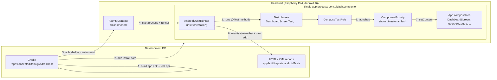

Key points:

| Piece | Role |
|---|---|
| **app APK** | Your normal app (`com.pidash.companion`). |
| **test APK** | Test classes and test libraries (`com.pidash.companion.test`). Its manifest declares an `<instrumentation>` that **targets the app package**, so Android loads both into one process. |
| **AndroidJUnitRunner** | The instrumentation entry point. It discovers JUnit classes and runs each `@Test`. |
| **`ui-test-manifest`** | A debug dependency that adds an empty `ComponentActivity` to the app manifest. `createComposeRule()` launches it as a blank canvas for your composable. |
| **Same process** | Tests can call app code directly: construct a `MediaViewModel`, pass lambdas, read `navController.currentBackStack`. No IPC is involved. |

### 1.1 Build, install and run as separate steps

The test APK contains **no app code** (verified with `dexdump`: `DashboardViewModel` is only in
`app-debug.apk`; `DashboardScreenTest` is only in `app-debug-androidTest.apk`). Android combines
them at run time:

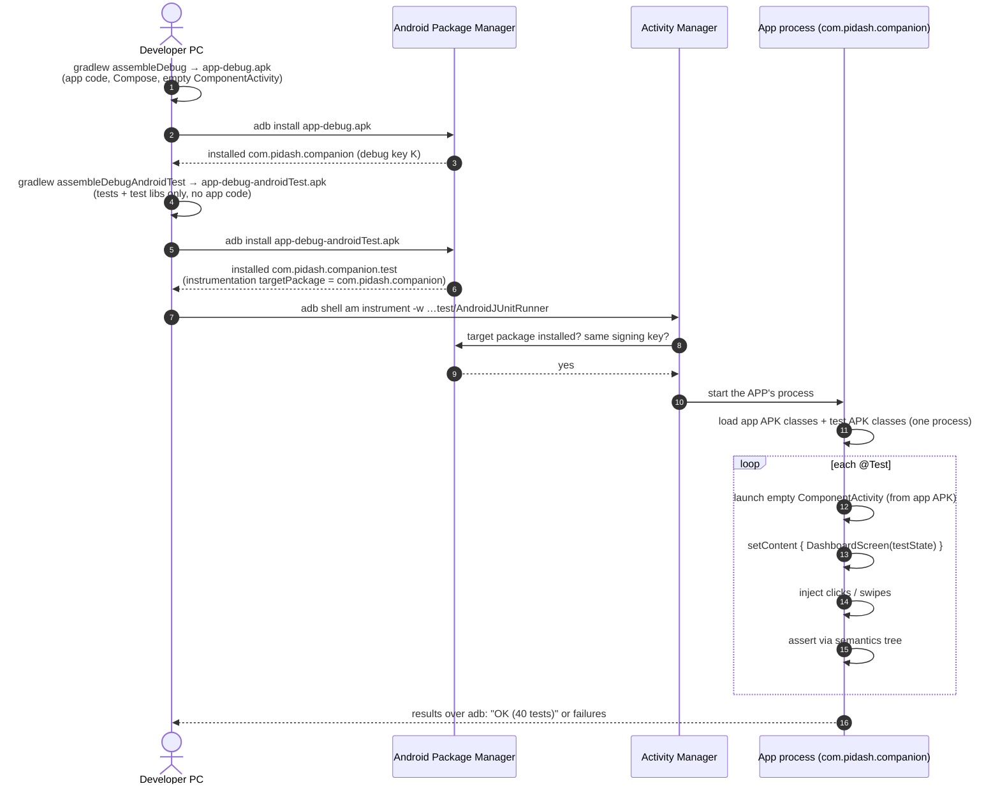

Requirements: both APKs from the **same source version** (otherwise `NoSuchMethodError`), signed
with the **same key** (otherwise Android refuses the instrumentation), and the app must be the
**debug** build (only it contains the empty `ComponentActivity`). The tests render individual app
screens inside the app's process; they do not drive `MainActivity`.

---

## 2. Anatomy of one test

```kotlin
@get:Rule
val rule = createComposeRule()                         // ① rule

@Test
fun speedometer_updatesWhenStateChanges() {
    var state by mutableStateOf(DashboardUiState(trip = TripData(speedKmh = 0)))
    rule.setContent { DashboardScreen(state, DashboardActions()) }       // ② compose

    rule.onNodeWithTag(TestTags.SPEED_VALUE)           // ③ find
        .assertTextEquals("0")                         // ④ sync + assert

    state = state.copy(trip = TripData(speedKmh = 88)) // ⑤ change state

    rule.onNodeWithTag(TestTags.SPEED_VALUE).assertTextEquals("88")      // ⑥ sync + assert
}
```

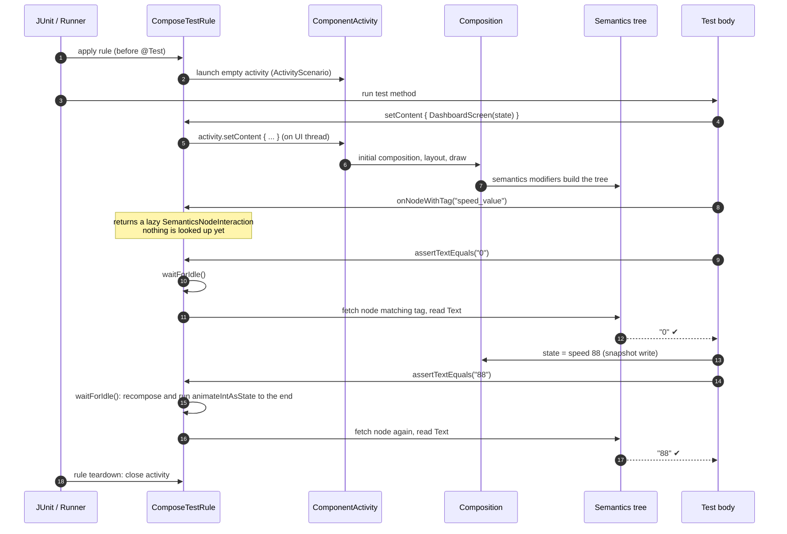

Note on step ⑥: the speed text uses `animateIntAsState`, so it moves 0 → 1 → … → 88 over 500 ms.
The test does not sleep. `waitForIdle()` drives the animation to completion on a virtual clock
(section 4) before the assertion reads the text.

---

## 3. How the test "sees" the UI: the semantics tree

A Compose test **never inspects pixels or composable functions**. It queries the **semantics
tree**, a parallel tree of nodes describing meaning: text, content description, role, actions,
state, test tag and size. It is the same tree that TalkBack and other accessibility services read.

### 3.1 From code to semantics nodes

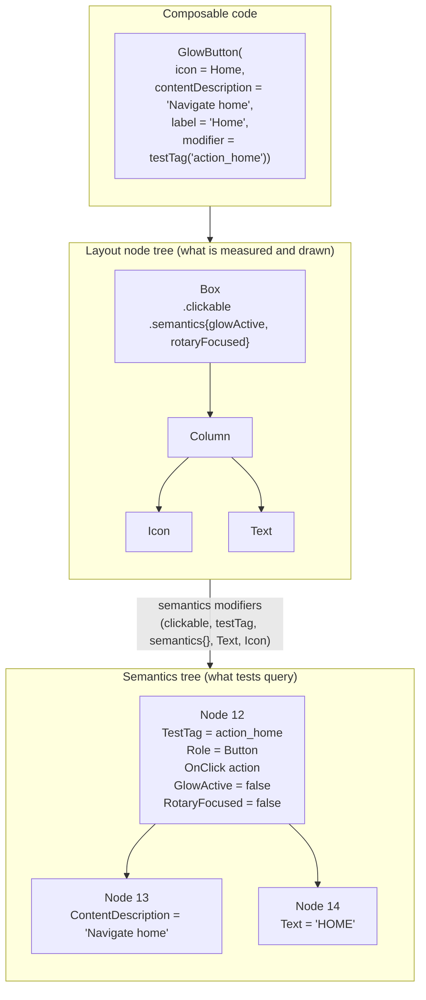

Every modifier that contributes meaning adds properties to the semantics node of its layout node:

| Source | Semantics it adds |
|---|---|
| `Modifier.testTag("action_home")` | `TestTag` |
| `Modifier.clickable(role = Button)` | `OnClick` action, `Role`, focusability, and **merges descendants** |
| `Icon(contentDescription = …)` | `ContentDescription` |
| `Text("HOME")` | `Text` |
| `Modifier.semantics { stateDescription = "Muted" }` | `StateDescription` |
| `Modifier.semantics { glowActive = true }` | Our **custom** key `DashSemantics.GlowActive` |

### 3.2 Merged vs unmerged tree

`clickable`, `selectable` and `semantics(mergeDescendants = true)` **merge** their children into
themselves. A button reads as one element ("Navigate home, HOME, button") rather than three.

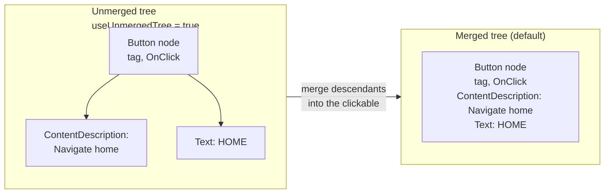

- Finders use the **merged** tree by default. That is why
  `onNodeWithTag(ACTION_MUTE).assert(hasContentDescription("Unmute audio"))` works even though the
  description lives on the child `Icon`.
- Pass `useUnmergedTree = true` to target the inner node itself, as `DashboardScreenTest` does for
  the weather icon: `onNodeWithTag(WEATHER_ICON, useUnmergedTree = true)`.
- `AccessibilitySemanticsTest` relies on the merged tree: for every node with a click action it
  checks the **merged** `ContentDescription` / `Text`, which is exactly what TalkBack would read.

### 3.3 Finders, matchers and lazy interactions

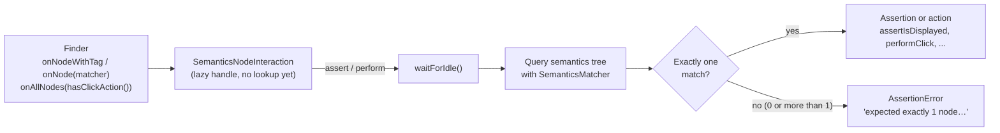

A **`SemanticsMatcher`** is a named predicate over a semantics node. You can combine the built-in
ones (`hasTestTag`, `hasText`, `hasClickAction`, `isSelected`, `isFocused`, …) with `and`, `or`
and `!`, or write your own. This project defines:

```kotlin
// testing/Matchers.kt
fun hasTestTagPrefix(prefix: String) = SemanticsMatcher("TestTag starts with '$prefix'") {
    it.config.getOrNull(SemanticsProperties.TestTag)?.startsWith(prefix) == true
}
fun isRotaryFocused(focused: Boolean = true) = SemanticsMatcher.expectValue(DashSemantics.RotaryFocused, focused)
```

Because the interaction is **lazy**, the lookup happens fresh on every assert/perform. A handle
created before a recomposition still finds the up-to-date node afterwards.

### 3.4 Custom semantics: testing what is only pixels

The speed gauge arc is drawn on a `Canvas`; there is no text node for "88 km/h" in the arc.
Rather than comparing screenshots, the screen **publishes its logical state** as custom semantics:

```kotlin
// DashSemantics.kt
val SpeedKmh = SemanticsPropertyKey<Int>("SpeedKmh")
val SpeedAlert = SemanticsPropertyKey<Boolean>("SpeedAlert")

// DashboardScreen.kt
NeonArcGauge(..., modifier = Modifier.testTag(SPEED_GAUGE).semantics {
    speedKmh = trip.speedKmh
    speedAlert = trip.isSpeeding
})

// DashboardScreenTest.kt
rule.onNodeWithTag(SPEED_GAUGE)
    .assert(SemanticsMatcher.expectValue(DashSemantics.SpeedAlert, true))
```

The same technique exposes `RotaryFocused` (focus ring drawn as a border) and `GlowActive` (halo
drawn in `drawBehind`).

---

## 4. Synchronization: how tests wait without `sleep()`

Before every finder lookup, assertion and action, the rule calls **`waitForIdle()`**. It blocks
the test thread until the UI has nothing left to do.

### 4.1 What "idle" means

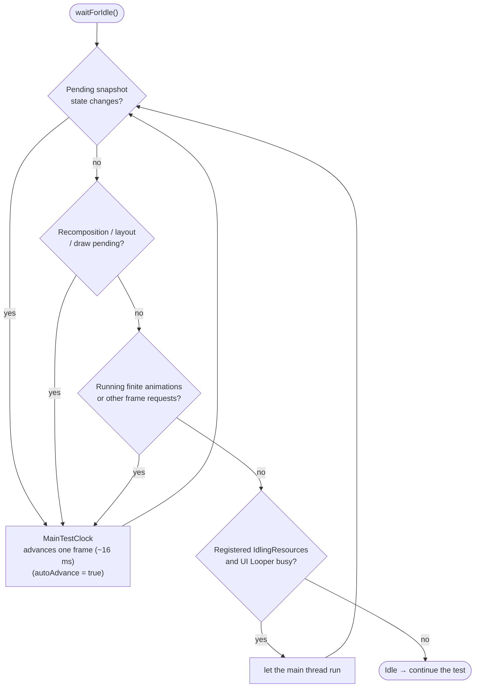

### 4.2 The virtual frame clock

In a test, Compose does not take its frames from the display's Choreographer. It uses a
**`MainTestClock`** controlled by the test:

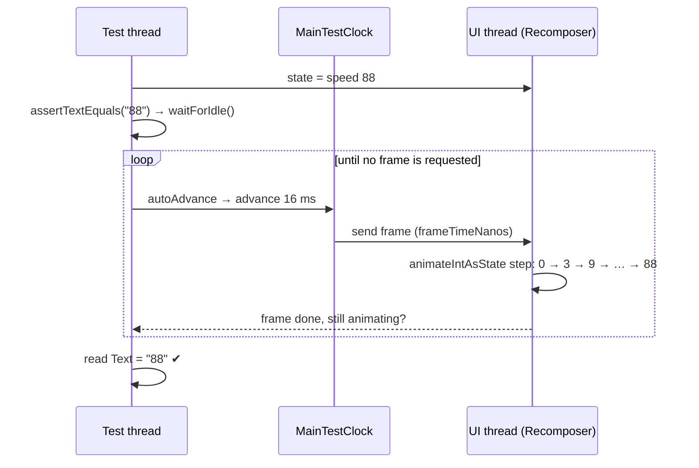

- **`autoAdvance = true` (the default):** the clock runs frames as fast as possible until the UI
  settles. A 500 ms animation finishes in a few milliseconds of real time, deterministically.
- **Manual control:** set `rule.mainClock.autoAdvance = false`, then
  `rule.mainClock.advanceTimeBy(250)` to assert a mid-animation value.
- **Infinite animations** (the breathing halo on active buttons, the wave visualizer) would never
  settle. Compose's test infrastructure stops them from keeping the UI permanently "busy", which is
  why `muteAndThemeToggles_reflectSettingsState` passes even while the Muted button pulses.

### 4.3 When automatic sync is not enough

Synchronization only covers work that Compose knows about. Two cases in this project needed help:

| Situation | Why sync misses it | What the test does |
|---|---|---|
| Slider drag end | The M3 `Slider` reports `onValueChangeFinished` from a coroutine launched when the drag stops; the test thread had already read the variable | Read the value inside `rule.runOnIdle { seekedTo }`, which runs on the UI thread after idle |
| Work outside Compose (network, a database, your own threads) | Compose cannot see it | Register an Espresso `IdlingResource`, or use `rule.waitUntil(timeoutMillis) { condition }` |

`runOnIdle { }` = wait for idle, then run the block **on the UI thread**. Use it to read or write
state that the UI thread owns, for example `focusManager.moveFocus(...)` and
`navController.navigateToTopLevel(...)` in this project.

---

## 5. Actions: how a click reaches your composable

Actions do not call `onClick` directly. They **synthesize real input events** and send them
through the same pipeline a finger would use. A click therefore also exercises hit-testing,
`clickable`, press feedback (`rememberPressScale`) and gesture detection.

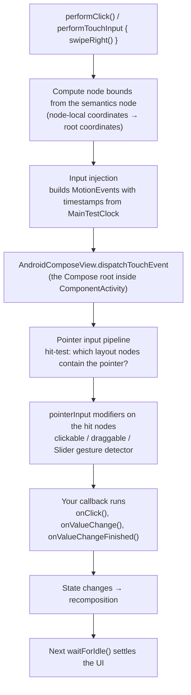

### 5.1 The three kinds of actions

| API | Mechanism | Example in this project |
|---|---|---|
| `performClick()` | Injects touch down + up at the node's centre | `onNodeWithTag(ACTION_MUTE).performClick()` |
| `performTouchInput { … }` | Gives you a `TouchInjectionScope` in node-local coordinates (`left`, `centerX`, `percentOffset`, `width`) to script any gesture | `swipeRight(startX = left + width * 0.05f, endX = centerX)` on the slider; `click(percentOffset(0.8f, 0.5f))` |
| `performKeyInput { … }` | Injects key events into the owner of the focused node | `pressKey(Key.DirectionCenter)` to "press the rotary knob" |
| `performSemanticsAction(...)` / `requestFocus()` / `performScrollToNode(...)` | Invokes a semantics **action** directly. No input event; this is what accessibility services do | `requestFocus()` on the Home button; `performScrollToNode(hasTestTag(spotCard("r3")))` on the LazyColumn |

### 5.2 Input mode matters for focus

Compose tracks an **input mode**: Touch or Keyboard. In touch mode, ordinary `clickable`s are not
focusable, which matches phone behaviour, where tapping does not leave a focus ring. A rotary knob
or D-pad switches the device to keyboard mode. The focus tests reproduce this explicitly:

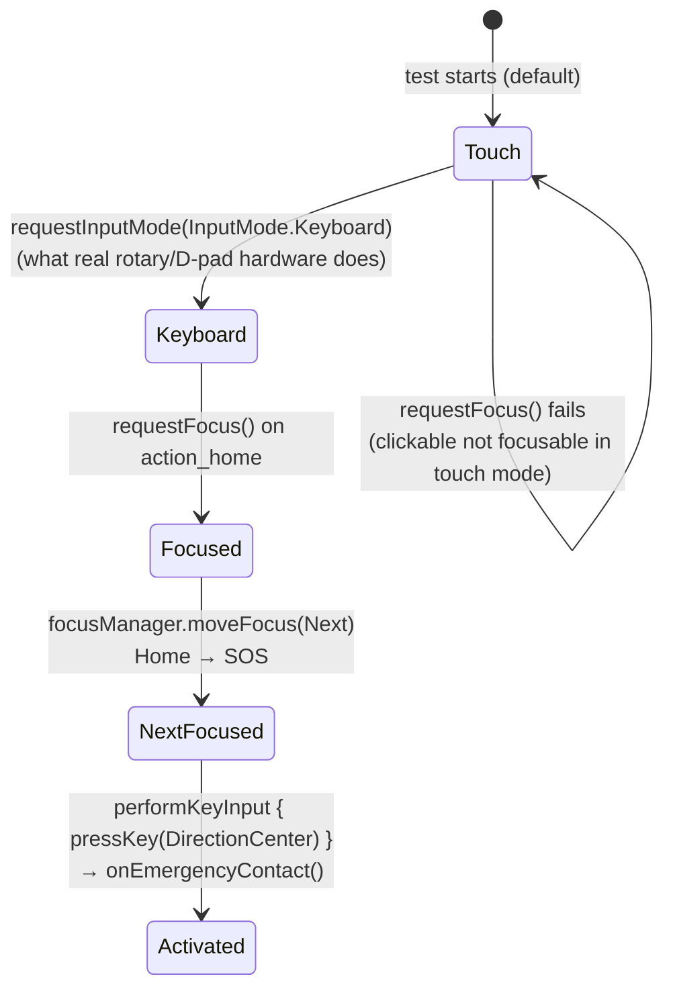

---

## 6. Assertions: what is actually checked

| Assertion | Reads from the semantics node |
|---|---|
| `assertExists()` / `assertDoesNotExist()` | Whether a matching node is in the tree |
| `assertIsDisplayed()` | Node is placed and its bounds intersect the visible root (not off-screen, not zero-size). In a `LazyColumn`, off-screen items are not composed at all, so scroll first |
| `assertTextEquals("88")` | `Text` (and `EditableText`) properties of the merged node |
| `assertIsSelected()` | `Selected` property, set by `Modifier.selectable` on the category chips |
| `assertIsFocused()` | `Focused` property |
| `assert(hasStateDescription("Muted"))` | `StateDescription` |
| `assert(SemanticsMatcher.expectValue(Key, v))` | Any custom key, e.g. `DashSemantics.SpeedKmh` |
| `fetchSemanticsNodes()` | Raw nodes, for checks the API does not offer, e.g. node `size` ≥ 64dp in `UiStandards.assertClickablesMeetTouchTarget` |

---

## 7. Two ways to run a composable under test

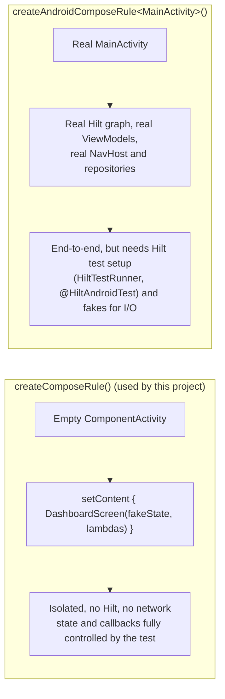

This project tests **stateless screens** with `createComposeRule()`. This works because the
architecture keeps UI and logic apart:

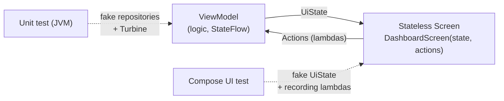

- **UI tests** replace the ViewModel with a fake state and lambdas that record calls:
  `DashboardActions(onToggleMute = { calls += "mute" })`.
- **Unit tests** replace the UI with Turbine assertions on the ViewModel's `StateFlow`.
- **Bridging tests** (`MediaCompanionTest.playPause_…`, `FavoriteSpotsTest`) connect a **real
  ViewModel** (with a MockK or fake repository) to the real screen and prove the wiring end to end
  without Hilt.

---

## 8. Project-specific helpers and why they exist

The examples above use the raw Compose test API to show the mechanism. In the project's tests these
calls are wrapped by the [Compose UI Test Standard](COMPOSE_TEST_STANDARD.md) (rule, robots,
contract tests). The table below maps each wrapper to the mechanism it builds on.

| Helper | Location | Mechanism it addresses |
|---|---|---|
| `AppComposeRule` / `piDashComposeRule()` | `testing/AppComposeRule.kt`, `PiDashTestSupport.kt` | A full `ComposeContentTestRule` (delegation) whose `setContent` wraps content in the theme and overrides `LocalDensity` with `fontScale = 1f`, so results don't depend on the device font setting (the test Pi uses 1.8×). It also chains the screenshot rule *inside* the compose rule and captures `FocusManager` / `InputModeManager` for `enableRotaryInput()` and `rotate(n)` (§5.2) |
| Robots (`DashboardRobot`, …) | `robots/`, base `testing/BaseRobot.kt` | Encapsulate finders (§3.3), actions (§5) and assertions (§6) behind named verbs |
| `UiStandards` | `testing/UiStandards.kt` | `fetchSemanticsNodes()` over every `hasClickAction()` node: labels in the merged tree (§3.2), node size, and focus traversal |
| `ScreenContractTest` | `testing/ScreenContractTest.kt` | Template method: one `setContent` per inherited test, so each screen gets themed, large-font, label, size and rotary checks |
| `hasTestTagPrefix()`, `hasSemantics()` | `testing/Matchers.kt` | Custom `SemanticsMatcher`s (§3.3) |
| `isRotaryFocused()`, `isGlowActive()` | `PiDashTestSupport.kt` | Matchers over the custom semantics keys (§3.4) |
| `saveScreenshot()`, `ScreenshotOnFailureRule` | `testing/Screenshots.kt` | `onRoot().captureToImage()` written via `TestStorage` |
| `TestTags` | `ui/components/TestTags.kt` | One source of stable selectors shared by app and tests |
| `DashSemantics` | `ui/components/DashSemantics.kt` | Exposes Canvas-only state to the semantics tree |

---

## 9. Quick reference: lifecycle of a Compose test

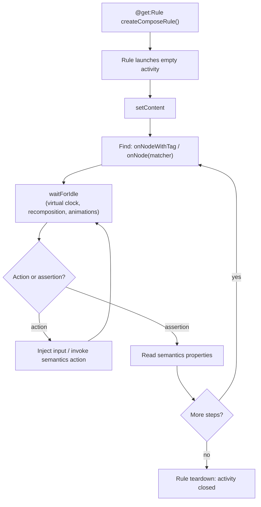

**Rules of thumb**

1. Query **meaning** (semantics), not appearance. If something is visible only as pixels, publish
   it as a semantics property.
2. Never `Thread.sleep()`. Rely on `waitForIdle`; use `runOnIdle`, `waitUntil` or an
   `IdlingResource` for work Compose cannot see.
3. Keep screens stateless so tests can drive them with plain data and lambdas.
4. Use stable `testTag`s from one shared object.
5. Remember the input mode (touch vs keyboard) when testing focus, and the merged vs unmerged tree
   when a property seems to be "missing".
