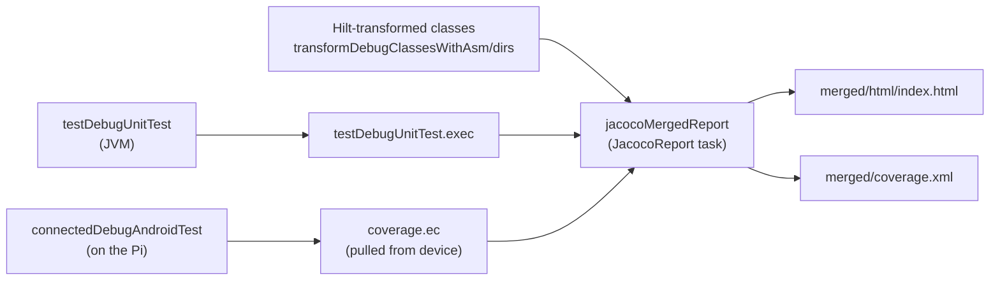

# Pi-Dash — How to Run Tests

## 1. Prerequisites

| Requirement | Version / note |
|---|---|
| JDK | 17 or newer (tested with JDK 21). `JAVA_HOME` must point to it |
| Android SDK | Platform **android-37** (compileSdk) and build-tools 36+; set `ANDROID_HOME` or `local.properties` → `sdk.dir` |
| Gradle | Not needed; use the wrapper (`gradlew` / `gradlew.bat`, Gradle 9.4.1) |
| adb | Platform-tools on `PATH` |
| Device (UI tests only) | Android 9+ (minSdk 28). Reference device: Raspberry Pi 4, Android 16, 800×480 |

`local.properties` (not committed) example:

```properties
sdk.dir=C\:\\Users\\<you>\\AppData\\Local\\Android\\Sdk
```

All commands below run from the project root
(`D:\02_DEVELOPMENT\04_COMPOSE_TEST\AndroidCarApplicationTest`). Use `.\gradlew` in PowerShell
and `./gradlew` in Git Bash.

## 2. Connect the head unit

On the Pi, enable **Developer options → Wireless debugging**, then:

```powershell
adb connect 192.168.1.118:44613     # use the IP:port shown on the device
adb devices                          # should list the device as "device"
```

If more than one device is connected, choose one for Gradle:

```powershell
$env:ANDROID_SERIAL = "192.168.1.118:44613"   # PowerShell
export ANDROID_SERIAL=192.168.1.118:44613      # Git Bash
```

## 3. Run the tests

### 3.1 Unit tests (JVM, no device)

```powershell
.\gradlew :app:testDebugUnitTest
```

Run a single class or test:

```powershell
.\gradlew :app:testDebugUnitTest --tests "com.pidash.companion.SpotsViewModelTest"
.\gradlew :app:testDebugUnitTest --tests "com.pidash.companion.MockMediaRepositoryTest.skip previous restarts track when past three seconds"
```

### 3.2 Compose UI tests (on the device)

```powershell
.\gradlew :app:connectedDebugAndroidTest
```

This builds the app and test APKs, installs both, runs all 40 tests (about 2–2.5 min on a Pi 4) and
**uninstalls the app afterwards**. Reinstall it with `.\gradlew :app:installDebug` if you want to keep
using it.

Run a single class or method:

```powershell
.\gradlew :app:connectedDebugAndroidTest "-Pandroid.testInstrumentationRunnerArguments.class=com.pidash.companion.MediaCompanionTest"
.\gradlew :app:connectedDebugAndroidTest "-Pandroid.testInstrumentationRunnerArguments.class=com.pidash.companion.FavoriteSpotsTest#categoryChip_coffeeSelected_listShowsOnlyCoffeeSpots"
```

The available UI test classes are `DashboardScreenTest`, `MediaCompanionTest`, `FavoriteSpotsTest`,
`AccessibilitySemanticsTest`, `NavigationTest`, and the contract tests `DashboardScreenContractTest`,
`MediaScreenContractTest` and `SpotsScreenContractTest`.

### 3.3 Everything

```powershell
.\gradlew :app:testDebugUnitTest :app:connectedDebugAndroidTest
```

### 3.4 Running from Android Studio

Open the project, then right-click `app/src/test` or `app/src/androidTest` (or a single class or
method) → **Run**. For `androidTest`, select the Pi in the device drop-down first.

### 3.5 Running directly with adb (APKs already installed)

```powershell
.\gradlew :app:installDebug :app:installDebugAndroidTest
adb shell am instrument -w -e class com.pidash.companion.DashboardScreenTest `
    com.pidash.companion.test/androidx.test.runner.AndroidJUnitRunner
```

## 4. Reading the results

| Report | Location |
|---|---|
| Unit tests — HTML | `app/build/reports/tests/testDebugUnitTest/index.html` |
| Unit tests — XML | `app/build/test-results/testDebugUnitTest/*.xml` |
| UI tests — HTML | `app/build/reports/androidTests/connected/debug/index.html` |
| UI tests — XML | `app/build/outputs/androidTest-results/connected/debug/*.xml` |
| **Failure screenshots** | `app/build/outputs/connected_android_test_additional_output/debugAndroidTest/connected/<device>/screenshots/<TestClass>_<method>.png` |
| **Merged coverage — HTML** | `app/build/reports/coverage/merged/html/index.html` |
| **Merged coverage — XML** (for CI / SonarQube) | `app/build/reports/coverage/merged/coverage.xml` |
| Unit-only coverage | `app/build/reports/coverage/test/debug/index.html` |
| UI-only coverage | `app/build/reports/coverage/androidTest/debug/connected/index.html` |

A green run ends with `Finished 40 tests on <device>` and `BUILD SUCCESSFUL`. Failures are printed
as `ClassName > testName[device] FAILED` with the assertion message. Open the HTML report for the
full stack trace and logcat.

## 5. Code coverage (JaCoCo)

Coverage is enabled for the `debug` build type (`enableUnitTestCoverage` and
`enableAndroidTestCoverage` in `app/build.gradle.kts`). The unit tests mainly exercise ViewModels,
use cases and generators; the UI tests mainly exercise composables. Only the **merged** report shows
the real picture.

```powershell
# Run unit + UI tests, then build one merged report (≈ 3 min on the Pi)
.\gradlew :app:jacocoMergedReport

# Rebuild the merged report from the last run's data, without re-running tests
.\gradlew :app:jacocoMergedReport -x testDebugUnitTest -x connectedDebugAndroidTest

# Separate reports, if needed
.\gradlew :app:createDebugUnitTestCoverageReport        # JVM unit tests only
.\gradlew :app:createDebugAndroidTestCoverageReport     # on-device UI tests only
```

How the merge works:



- Generated code (Hilt/Dagger, `R`, `BuildConfig`, `ComposableSingletons`) is excluded; edit
  `coverageExclusions` in `app/build.gradle.kts` to change this.
- The report reads the classes **after Hilt's bytecode transform**, because those are the classes
  JaCoCo instrumented. Pointing it at the raw compiler output makes `MainActivity` and
  `PiDashApplication` show as "execution data mismatch".
- If any UI test fails, `connectedDebugAndroidTest` fails and the merged report is not produced.
  Fix the test, or regenerate from the existing data with the `-x` command above.

Baseline (30 Oct 2026, 12 unit + 40 UI tests): **83.1 % lines, 74.3 % branches** (before the
contract tests were added, with 24 UI tests: 82.2 % / 70.5 %). UI packages are
95–100 %; the main gaps are `MainActivity` / `PiDashApp` (Hilt and NavHost wiring, covered only by the
manual checklist) and `AudioSettingsRepository` / the weather and trip mock repositories.

## 6. Screenshots

Both kinds are written through `TestStorage` and pulled by Gradle into
`app/build/outputs/connected_android_test_additional_output/debugAndroidTest/connected/<device>/`
(enabled by the `useTestStorageService` runner argument and the `test-services` APK installed via
`androidTestUtil`).

| Folder | When | Produced by |
|---|---|---|
| `screenshots/<TestClass>_<method>.png` | Only when a test **fails** | `ScreenshotOnFailureRule`, chained automatically inside `piDashComposeRule()` |
| `screens/<Screen>_dark.png`, `_light.png`, `_maxFont.png` | Every run — a gallery of all screens | The contract tests (`ScreenContractTest`) |

## 7. Troubleshooting

| Symptom | Cause / fix |
|---|---|
| `NoSuchMethodException: android.hardware.input.InputManager.getInstance` in every UI test | Espresso older than 3.7 on Android 16. The project pins `espresso-core 3.7.0`; do not remove it from `app/build.gradle.kts` |
| `checkDebugAarMetadata` fails: "requires … compile against version 37" | Install SDK Platform **android-37** (SDK Manager or `sdkmanager "platforms;android-37.0"`) |
| `No connected devices!` | Run `adb connect <ip:port>` again; wireless debugging ports change after a reboot or toggle |
| `More than one device` / wrong device used | Set `ANDROID_SERIAL` (section 2) |
| `requestFocus()` assertion fails in a new test | The test is still in touch input mode; request `InputMode.Keyboard` first (see [TEST_INSTRUCTIONS.md](TEST_INSTRUCTIONS.md) §3, rule 6) |
| Slider drag test sees no seek | Read the callback value inside `rule.runOnIdle {}` and start the swipe inside the track |
| Text assertions fail only on the device | Device font scale or locale. Use `piDashComposeRule()` (pins font scale) and assert through robots, not by visible label |
| App missing after the UI tests | Expected: the connected task uninstalls it. Run `.\gradlew :app:installDebug` |
| `Test execution failed with fatal error! Finished 0 tests` | Seen once on the Pi immediately after `clean` (no tests started); rerunning the same command succeeded. Re-run; if it persists, check `adb devices` and `adb logcat -b crash` |
| A screenshot appears for a test that no longer exists | Left over in device test storage from an aborted run. Delete it with `adb shell rm -rf /sdcard/googletest/test_outputfiles/screenshots` |
| Merged report shows "execution data does not match" | The class directories don't match the instrumented classes; keep `transformDebugClassesWithAsm/dirs` in `jacocoMergedReport` |
