# Pi-Dash — Maintenance Guide

For developers who maintain or extend Pi-Dash, including developers new to Kotlin or Android.
It explains how a Kotlin/Compose Android app runs, how this app is put together, and how data and
events flow through the code, with file references for each step.

Related documents: [DESIGN.md](DESIGN.md) (visual design and rationale),
[TEST_INSTRUCTIONS.md](TEST_INSTRUCTIONS.md) and [HOW_TO_RUN_TESTS.md](HOW_TO_RUN_TESTS.md) (testing).

**Contents**
1. [Quick facts](#1-quick-facts)
2. [How a Kotlin Android app operates](#2-how-a-kotlin-android-app-operates)
3. [Architecture](#3-architecture)
4. [Components reference](#4-components-reference)
5. [Main code flows](#5-main-code-flows)
6. [Kotlin features you will meet in this code](#6-kotlin-features-you-will-meet-in-this-code)
7. [Threading, lifecycles and scopes](#7-threading-lifecycles-and-scopes)
8. [Build system](#8-build-system)
9. [Common maintenance tasks](#9-common-maintenance-tasks)
10. [Debugging and troubleshooting](#10-debugging-and-troubleshooting)
11. [Known limitations and technical debt](#11-known-limitations-and-technical-debt)

---

## 1. Quick facts

| Item | Value |
|---|---|
| Package / application id | `com.pidash.companion` |
| Target device | Raspberry Pi 4, Android 16 (API 36), 800×480 touchscreen, landscape |
| Language / UI | Kotlin 2.4, Jetpack Compose (Material 3), 100 % Compose, no XML layouts |
| Architecture | MVVM + clean-architecture layers (`domain` / `data` / `ui` / `di`) |
| Dependency injection | Hilt (code generated by KSP at build time) |
| Build | Gradle 9.4.1 wrapper, Android Gradle Plugin 9.2.1, compileSdk 37, minSdk 28 |
| Source size | 28 Kotlin files in `app/src/main`; 19 UI-test files (`androidTest`) and 3 unit-test files (`test`) |

```powershell
adb connect <ip:port>            # head unit over wireless debugging
.\gradlew :app:installDebug      # build + install
adb shell am start -n com.pidash.companion/.MainActivity
```

---

## 2. How a Kotlin Android app operates

This section explains the runtime model that the rest of the guide relies on. Skip it if you
already know Android and Compose.

### 2.1 From source code to a running process

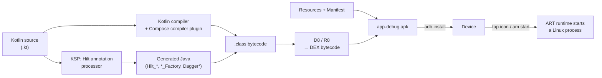

- Kotlin compiles to the same bytecode as Java. Android converts it to **DEX**, which the Android
  Runtime (ART) executes.
- The **Compose compiler plugin** rewrites every `@Composable` function so that it can be
  re-executed ("recomposed") when the data it reads changes.
- **KSP** runs Hilt's annotation processor, which generates the dependency-injection code
  (factories and components) at build time. There is no reflection at runtime.

### 2.2 What happens when the app starts

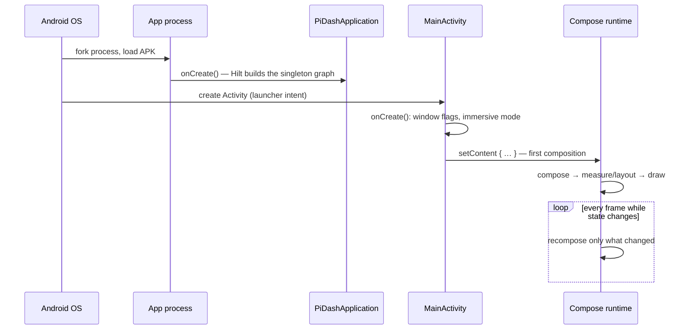

| Concept | What it is | In this app |
|---|---|---|
| **Process** | One Linux process per app; all code runs in it | `com.pidash.companion` |
| **`Application`** | Created once per process, before anything else | `PiDashApplication` (`@HiltAndroidApp`) |
| **`Activity`** | A screen-hosting window with a lifecycle (created → started → resumed → paused → stopped → destroyed) | Only one: `MainActivity` |
| **Main (UI) thread** | The only thread that may touch UI; must never block | Compose runs here |
| **Configuration change** | Rotation, theme or locale change can recreate the Activity | Declared in the manifest as handled (`configChanges`), so the Activity is kept |

### 2.3 How Jetpack Compose draws the UI

Compose is **declarative**: a `@Composable` function describes what the UI should look like for
the current data. When the data changes, Compose calls the affected functions again
(**recomposition**) and updates only what changed.

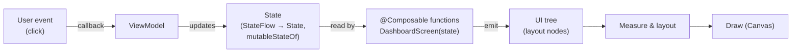

The loop to remember is **state flows down, events flow up**:
- Screens receive **state** as parameters: `DashboardScreen(state: DashboardUiState, …)`.
- Screens report **events** through callbacks (`DashboardActions.onToggleMute`), which the
  ViewModel handles.
- The ViewModel updates state, Compose recomposes, and the screen shows the new state.

Key Compose building blocks used here: `remember` (keep a value across recompositions),
`mutableStateOf` (observable local state), `LaunchedEffect` (run a coroutine tied to a composable),
`Modifier` chains (size, padding, click, drawing, semantics), and `CompositionLocal` (implicit
values such as the theme colours).

### 2.4 Coroutines and Flow (asynchronous Kotlin)

| Concept | Meaning | Example here |
|---|---|---|
| `suspend` function / coroutine | Lightweight task that can pause without blocking a thread | `delay(500)` in the speed generator |
| `CoroutineScope` | Owner of coroutines; cancelling it cancels its children | `viewModelScope`, `@ApplicationScope` |
| `Flow<T>` (cold) | A stream that runs its producer **per collector** | `MockSpeedGenerator.stream()` |
| `StateFlow<T>` (hot) | Always holds a current value; shared by all collectors | `MediaRepository.mediaState` |
| Operators | Transform or merge streams | `combine`, `map`, `onStart`, `stateIn` |
| `collectAsStateWithLifecycle()` | Turns a `StateFlow` into Compose `State`; pauses collecting when the app is in the background | Every route in `PiDashApp` |

### 2.5 Dependency injection with Hilt

Classes declare what they need in their constructor (`@Inject constructor(...)`) and Hilt supplies
it. Interfaces are mapped to implementations in modules (`di/AppModule.kt`). This lets tests and
future real data sources swap implementations without touching the UI.

```kotlin
@HiltViewModel
class MediaViewModel @Inject constructor(
    observeMedia: ObserveMediaStateUseCase,      // Hilt builds this…
    private val mediaControl: MediaControlUseCase,
) : ViewModel()                                   // …which needs MediaRepository → MockMediaRepository
```

---

## 3. Architecture

### 3.1 Layers and the dependency rule

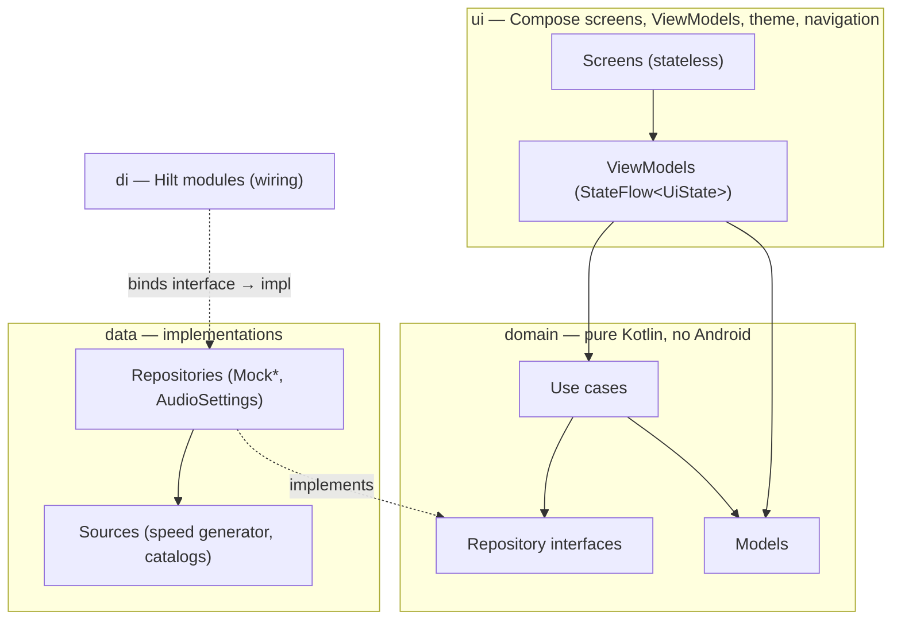

**Rule:** dependencies point *inwards*. `ui` → `domain` ← `data`. The `domain` layer knows nothing
about Android, Compose or the mocks. To replace mock data with real data, only `data` and `di`
change.

### 3.2 Package map

```
com.pidash.companion
├── PiDashApplication.kt          App entry point (@HiltAndroidApp)
├── MainActivity.kt               Single Activity + MainViewModel + external intents
├── domain/
│   ├── model/                    TripData, Weather(+Condition), Track, MediaState,
│   │                             Spot, SpotCategory, SystemSettings
│   ├── repository/Repositories.kt  TripRepository, WeatherRepository, MediaRepository,
│   │                             SpotsRepository, SettingsRepository (interfaces)
│   └── usecase/UseCases.kt       ObserveTripData, ObserveWeather, ObserveMediaState,
│                                 MediaControl, FilterSpots, ToggleTheme, ToggleMute
├── data/
│   ├── source/                   MockSpeedGenerator, MockMediaCatalog
│   └── repository/               MockRepositories.kt (Trip, Weather, Media, Spots),
│                                 AudioSettingsRepository.kt
├── di/AppModule.kt               @Binds interface→impl, @ApplicationScope CoroutineScope
└── ui/
    ├── theme/Theme.kt            Colours, typography, PiDashTheme, ambientBackground
    ├── components/               PremiumGlassCard, GlowButton, NeonArcGauge, MediaVisuals,
    │                             TestTags, DashSemantics
    ├── navigation/PiDashApp.kt   App shell: rail, NavHost, routes, rotary handling
    ├── dashboard/                DashboardScreen, DashboardViewModel
    ├── media/                    MediaScreen, MediaViewModel
    └── spots/                    SpotsScreen, SpotsViewModel
```

### 3.3 Runtime object graph

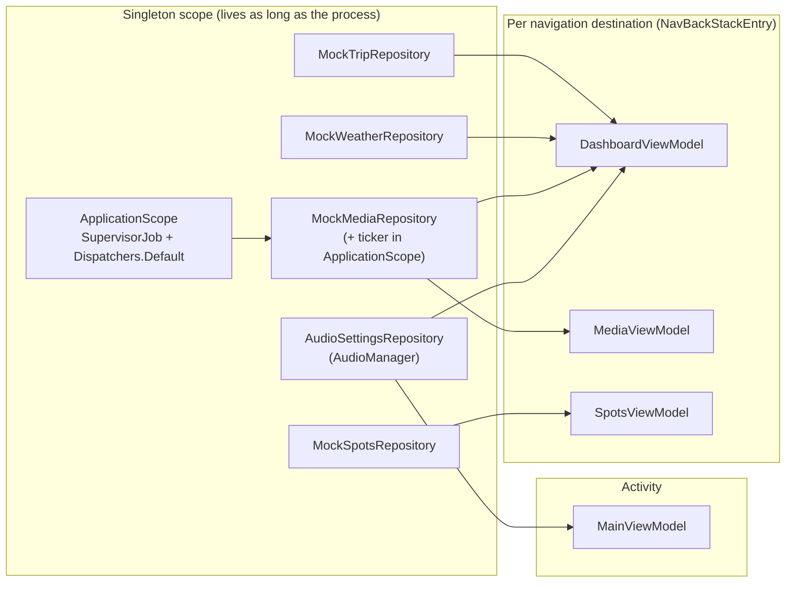

Shared singletons are why the **mini player on the Dashboard and the Media screen always agree**:
both ViewModels observe the same `MockMediaRepository.mediaState`.

---

## 4. Components reference

### 4.1 Entry points

| Class | File | Responsibility |
|---|---|---|
| `PiDashApplication` | `PiDashApplication.kt` | `@HiltAndroidApp`: triggers generation of the Hilt component and initialises the singleton graph |
| `MainActivity` | `MainActivity.kt` | `@AndroidEntryPoint`. Keeps the screen on, hides system bars, caps the font scale at 1.3×, applies `PiDashTheme(dark/light)`, hosts `PiDashApp`, implements `ExternalActions` (maps, dialer, snackbar fallback) |
| `MainViewModel` | `MainActivity.kt` | Exposes `SettingsRepository.settings`, so the Activity can switch the theme |

### 4.2 Domain

| Element | Purpose |
|---|---|
| `TripData` | Speed, limit, distance, average, elapsed; `isSpeeding` is a computed property |
| `MediaState` | Current track, playing flag, position; `progress` is a computed 0..1 value |
| `Spot`, `SpotCategory` | Favourite places and their four categories |
| `SystemSettings` | `isDarkTheme`, `isMuted` |
| Repository interfaces | Contracts for each data source (`Flow`/`StateFlow` + commands) |
| `MediaControlUseCase` | Play/pause toggle logic, skip, **clamped** seek |
| `FilterSpotsUseCase` | `combine(spots, selectedCategory)` → filtered list sorted by distance |
| `ToggleThemeUseCase`, `ToggleMuteUseCase` | Flip the current setting |

### 4.3 Data

| Class | Behaviour |
|---|---|
| `MockSpeedGenerator` | Cold `Flow<TripData>`: every 500 ms it moves the speed toward a random target (stop / city / highway) and integrates distance, average and time |
| `MockTripRepository` | Exposes the generator's flow |
| `MockWeatherRepository` | Cold flow cycling through 5 Da Nang-area locations every 30 s |
| `MockMediaRepository` | `MutableStateFlow<MediaState>`. `play()` launches a 1 s ticker coroutine in `@ApplicationScope`; handles end-of-track, skip, wrap-around and seek |
| `MockSpotsRepository` | Static list of 14 spots (`SAMPLE_SPOTS`) |
| `AudioSettingsRepository` | Theme flag in memory; **mute is real**: `AudioManager.adjustStreamVolume(STREAM_MUSIC, ADJUST_MUTE/UNMUTE)` |

### 4.4 UI

| Component | Role |
|---|---|
| `PiDashApp` | App shell: ambient background, navigation rail (`RailItem`, `Clock`), `NavHost` with three routes, rotary → focus mapping, snackbar host |
| `Routes`, `navigateToTopLevel()` | Route strings; rail navigation without save/restore state (see §10) |
| `DashboardScreen` / `DashboardViewModel` | Gauge, weather, mini player, quick actions and quick stops; VM combines 4 flows |
| `MediaScreen` / `MediaViewModel` | Player UI; VM exposes `mediaState` and forwards commands |
| `SpotsScreen` / `SpotsViewModel` | Chips + list; VM holds the selected category (seeded from the navigation argument) |
| `PremiumGlassCard`, `GlowButton`, `NeonArcGauge`, `SectionLabel`, `AlbumArtwork`, `WaveVisualizer` | Reusable design-system components ([DESIGN.md §4.4](DESIGN.md)) |
| `PiDashTheme`, `DashTheme.colors`, `ambientBackground` | Theme tokens via `CompositionLocal` |
| `TestTags`, `DashSemantics` | Stable test selectors and custom semantics for tests and accessibility |

---

## 5. Main code flows

### 5.1 Startup → first frame

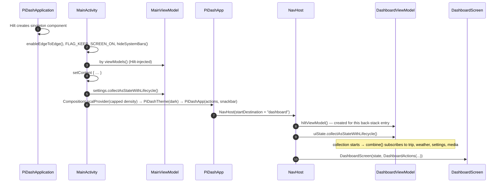

Code path: `MainActivity.onCreate` → `setContent` → `PiDashApp` (`ui/navigation/PiDashApp.kt`) →
`composable(Routes.DASHBOARD) { … }`.

### 5.2 Data flow: from the speed generator to the gauge

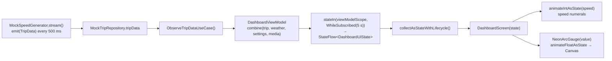

The key code, in `DashboardViewModel`:

```kotlin
val uiState: StateFlow<DashboardUiState> = combine(
    observeTrip().onStart { emit(TripData()) },                       // show 0 immediately
    observeWeather().map<Weather, Weather?> { it }.onStart { emit(null) }, // "Loading weather…"
    settingsRepository.settings,
    observeMedia(),
) { trip, weather, settings, media ->
    DashboardUiState(trip, weather, settings, media)
}.stateIn(viewModelScope, SharingStarted.WhileSubscribed(5_000), DashboardUiState())
```

- `combine` emits a new `DashboardUiState` whenever **any** of the four sources emits.
- `onStart` gives each source an initial value, so the screen appears without waiting for
  weather.
- `stateIn(... WhileSubscribed(5_000))` keeps the upstream running while the UI collects, plus
  5 seconds of grace. This avoids restarting on brief interruptions.
- Compose then recomposes only the parts that read the changed values. The speed number animates
  with `animateIntAsState`, and the gauge arc with `animateFloatAsState` and `animateColorAsState`.

### 5.3 Event flow: tapping Mute

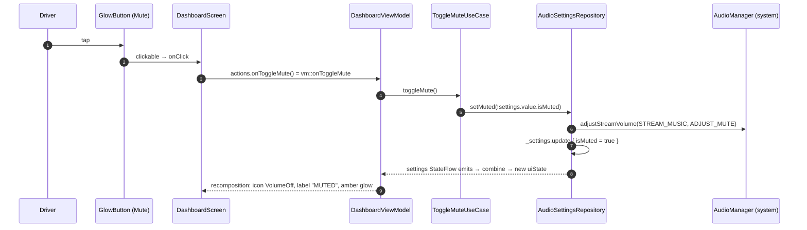

**Theme toggle** follows the same path through `ToggleThemeUseCase`. The difference is that
`MainActivity` also observes `settings` and re-runs `PiDashTheme(darkTheme = …)`, which
recomposes the entire tree with the other palette.

### 5.4 Media playback across two screens

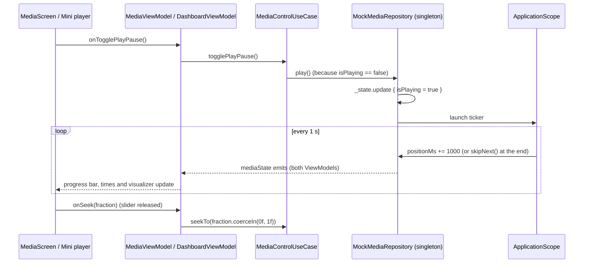

The ticker runs in `@ApplicationScope`, not in a ViewModel scope, so playback **continues when
you navigate away** from the Media screen.

### 5.5 Navigation flows

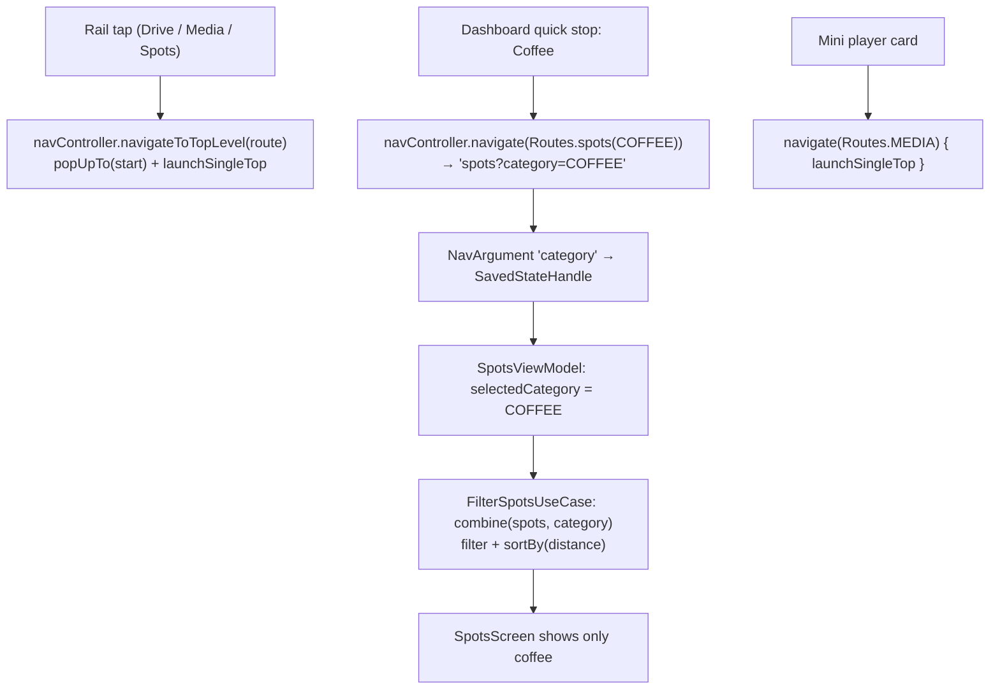

- Each destination gets its **own ViewModel** from `hiltViewModel()`, scoped to that back-stack
  entry. Popping the entry clears the ViewModel.
- Which rail item is selected is derived from `currentBackStackEntryAsState()`
  (`route.substringBefore('?')`).

### 5.6 Leaving the app: Navigate / Home / SOS

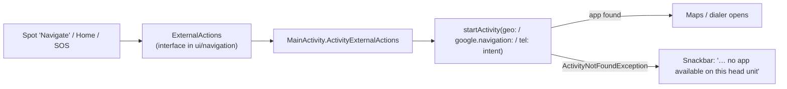

The UI only knows the `ExternalActions` interface, so screens stay testable and Android-free.

### 5.7 Rotary knob / D-pad

`PiDashApp` root: `Modifier.onRotaryScrollEvent { focusManager.moveFocus(Next or Previous) }`.
Every interactive component tracks focus with `collectIsFocusedAsState()`. It draws a champagne
ring when focused and publishes `DashSemantics.RotaryFocused`. Pressing the knob (D-pad centre or
Enter) triggers the focused `clickable`.

---

## 6. Kotlin features you will meet in this code

| Feature | Example from the app | What it does |
|---|---|---|
| `data class` + `copy()` | `state.copy(trip = TripData(speedKmh = 88))` | Immutable value objects; `copy` makes a modified clone (all UI state is immutable) |
| Computed property | `val isSpeeding get() = speedKmh > speedLimitKmh` | Derived value, never stale |
| `enum class` with fields | `SpotCategory.COFFEE("Coffee")` | Fixed set of values with data |
| Null safety | `track?.title ?: "Nothing playing"` | `?.` calls only if non-null; `?:` supplies a default |
| Default and named arguments | `GlowButton(icon = …, active = muted, size = 92.dp)` | No overload explosion |
| Lambdas / function types | `val onToggleMute: () -> Unit`, `(SpotCategory) -> Unit` | Callbacks passed as values |
| Function references | `vm::onToggleMute`, `navController::navigateToTopLevel` | Pass an existing function as a lambda |
| Trailing lambda syntax | `PremiumGlassCard(modifier) { … }` | The last lambda parameter goes outside the parentheses — this is how Compose nesting reads |
| Extension functions | `fun Modifier.ambientBackground(colors)`, `fun SpotCategory.icon()` | Add functions to existing types without inheritance |
| Property delegation `by` | `val state by vm.uiState.collectAsStateWithLifecycle()`, `private val viewModel: MainViewModel by viewModels()` | Delegates get/set to another object (Compose `State`, lazy ViewModel lookup) |
| `object` / `companion object` | `object TestTags`, `companion object { const val ARG_CATEGORY = "category" }` | Singletons and static-like members |
| `interface` + implementation | `MediaRepository` ← `MockMediaRepository` | Swappable implementations (DI) |
| Scope functions | `WindowCompat.getInsetsController(…).apply { hide(…) }`, `?.let { … }` | Run a block with an object as receiver or argument |
| `when` expression | `when (this) { CLEAR -> Icons.Outlined.WbSunny … }` | Exhaustive branching that returns a value |
| Coroutines | `scope.launch { while (isActive) { delay(TICK_MS) … } }` | Asynchronous loops without threads |
| Flow builders and operators | `flow { emit(x); delay(…) }`, `combine`, `map`, `stateIn` | Reactive data streams |
| Annotations | `@Composable`, `@Inject`, `@HiltViewModel`, `@Singleton`, `@Binds` | Instructions for the Compose compiler and Hilt code generation |
| String templates | `"Speed ${trip.speedKmh} kilometers per hour"` | Inline expressions in strings |
| Backing property | `private val _state = MutableStateFlow(…)`; `val mediaState = _state.asStateFlow()` | Mutable inside, read-only outside |

---

## 7. Threading, lifecycles and scopes

| Scope / owner | Lives as long as | Used for | Thread |
|---|---|---|---|
| Process / `@Singleton` | The app process | Repositories, settings | — |
| `@ApplicationScope` (`SupervisorJob + Dispatchers.Default`) | The process | Media ticker | Background pool |
| `MainActivity` | Until finished; survives rotation (`configChanges`) | Window, theme, intents | Main |
| `viewModelScope` | The ViewModel (Activity, or nav back-stack entry) | `stateIn` collection | Main (`Dispatchers.Main.immediate`) |
| `LaunchedEffect` | The composable staying in composition | Rail clock tick | Main |
| `collectAsStateWithLifecycle` | Activity at least `STARTED` | UI collection | Main |

Practical consequences:

- **App in background** → UI collection stops → after 5 s `WhileSubscribed` stops the upstream
  flows → the cold mock flows stop producing (saving CPU on the Pi).
- **Cold flows restart from scratch** when collection restarts. The mock trip resets to 0 km if
  the Dashboard was not visible for more than 5 s (see §11).
- `MutableStateFlow.update { }` is thread-safe, so the media ticker on `Dispatchers.Default` and UI
  commands on the main thread can update the same state safely.
- Never call blocking I/O on the main thread. Real data sources should use
  `withContext(Dispatchers.IO)` or `flowOn(Dispatchers.IO)`.

---

## 8. Build system

| File | Purpose |
|---|---|
| `settings.gradle.kts` | Repositories and the `:app` module |
| `build.gradle.kts` (root) | Declares plugins (not applied) |
| `gradle/libs.versions.toml` | **Version catalog**: every library and plugin version in one place (`libs.xxx` in build files) |
| `app/build.gradle.kts` | Android config (SDKs, Compose, coverage, test runner args), dependencies, `jacocoMergedReport` task |
| `gradle.properties` | JVM heap, AndroidX, build cache |
| `local.properties` | Local SDK path (not committed) |
| `gradle/wrapper/` | Pins Gradle 9.4.1 — always use `gradlew` |

Plugins: `com.android.application` (AGP 9 with **built-in Kotlin**, so no separate
`kotlin-android` plugin), `org.jetbrains.kotlin.plugin.compose` (Compose compiler),
`com.google.devtools.ksp` + `com.google.dagger.hilt.android` (DI code generation), `jacoco`.

Version constraints learned the hard way:

| Constraint | Why |
|---|---|
| `compileSdk = 37` | Current AndroidX libraries (Compose BOM 2026.09, Navigation 2.10, Hilt-navigation 1.4) require it |
| Hilt ≥ 2.59 | Needed for AGP 9 compatibility |
| `espresso-core` 3.7.0 pinned for tests | Older Espresso crashes on Android 16 (`InputManager.getInstance`) |
| Compose compiler plugin version = Kotlin version | They are released together |

Useful outputs: APK in `app/build/outputs/apk/debug/`, test and coverage reports under
`app/build/reports/`.

---

## 9. Common maintenance tasks

### 9.1 Replace mock data with a real source (e.g. GPS speed)

1. Implement the domain interface in `data/`:
   ```kotlin
   @Singleton
   class GpsTripRepository @Inject constructor(@ApplicationContext ctx: Context) : TripRepository {
       override val tripData: Flow<TripData> = callbackFlow {
           // register LocationManager listener → trySend(TripData(speedKmh = (loc.speed * 3.6f).toInt()))
           awaitClose { /* unregister */ }
       }
   }
   ```
2. Change one line in `di/AppModule.kt`: `bindTripRepository(impl: GpsTripRepository)`.
3. Add the permission to the manifest and request it at runtime.
4. Nothing in `ui/` changes. Existing UI tests still pass because they use fake state.

### 9.2 Add a new screen

1. `domain`: models, repository interface or use case if needed.
2. `ui/<feature>/`: `<Feature>UiState`, `@HiltViewModel <Feature>ViewModel`, a stateless
   `<Feature>Screen(state, actions)`.
3. `ui/navigation/PiDashApp.kt`: add the route to `Routes`, a `composable(...)` entry, and a
   `RailDestination` if it belongs in the rail.
4. Add test tags to `TestTags`, and use `GlowButton` / `PremiumGlassCard` so it meets the 64dp
   standard automatically.
5. Tests: robot + contract test + behaviour tests ([COMPOSE_TEST_STANDARD.md §3](COMPOSE_TEST_STANDARD.md)).

### 9.3 Add a quick action button on the Dashboard

Add a field to `DashboardActions`, a `GlowButton` in `QuickActionsCard` with a `contentDescription`
and a `testTag`, and wire it in `PiDashApp`'s `DashboardActions(...)`. If it leaves the app, add a
method to `ExternalActions` and implement it in `MainActivity`.

### 9.4 Change colours, fonts or sizes

Edit only `ui/theme/Theme.kt` (`DarkDashColors`, `LightDashColors`, `DashTypography`, `Dimens`).
Components read tokens through `DashTheme.colors` and `MaterialTheme.typography`. Check the result
in the contract-test screenshot gallery.

### 9.5 Persist settings across restarts

Theme is in memory today. Replace the `MutableStateFlow` in `AudioSettingsRepository` with
Jetpack **DataStore** (`dataStore.data.map { … }.stateIn(appScope, Eagerly, default)`), keeping the
`SettingsRepository` interface unchanged.

### 9.6 Change mock data

Spots: `MockSpotsRepository.SAMPLE_SPOTS`. Weather route: `MockWeatherRepository.samples`. Tracks:
`MockMediaCatalog.tracks`. Driving behaviour: the scenario table in
`MockSpeedGenerator.stream()`. If you change IDs or names used in tests (`c1`, "Highlands
Coffee", `r2`), update `TestData` and the tests.

### 9.7 Update dependencies

Change versions in `gradle/libs.versions.toml` only. Then run `.\gradlew :app:assembleDebug` and
the full test suite on the device. Watch the constraints in §8.

---

## 10. Debugging and troubleshooting

```powershell
adb logcat --pid=$(adb shell pidof com.pidash.companion)   # app logs only
adb logcat -b crash -d                                     # crashes
adb shell dumpsys activity activities | findstr Resumed    # which Activity is on top
adb shell "dumpsys audio | grep -A2 STREAM_MUSIC:"            # verify real mute
adb exec-out screencap -p > screen.png                     # screenshot
adb shell settings get system font_scale                   # device font scale (Pi: 1.8)
```

| Symptom | Cause | Where |
|---|---|---|
| Rail buttons stop responding after opening Spots | Navigation `saveState`/`restoreState` restored the stack saved under the start destination (fixed) | `navigateToTopLevel` in `PiDashApp.kt`; guarded by `NavigationTest` |
| Labels truncated | Device font scale 1.8× | Capped at 1.3× by `MAX_FONT_SCALE` in `MainActivity` |
| Navigate/SOS shows a snackbar | No maps/dialer app on the head unit | Expected; `launchOrNotify` in `MainActivity` |
| Trip distance resets to 0 | Cold mock flow restarted after > 5 s off the Dashboard | §11 |
| `uiautomator dump` fails on Dashboard | Continuous gauge animation never idles | Tap by coordinates or dump on another screen |
| Build error "compile against version 37" | Missing SDK platform | Install android-37 |

Use the `@Preview` functions at the bottom of each screen file to iterate on UI in Android Studio
without a device.

---

## 11. Known limitations and technical debt

| Item | Impact | Suggested fix |
|---|---|---|
| All data is mocked (speed, weather, media, spots) | Demo only | Implement real repositories (§9.1) |
| Trip flow is cold: restarts when the Dashboard is re-entered after > 5 s | Trip stats reset | `shareIn(appScope, SharingStarted.Eagerly, replay = 1)` in `MockTripRepository` (or the real repository) |
| Theme setting not persisted | Resets to Night on restart | DataStore (§9.5) |
| Media is simulated, no real audio playback | No sound | Media3 `ExoPlayer` + `MediaSession` behind `MediaRepository` |
| No Hilt end-to-end UI test | Activity/DI wiring checked manually | `createAndroidComposeRule<MainActivity>` + `HiltAndroidRule` |
| Compose test rule uses deprecated v1 API | Future removal | One-line migration in `testing/AppComposeRule.kt` |
| No release signing / minification configured | Debug builds only | Add a signing config; enable R8 with Hilt/Compose keep rules |
