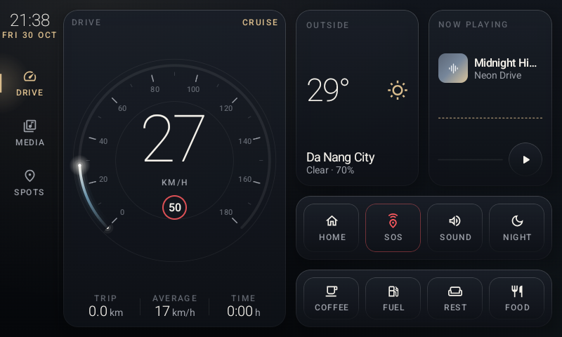

# Pi-Dash — Documentation

Pi-Dash is a Jetpack Compose dashboard for a DIY car head unit: a Raspberry Pi 4 running Android 16
on an 800×480 touchscreen. It shows a speedometer, weather, a media player and a list of nearby
favorite spots in Da Nang.

| Document | What it covers |
|---|---|
| [MAINTENANCE_GUIDE.md](MAINTENANCE_GUIDE.md) | For maintainers: how a Kotlin/Compose Android app runs, architecture and runtime object graph, component reference, main code flows (startup, data, events, media, navigation, external intents, rotary), Kotlin features used, threading/scopes, build system, common tasks, debugging, technical debt |
| [DESIGN.md](DESIGN.md) | Architecture, data flow, the "Midnight & Champagne" visual design system, components, screens and the main technical decisions |
| [TEST_INSTRUCTIONS.md](TEST_INSTRUCTIONS.md) | What the automated tests cover and why, how to write new tests in the same style, and the manual on-device checklist |
| [COMPOSE_TEST_CAPABILITIES.md](COMPOSE_TEST_CAPABILITIES.md) | What Compose UI tests can and cannot test (clicks, gestures, state, layout, accessibility vs colours, visuals, system UI, hardware, performance), workarounds, and which tool to use instead |
| [COMPOSE_TEST_STANDARD.md](COMPOSE_TEST_STANDARD.md) | The reusable Compose test template: layers (framework → app config → robots → tests), the standard test method, screen contract, templates in [`templates/`](templates/), and how to apply it to another app |
| [HOW_COMPOSE_TESTING_WORKS.md](HOW_COMPOSE_TESTING_WORKS.md) | The mechanism behind Compose UI tests: instrumentation, the semantics tree, synchronization and the virtual clock, input injection, assertions — with diagrams |
| [HOW_TO_RUN_TESTS.md](HOW_TO_RUN_TESTS.md) | Prerequisites, connecting the Pi, commands for running unit and UI tests, reading reports, troubleshooting |

## Quick start

```powershell
adb connect 192.168.1.118:44613          # IP:port of the head unit (wireless debugging)
.\gradlew :app:installDebug               # build + install the app
.\gradlew :app:testDebugUnitTest          # JVM unit tests (no device needed)
.\gradlew :app:connectedDebugAndroidTest  # Compose UI tests on the connected device
.\gradlew :app:jacocoMergedReport         # both + merged coverage → app/build/reports/coverage/merged/html
```

Failed UI tests save a screenshot under
`app/build/outputs/connected_android_test_additional_output/…/screenshots/`.


