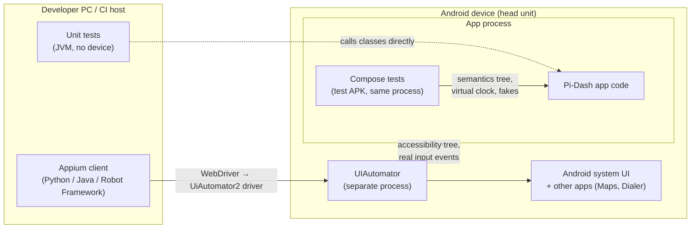
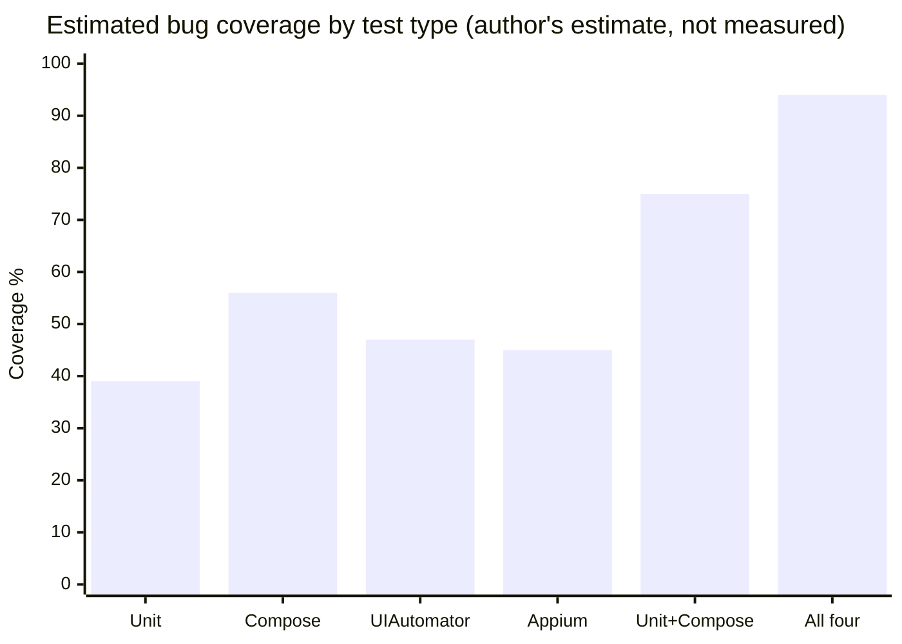

# Unit Tests vs Compose Tests vs UIAutomator vs Appium

What each kind of automated test can see, which bugs **only** it can catch, and how to combine them
for Pi-Dash. The examples are real Pi-Dash code, and section 7 shows the results of a bug-injection
experiment run on the Raspberry Pi head unit.

**In one sentence:** unit tests are the only practical way to check **logic** in depth; Compose tests
are the only ones that can see **inside the UI** and control its state and time; UIAutomator and Appium
are the only ones that test the **real installed app together with Android and other apps**.

Related: [COMPOSE_TEST_CAPABILITIES.md](COMPOSE_TEST_CAPABILITIES.md) (what Compose tests can and cannot
do), [HOW_COMPOSE_TESTING_WORKS.md](HOW_COMPOSE_TESTING_WORKS.md) (the mechanism).

> **How to read the evidence in this document.** Each claim is marked with its source:
>
> | Mark | Meaning | Use in a presentation |
> |---|---|---|
> | **[R*n*]** | Documented fact or published result; see [References](#references) | Cite it |
> | **[M]** | Measured in this project (on the Pi, reproducible) | Present it as a demonstration on our app |
> | **[E]** | Author's estimate, based on the documented capabilities | Present it as an opinion for discussion, not as data |

---

## 1. Where each test runs



- **Unit tests** call Kotlin classes directly on the JVM. No device, no UI. Local tests run on the
  development machine; instrumented tests run on a device [R1].
- **Compose tests** run inside the app's process. They find and act on nodes of the Compose
  **semantics tree** [R2][R3], and the test rule controls a virtual clock (`mainClock`) to step through
  recomposition and animations [R4].
- **UIAutomator** runs on the device and works across apps and the system UI [R5]. It does not see
  Compose test tags unless the app turns on `testTagsAsResourceId`; Android's guidance is to use it for
  system-level or end-to-end flows such as notifications [R6].
- **Appium** drives the device from the host over WebDriver. Its Android driver, UiAutomator2, sends
  most commands to a server that uses Google's UiAutomator framework underneath [R7], so Appium sees
  what UIAutomator sees.

---

## 2. How they compare

| | Unit test (JVM) | Compose UI test | UIAutomator | Appium |
|---|---|---|---|---|
| Where it runs [R1][R5][R7] | Developer PC / CI, no device | On the device, **inside the app's process** | On the device, **outside the app** | On the host, driving the device remotely |
| What it sees | Classes and functions | Compose **semantics tree**: every node, test tags, custom properties [R2][R3] | Android **accessibility tree** of the whole screen, any app; test tags only with `testTagsAsResourceId` [R6] | Same as UIAutomator, through WebDriver [R7] |
| Knowledge of the code | Full (white box) | Full (white box) | None (black box) | None (black box) |
| Inputs | Any values you construct | Fake state, fake ViewModels, a virtual clock [R4] | The real app with its real data | The real app with its real data |
| Build under test | Classes | Debug build + test APK | Any installed build, including release | Any installed build, including release; iOS too |
| Typical speed | Milliseconds per test | **[M]** ~2.5 s per test (54 tests in 2 min 15 s on the Pi 4) | **[E]** ~5–20 s per test | **[E]** ~10–30 s per test |
| Determinism | Very high | High: actions and assertions wait for the UI to be idle [R4] | Medium (real timing, waits) | Lower (network hop, real timing) |
| Language | Kotlin | Kotlin | Kotlin / Java [R5] | Python, Java, JavaScript, … and **Robot Framework (AppiumLibrary)** |
| Runs in this project | `gradlew testDebugUnitTest` | `gradlew connectedDebugAndroidTest`, `scripts\run_composet_test.bat`, ATR | — (not set up) | — (not set up) |

---

## 3. Bugs that only unit tests realistically catch

These are reachable only with inputs the UI can't easily produce, or in code that has no UI. Android's
guidance is to unit-test ViewModels, repositories and other logic classes [R1].

| Bug type | Pi-Dash example | Why the others miss it |
|---|---|---|
| Edge cases and boundaries | `TripData.isSpeeding` wrong at exactly 80 vs 81 km/h; negative speed; overflow of `elapsedSeconds` | UI tests check a few values; unit tests can cover hundreds of inputs in a second |
| Logic without a screen | `MockSpeedGenerator` scenarios, data mapping, parsing, repository caching | Nothing to tap or look at |
| Error paths | Weather source times out or returns nothing, so the state must fall back correctly | Hard to force a timeout through the real UI; end-to-end tests would need a broken backend |
| Concurrency and flows | `combine` / `stateIn` emitting stale or duplicate values; a race between two flows | Needs `runTest`, Turbine and virtual coroutine time; invisible from the UI |
| Many combinations | Every spot category × sort order × empty or full list | Far too slow as UI tests |
| Exact failure location | "`FilterSpotsUseCase` drops the filter" | A UI failure only says "wrong cards shown"; you still have to find the cause |

---

## 4. Bugs that only Compose tests catch

These need you to be **inside** the UI and in control of it.

| Bug type | Pi-Dash example | Why the others miss it |
|---|---|---|
| States the real app rarely reaches | Over-speed alert with fake 97/80 km/h data; empty spots list; missing weather; a 3-hour track | **Unit:** no rendering. **UIAutomator / Appium:** must wait for the real app to reach that state; the mock speed is random, so this is flaky or impossible |
| Internal UI state not exposed to accessibility | Custom semantics `SpeedAlert` and `RevealFraction`; which clock page the pager is on | UIAutomator and Appium see only the accessibility tree; test tags appear only if `testTagsAsResourceId` is enabled [R6] |
| Animation and timing | `expandAnimation_midway_isPartiallyRevealed` freezes the clock at 50% of the expand animation | Compose tests can stop the clock (`autoAdvance = false`) and step it frame by frame [R4]; black-box tools can't pause time and only see the moving result |
| Wrong callback wiring | "Next" wired to `onSkipPrevious`; the test counts the callback calls directly (**[M]** caught, bug B3 in section 7) | **Appium:** sees only the visible effect, if there is one. **Unit:** no buttons |
| Rules applied to every element of a screen | Contract tests: every clickable ≥ 64 dp, every icon labelled, works at 1.3× font scale and in day and night themes (**[M]** caught, bug B4) | Possible with Appium, but slow and coarse (pixel bounds only, no merged semantics [R3]) |
| A composable tested on its own | `MediaScreen` with a fake ViewModel and a MockK repository | Black-box tools always need the whole app running |

---

## 5. Bugs that only UIAutomator or Appium catch

These need the **real installed app** interacting with **Android itself**. UIAutomator is the Android
framework for testing across apps and system UI [R5][R6].

| Bug type | Pi-Dash example | Why Compose and unit tests miss it |
|---|---|---|
| Handing off to other apps | "Navigate" must really open Google Maps; SOS must open the dialer | A Compose test can only check that the callback or intent fired; it can't see another app |
| System UI | Permission dialogs, notifications, media controls in the notification shade, Settings, Home / Recents | Compose tests can't interact outside the app's window; UIAutomator handles these, including permission dialogs [R5] |
| Release-build problems | R8/ProGuard removes a class; crash only in the minified build; wrong signing; missing resources | Compose tests run on the **debug** build plus the test APK |
| Real start-up and dependency wiring | Hilt graph, real repositories, `Application.onCreate`, a missing manifest entry | Compose tests usually inject fakes and skip the real wiring |
| Process lifecycle | App killed in the background and restored; state lost after rotation or a display change; behaviour after a reboot | The test process dies with the app; a Compose test can't observe the restart |
| Device input from outside the app | Hardware keys or rotary-encoder key events through the real input stack; deep links launched by another app | Compose tests simulate input inside the app only |
| Flows across apps or devices | Phone + head unit; a music app + Pi-Dash media controls | Outside a single app process |
| Performance and jank (UIAutomator) | Start-up time, dropped frames on the cockpit clock | Macrobenchmark drives the app with UIAutomator to measure start-up, scrolling and animations [R8] |
| **Appium only:** cross-platform | The same test for an iOS and an Android version of the app | UIAutomator is Android-only |
| **Appium only:** fits other test stacks | Robot Framework tests with AppiumLibrary; device farms (BrowserStack, Sauce Labs) | — |
| **Appium only, with an image plugin:** visuals | A brand colour changed from gold to red, caught by screenshot comparison | Compose tests check behaviour and structure, not pixels (**[M]** bug B7 not caught). Screenshot libraries such as Roborazzi and Paparazzi are the in-code alternative [R9][R10] |

---

## 6. Bug coverage by category (%) — author's estimate [E]

> ⚠️ **These numbers are not research results.** I found no published study that measures the share
> of bugs caught by unit vs Compose vs UIAutomator vs Appium tests. Published studies benchmark
> *automated test generators* [R13], and even there fault-detection figures were found to be
> unstable [R14]. The table below is the author's judgement, based on the documented capabilities in
> sections 1–5. Use it to start a discussion about where to invest; to get real numbers, see
> [How to replace these estimates with measurements](#how-to-replace-these-estimates-with-measurements).

Each cell is the estimated chance that a bug of that category is caught by a reasonably complete suite
of that test type for an app like Pi-Dash. **Share of bugs** is also an estimate; it weights the totals.
**Bold** = the best layer for that category.

| # | Bug category | Example in Pi-Dash | Share of bugs [E] | Unit [E] | Compose [E] | UIAutomator [E] | Appium [E] |
|---|---|---|---:|---:|---:|---:|---:|
| 1 | Business / domain logic | speeding rule, spot filter, sorting | 20% | **90%** | 50% | 30% | 30% |
| 2 | Edge cases and error handling | 80 vs 81 km/h, empty weather, timeouts | 12% | **85%** | 40% | 15% | 15% |
| 3 | Async state and flows | stale `stateIn` value, race between flows | 8% | **70%** | 45% | 20% | 20% |
| 4 | UI rendering for a given state | over-speed alert shown, empty-state text | 15% | 15% | **90%** | 50% | 50% |
| 5 | Interaction and event wiring | "Next" calls "previous", chip tap not applied | 10% | 5% | **90%** | 70% | 65% |
| 6 | Animation and timing in the UI | clock expand stuck halfway | 3% | 0% | **75%** | 20% | 15% |
| 7 | Accessibility and touch targets | icon without label, button under 64 dp | 5% | 0% | **80%** | 50% | 40% |
| 8 | In-app navigation and Back | rail back stack, Back closes the clock | 6% | 20% | **80%** | **80%** | 75% |
| 9 | Integration, DI and start-up | Hilt graph, real repositories, manifest | 6% | 10% | 25% | **85%** | **85%** |
| 10 | Release-build only | R8 strips a class, signing, resources | 3% | 0% | 0% | 80% | **85%** |
| 11 | System UI and other apps | Maps / dialer hand-off, permissions, notifications | 4% | 5% | 15% | **85%** | **85%** |
| 12 | Process lifecycle | kill and restore, rotation / display change | 4% | 10% | 30% | **75%** | 70% |
| 13 | Visual (colour, font, layout drift) | gold accent turned red | 3% | 0% | 10% | 10% | 10% *(60% with an image-comparison plugin)* |
| 14 | Performance and jank | dropped frames on the cockpit clock | 1% | 0% | 5% | **60%** *(Macrobenchmark [R8])* | 20% |
| | **Weighted total (one type alone)** | | **100%** | **≈ 39%** | **≈ 56%** | **≈ 47%** | **≈ 45%** |

How the total is calculated: Σ (share of bugs × detection %). For example, Compose = 20%×50% +
12%×40% + … ≈ 56%. The arithmetic is exact; the inputs are estimates.

### Combining the layers [E]

The layers catch **different** bugs, so they add up instead of overlapping. Combined coverage per
category is 1 − Π(1 − p), which assumes the layers miss independently, so read it as an upper bound:

| Test suite | Estimated coverage | What is still missed |
|---|---:|---|
| Unit only | ≈ 39% | Everything about the UI, the device and the release build |
| Compose only | ≈ 56% | Deep logic edge cases, the system, other apps, the release build |
| **Unit + Compose** (Pi-Dash today) | **≈ 75%** | Integration and start-up, release build, other apps, lifecycle, visuals, performance |
| Unit + Compose + Appium or UIAutomator smoke tests | ≈ 90–94% | Mainly visual drift and performance |
| + screenshot tests (Roborazzi / Paparazzi) + Macrobenchmark | ≈ 95%+ | Bugs nobody wrote a test for: exploratory and manual testing still matter |



### What published research says about bug types [R11][R12]

These figures are published, but they classify bugs differently from the table above, so they can't
be substituted one-for-one.

| Source | Finding | What it means for this table |
|---|---|---|
| Empirical study of reproducing Android bug reports [R11] | Failure types in the studied reports: **output 33%, cosmetic 31%, navigation 8%, crash 28%** | **Cosmetic** failures (wrong appearance) are far more common there than the 3% estimated for category 13. Visual bugs deserve more weight, which strengthens the case for screenshot tests |
| Linares-Vásquez et al., FSE 2017 [R12] | A taxonomy of **262 Android fault types in 14 categories**, built from 2,023 bug reports and commits; the basis of the MDroid+ mutation-testing tool | A research-backed list of bug categories, and the method (mutation testing) to measure detection rates yourself |
| Themis benchmark, FSE 2021 [R13]; ASE 2024 analysis [R14] | Ground-truth evaluation of automated Android GUI testing tools on real bugs; fault-detection results vary strongly between runs | Detection percentages depend on the app and the test suite, so a single number is only meaningful if measured on your own app |

### How to replace these estimates with measurements

1. **Mutation campaign on Pi-Dash** (the method of [R12]): inject 40–60 bugs spread across the 14
   categories, one at a time, and run the unit and Compose suites against each. The result is a
   **measured** detection rate per category for this app. Section 7 is a 7-bug pilot of this.
2. **Add a small Appium or UIAutomator smoke suite** and run it against the same injected bugs to
   measure all four types side by side.
3. **Replace the "share of bugs" column** with Pi-Dash's own bug-tracker history, once it has enough
   bugs, or with the categories of [R11] / [R12].

---

## 7. Evidence: bug-injection experiment [M]

**What was done:** seven bugs were put into the **app code only** (tests unchanged), and the whole
Compose suite was run on the Raspberry Pi 4 (Android 16) with `scripts\run_composet_test.bat all`
on 2026-10-31. This is a small, hand-picked version of mutation testing [R12].

**Result:** 8 of 54 tests failed and **5 of the 7 bugs were caught**. With the code restored, all
54 tests passed again. The failing run's report is kept in `test-run-report-bugs/html/index.html`, with
the failure message and logcat of each test.

| Bug | Unit | Compose (measured) | UIAutomator / Appium |
|---|---|---|---|
| B1: speeding alert only 20 km/h over the limit (`TripData`) | [E] ✅ cheapest place to catch it | ✅ `speedometer_overSpeedLimit_raisesAlert` | [E] ⚠️ only if the random mock speed reaches that range |
| B2: category filter dropped (`FilterSpotsUseCase`) | [E] ✅ use-case test | ✅ 4 tests, e.g. *"Unexpected cards rendered: [g1, f1, f2]"* | [E] ✅ |
| B3: "Next" wired to "previous" (`MediaScreen`) | [E] ❌ | ✅ `skipButtons_tapped_invokeCallbacks`: *expected 2 but was 0* | [E] ⚠️ only if the track change is visible and distinguishable |
| B4: Home button 40 dp (< 64 dp) | [E] ❌ | ✅ contract test: *"action_home is 91 x 30 px, below 64.0.dp"* | [E] ⚠️ pixel bounds only |
| B5: SOS accessibility description emptied | [E] ❌ | ❌ visible text "SOS" still counts as a label | [E] ❌ same reason |
| B6: Back no longer closes the full-screen clock | [E] ❌ | ✅ `fullScreenClock_backPressed_collapses` | [E] ✅ |
| B7: gold accent changed to red | [E] ❌ | ❌ no pixel checks | [E] ✅ only with screenshot comparison |

Only the **Compose** column was measured. The Unit, UIAutomator and Appium columns are estimates,
because those suites were not run against the bugs (no unit tests target these classes yet, and no
UIAutomator or Appium suite exists).

What it shows:

- Compose tests find UI and wiring bugs **with the exact cause** in the failure message.
- B5 needs a more specific assertion (the description "Call emergency contact"). B7 needs
  screenshot tests. Neither is a gap that another test *type* would close automatically.
- B1 belongs in a unit test as well: a boundary test (80 vs 81 km/h) is cheaper and more precise.
- Limits: 7 hand-picked bugs, one app, one run. It demonstrates the behaviour; it is not a statistic.

---

## 8. Recommended mix for Pi-Dash

The pyramid shape follows Google's guidance: mostly unit tests, fewer integration tests, very few
end-to-end tests, because end-to-end tests are slow and flaky [R15]. Android's testing guide gives the
same scopes: small (unit), medium (integration) and large (end-to-end) tests [R1].

```text
            ┌────────────────────┐  FEW (5–10): end-to-end smoke on the RELEASE build
            │ Appium / UIAutomator│  Maps/dialer hand-off, start-up, kill & restore
            ├────────────────────┤
            │   Compose tests    │  MANY (54 today): every screen state, contracts, callbacks
            ├────────────────────┤
            │    Unit tests      │  MOST: logic, edge cases, flows, error paths
            └────────────────────┘
            + screenshot tests (Roborazzi / Paparazzi) for colours and layout
```

| Layer | Use it for | In this project |
|---|---|---|
| Unit | Domain rules, use cases, ViewModels, edge cases, error paths [R1] | `app/src/test`; add boundary tests such as `isSpeeding` at 80/81 km/h |
| Compose | Screen states, interactions, callbacks, accessibility and touch-target contracts, animations [R2][R4] | `app/src/androidTest` (54 tests); run with the script or ATR |
| Appium + Robot Framework | A few release-build flows across apps and the system [R7] | Not set up. AppiumLibrary writes Robot `output.xml`, so `rebot` can merge it with ATR's results in one report |
| UIAutomator | Same purpose as Appium, if you prefer Kotlin and Android-only tests [R5][R6] | Not set up. Also the basis of Macrobenchmark (start-up time, jank) [R8] |
| Screenshot tests | Colours, typography, layout drift (the "luxury" look) [R9][R10] | Not set up. The only reliable way to catch bugs like B7; [R11] suggests cosmetic bugs are common |

**Rule of thumb:** test each behaviour at the **lowest layer that can see it**. Use a higher layer only
for what lower layers cannot reach: rendering and interaction for Compose, other apps and the release
build for UIAutomator and Appium.

---

## References

Links checked on 2026-10-31. For the research papers ([R11]–[R14]), the figures quoted here come from
the abstracts and summaries; read the full text before quoting them in a formal setting.

**Official documentation**

- [R1] Android Developers — *Fundamentals of testing Android apps* (test scopes, local vs
  instrumented tests, what to test).
  <https://developer.android.com/training/testing/fundamentals> ·
  <https://developer.android.com/training/testing/fundamentals/what-to-test>
- [R2] Android Developers — *Test your Compose layout* and *Testing APIs* (finders, actions,
  assertions on the semantics tree).
  <https://developer.android.com/develop/ui/compose/testing> ·
  <https://developer.android.com/develop/ui/compose/testing/apis>
- [R3] Android Developers — *Semantics in Compose* (merged and unmerged semantics trees).
  <https://developer.android.com/jetpack/compose/semantics>
- [R4] Android Developers — *Synchronize your tests* (idle synchronization, `mainClock`,
  `autoAdvance`) and *MainTestClock* API reference.
  <https://developer.android.com/develop/ui/compose/testing/synchronization> ·
  <https://developer.android.com/reference/kotlin/androidx/compose/ui/test/MainTestClock>
- [R5] Android Developers — *Write automated tests with UI Automator* (cross-app testing, system
  dialogs).
  <https://developer.android.com/training/testing/other-components/ui-automator>
- [R6] Android Developers — *Compose testing: Interoperability* (UiAutomator sees test tags only with
  `testTagsAsResourceId`; use UiAutomator for system-level flows).
  <https://developer.android.com/develop/ui/compose/testing/interoperability>
- [R7] Appium — *UiAutomator2 driver* (Appium's Android driver, built on Google's UiAutomator).
  <https://github.com/appium/appium-uiautomator2-driver>
- [R8] Android Developers — *Write a Macrobenchmark* (start-up, scrolling and animation performance,
  driven with UiAutomator).
  <https://developer.android.com/topic/performance/benchmarking/macrobenchmark-overview>
- [R9] Roborazzi — screenshot testing on the JVM with Robolectric. <https://github.com/takahirom/roborazzi>
- [R10] Paparazzi (Cash App) — screenshot testing on the JVM. <https://github.com/cashapp/paparazzi>

**Research**

- [R11] *An Empirical Investigation into the Reproduction of Bug Reports for Android Apps*
  (arXiv 2301.01235). Failure types: output 33%, cosmetic 31%, navigation 8%, crash 28%.
  <https://arxiv.org/pdf/2301.01235>
- [R12] M. Linares-Vásquez et al., *Enabling Mutation Testing for Android Apps*, ESEC/FSE 2017
  (arXiv 1707.09038): taxonomy of 262 Android fault types in 14 categories from 2,023 artifacts; and
  *MDroid+: A Mutation Testing Framework for Android*, ICSE 2018 (arXiv 1802.04749).
  <https://arxiv.org/pdf/1707.09038> · <https://arxiv.org/pdf/1802.04749.pdf>
- [R13] T. Su et al., *Benchmarking Automated GUI Testing for Android against Real-World Bugs*
  (Themis), ESEC/FSE 2021. <https://tingsu.github.io/files/fse21-themis.pdf>
- [R14] Y. Lan, Y. Lu, M. Pan, X. Li, *Navigating Mobile Testing Evaluation: A Comprehensive
  Statistical Analysis of Android GUI Testing Metrics*, ASE 2024 (code coverage is more stable than
  fault detection across runs; the two metrics often disagree).
  <https://conf.researchr.org/details/ase-2024/ase-2024-research/76/Navigating-Mobile-Testing-Evaluation-A-Comprehensive-Statistical-Analysis-of-Android>

**Industry guidance**

- [R15] M. Wacker, *Just Say No to More End-to-End Tests*, Google Testing Blog, 22 April 2015 (test
  pyramid; the often-quoted 70/20/10 unit/integration/E2E split is attributed to this post by
  secondary sources).
  <https://testing.googleblog.com/2015/04/just-say-no-to-more-end-to-end-tests.html>
