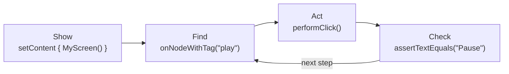
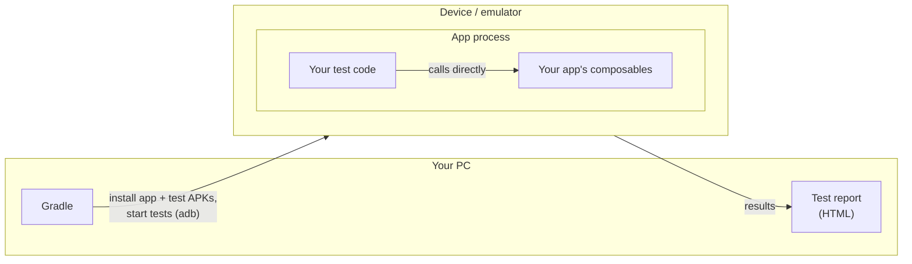
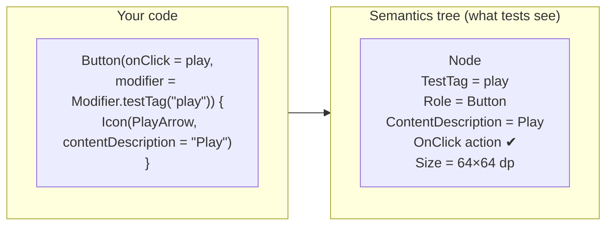
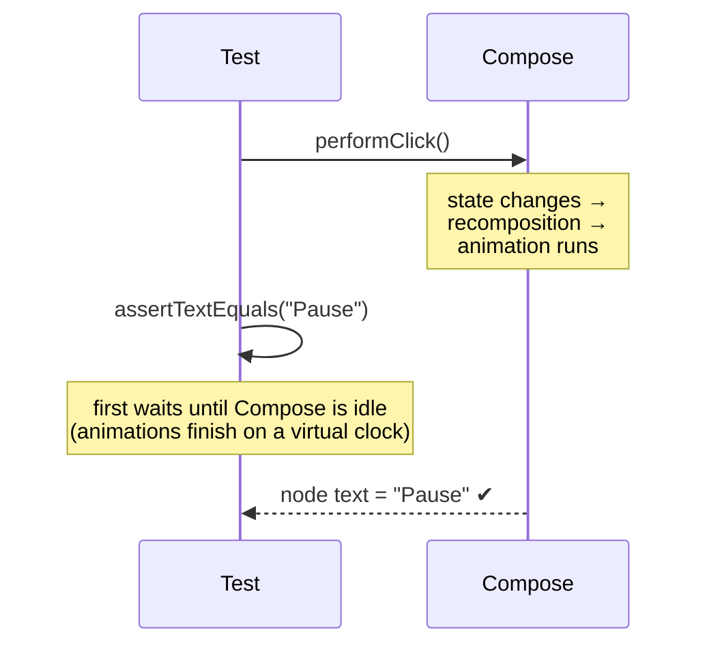
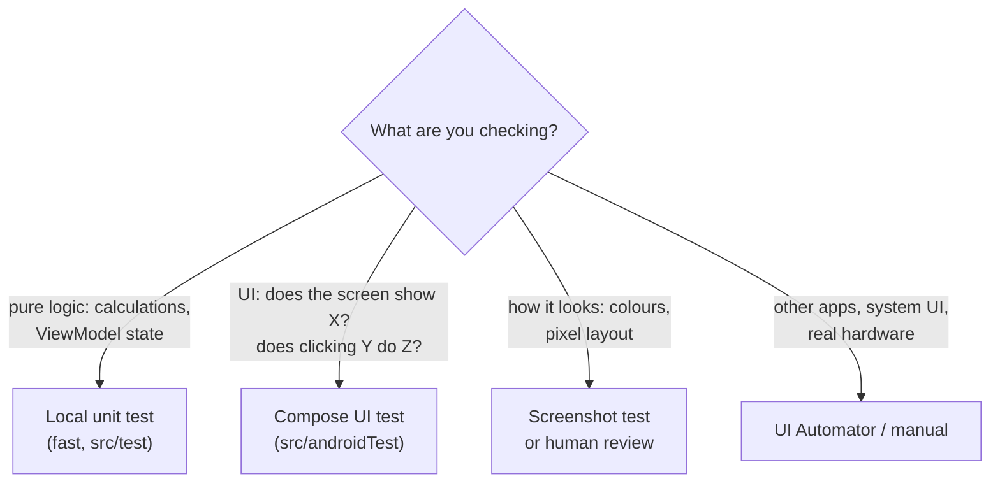

# 1 · Concepts

Before writing code, it helps to understand **what a Compose test is, where it runs and how it
"sees" your screen**. Five ideas cover almost everything.

---

## Idea 1: A Compose UI test is a robot that uses your screen

A Compose UI test does what a person would do:

1. **Show** a piece of UI.
2. **Find** an element ("the Play button").
3. **Do** something to it (click, type, swipe).
4. **Check** the result ("the button now says Pause").



It is still a normal **JUnit test**: a class with `@Test` methods, which pass or fail.

---

## Idea 2: It runs on a device, inside your app

There are two kinds of tests in an Android project:

| | **Local unit test** | **Instrumented test** (Compose UI tests live here) |
|---|---|---|
| Folder | `app/src/test/` | `app/src/androidTest/` |
| Runs on | Your PC (JVM) | A device or emulator |
| Speed | Milliseconds | Seconds |
| Can draw real UI? | No | **Yes** |
| Typical use | ViewModels, logic | Screens, clicks, gestures, accessibility |



Gradle builds **two APKs**: your app, and a test APK that holds only the test code. Android loads
both **into the same process**, so a test can call your composables and classes directly.
([More detail](../HOW_COMPOSE_TESTING_WORKS.md#11-build-install-and-run-as-separate-steps).)

---

## Idea 3: Tests see the *semantics tree*, not pixels

A test cannot "look" at the screen the way you do. Compose keeps a second, hidden description of
the UI called the **semantics tree**. It records what each element *means*: its text, label,
role, state and size. Accessibility services such as TalkBack read the same tree.



Consequences you will meet immediately:

| ✅ Easy to test (it's in the tree) | ❌ Not in the tree |
|---|---|
| Text, labels, test tags | Colours, gradients, shadows |
| Enabled / selected / checked / focused | Fonts and visual style |
| Size and position | Anything drawn on a `Canvas` |
| Clickable / scrollable actions | Things outside your app (system dialogs, other apps) |

Anything in the right column can still be made testable by **publishing its meaning** to the
tree. Chapter 7 shows how. The full list is in
[COMPOSE_TEST_CAPABILITIES.md](../COMPOSE_TEST_CAPABILITIES.md).

---

## Idea 4: You find nodes with *matchers*

To find a node you describe it, for example "the node whose test tag is `play`" or "the node with
text `Settings`". These descriptions are called **matchers**.

```kotlin
rule.onNodeWithTag("play")                     // by test tag  (most reliable)
rule.onNodeWithText("Settings")                // by visible text
rule.onNodeWithContentDescription("Play")      // by accessibility label
rule.onNode(hasClickAction() and hasText("OK")) // any combination
```

`onNodeWith…` must match **exactly one** node. If it matches none, or several, the test fails with
a clear message.

---

## Idea 5: Tests wait for the UI automatically

Compose updates the screen asynchronously: state changes, recomposition, animations. Before every
find or check, the test framework **waits until the UI is idle**, so you never need `sleep()`.



Chapter 5 covers the few cases where you need to help it.

---

## The anatomy of every test: Arrange → Act → Assert

```kotlin
@Test
fun mute_tapped_showsMutedState() {
    // Arrange (Given): put the UI in a known state
    rule.setContent { DashboardScreen(state = mutedOff, actions = ...) }

    // Act (When): do what the user does
    rule.onNodeWithTag("action_mute").performClick()

    // Assert (Then): check the visible result
    rule.onNodeWithTag("action_mute").assert(hasStateDescription("Muted"))
}
```

| Part | Question it answers |
|---|---|
| **Arrange / Given** | What does the screen look like before the user acts? |
| **Act / When** | What does the user do? |
| **Assert / Then** | What should the user see now? |

---

## What to test with Compose tests, and what not to



**Rule of thumb:** test logic in fast unit tests, and use Compose tests for what the *user sees and
does*.

---

### ✅ Check your understanding

1. Why can a Compose test call `DashboardScreen(...)` directly, even though it is in a different APK?
2. Why can't a normal assertion check that a button is red?
3. What happens if `onNodeWithText("OK")` matches two buttons?

<details><summary>Answers</summary>

1. Both APKs are loaded into the same app process.
2. Colour isn't stored in the semantics tree; only meaning is.
3. The test fails ("expected exactly 1 node but found 2"). Use a test tag or a more specific matcher.
</details>

Next: [2 · Setup →](02-setup.md)
