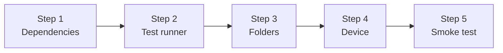

# 2 · Setup

This chapter prepares any Compose app for UI tests. If you created your project from Android
Studio's "Empty Activity (Compose)" template, most of this is already done; check each step anyway.



---

## Step 1: Add the test dependencies

Open `app/build.gradle.kts` and add these to `dependencies { }`:

```kotlin
dependencies {
    // … your existing implementation(...) lines …

    // Compose UI testing
    androidTestImplementation(platform("androidx.compose:compose-bom:<your BOM version>"))
    androidTestImplementation("androidx.compose.ui:ui-test-junit4")   // createComposeRule, finders, assertions
    debugImplementation("androidx.compose.ui:ui-test-manifest")        // empty Activity used to host the UI

    // Test runner + JUnit4 integration
    androidTestImplementation("androidx.test.ext:junit:1.3.0")
    androidTestImplementation("androidx.test:runner:1.7.0")
    androidTestImplementation("androidx.test.espresso:espresso-core:3.7.0") // see note below

    // Optional, used in later chapters
    androidTestImplementation("io.mockk:mockk-android:1.14.11")                 // mocking
    androidTestImplementation("org.jetbrains.kotlinx:kotlinx-coroutines-test:1.10.2")
}
```

| Dependency | Why you need it |
|---|---|
| `compose-bom` (as `platform`) | Keeps all Compose libraries on matching versions, so you don't write versions per library |
| `ui-test-junit4` | The Compose test API: `createComposeRule`, `onNodeWithTag`, `performClick`, `assert…` |
| `ui-test-manifest` (**debug**Implementation) | Adds an empty `ComponentActivity` to your **debug** app, which the rule opens to display your UI. Not included in release builds |
| `androidx.test.ext:junit` | `AndroidJUnit4` runner for `@RunWith` |
| `espresso-core` | Pulled in by Compose testing anyway. **Pin 3.7.0 or newer when testing on Android 16**; older versions crash every test with `NoSuchMethodException: InputManager.getInstance` (this project hit exactly that) |

> **This project** uses a version catalog (`gradle/libs.versions.toml`), so the lines read
> `androidTestImplementation(libs.androidx.compose.ui.test.junit4)`. The meaning is identical.

---

## Step 2: Declare the test runner

In the same file, inside `android { defaultConfig { } }`:

```kotlin
android {
    defaultConfig {
        // …
        testInstrumentationRunner = "androidx.test.runner.AndroidJUnitRunner"
    }
}
```

This tells Android which program starts your tests on the device.

---

## Step 3: Know the folders

```
app/
└── src/
    ├── main/java/com/example/app/        ← your app code
    ├── test/java/com/example/app/        ← local unit tests (JVM)
    └── androidTest/java/com/example/app/ ← Compose UI tests  ★ you work here
```

- Create `app/src/androidTest/java/<your/package>/` if it doesn't exist.
- Use the **same package name** as your app, so tests can see `internal` classes.

---

## Step 4: Connect a device or start an emulator

**Emulator:** in Android Studio, open *Device Manager* → create or start a virtual device.

**Physical device over USB:** enable *Developer options* → *USB debugging*, then plug it in.

**Device over Wi-Fi** (how this project's Raspberry Pi is connected):

```powershell
# On the device: Developer options → Wireless debugging → note IP:port
adb connect 192.168.1.118:44613
adb devices
# List of devices attached
# 192.168.1.118:44613     device      ← "device" means ready
```

If several devices are connected, choose one for Gradle:

```powershell
$env:ANDROID_SERIAL = "192.168.1.118:44613"
```

---

## Step 5: Smoke test: prove the setup works

Create `app/src/androidTest/java/<your/package>/SetupSmokeTest.kt`:

```kotlin
package com.example.app

import androidx.compose.material3.Text
import androidx.compose.ui.test.assertIsDisplayed
import androidx.compose.ui.test.junit4.createComposeRule
import androidx.compose.ui.test.onNodeWithText
import androidx.test.ext.junit.runners.AndroidJUnit4
import org.junit.Rule
import org.junit.Test
import org.junit.runner.RunWith

@RunWith(AndroidJUnit4::class)
class SetupSmokeTest {

    @get:Rule
    val rule = createComposeRule()

    @Test
    fun setup_works() {
        rule.setContent { Text("Hello test") }
        rule.onNodeWithText("Hello test").assertIsDisplayed()
    }
}
```

Run it with **one** of these:

- **Android Studio:** click the green ▶ next to `class SetupSmokeTest` → *Run*.
- **Terminal:**
  ```powershell
  .\gradlew :app:connectedDebugAndroidTest "-Pandroid.testInstrumentationRunnerArguments.class=com.example.app.SetupSmokeTest"
  ```

Expected output:

```
Finished 1 tests on <your device>
BUILD SUCCESSFUL
```

If it fails, look up the error message in [9 · Troubleshooting](09-troubleshooting.md). Once it
passes, you can delete the smoke test.

> **Note on `createComposeRule`:** very recent Compose versions show a deprecation warning
> suggesting `androidx.compose.ui.test.junit4.v2.createComposeRule`. Both work. The v2 rule runs
> coroutines with a standard (queued) test dispatcher. This guide uses the familiar v1 API, which
> is what this project uses today.

---

### ✅ Checklist

- [ ] `ui-test-junit4` and `ui-test-manifest` added (manifest as **debug**Implementation)
- [ ] `testInstrumentationRunner` set
- [ ] `src/androidTest/java/<package>/` exists
- [ ] `adb devices` shows your device as `device`
- [ ] Smoke test passes

Next: [3 · Your first test →](03-first-test.md)
