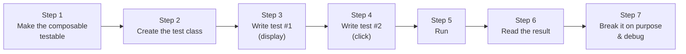
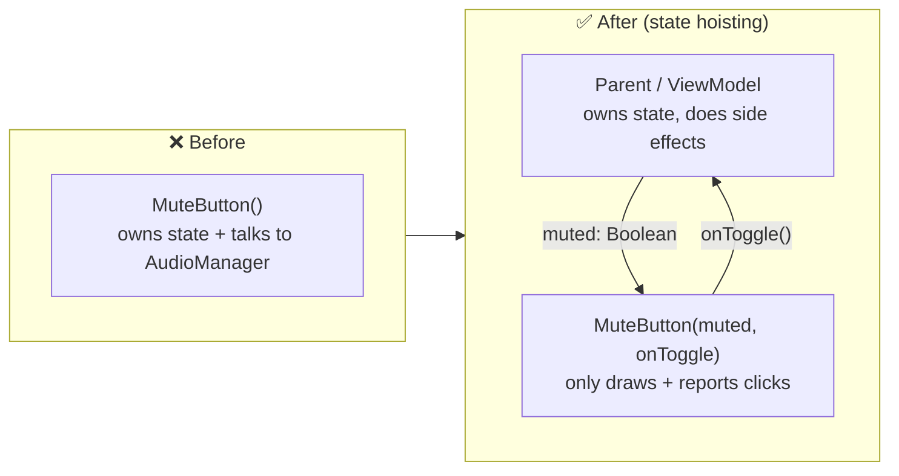
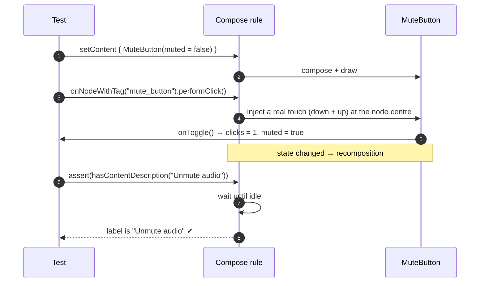
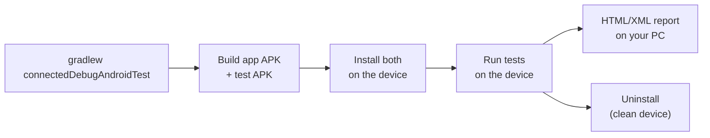

# 3 · Your First Real Test

We will test a **mute button** like the one on the Pi-Dash dashboard. The order matters:



---

## Step 1: Make the composable testable

### 1a. The problem: an untestable composable

```kotlin
@Composable
fun MuteButton() {
    var muted by remember { mutableStateOf(false) }       // ❌ state hidden inside
    val audio = LocalContext.current.getSystemService(AudioManager::class.java)
    IconButton(onClick = {
        muted = !muted
        audio.adjustStreamVolume(STREAM_MUSIC, if (muted) ADJUST_MUTE else ADJUST_UNMUTE, 0) // ❌ side effect
    }) {
        Icon(if (muted) Icons.Default.VolumeOff else Icons.Default.VolumeUp, null) // ❌ no label
    }
}
```

Why it's hard to test:
- You can't start it in the "muted" state.
- Clicking it changes the real system volume.
- The icon has no label, so a test can't find it, and neither can TalkBack.

### 1b. The fix: state hoisting, tags and labels

```kotlin
@Composable
fun MuteButton(
    muted: Boolean,                 // ✅ state comes IN as a parameter
    onToggle: () -> Unit,           // ✅ events go OUT as a callback
    modifier: Modifier = Modifier,
) {
    IconButton(
        onClick = onToggle,
        modifier = modifier
            .testTag("mute_button")                                   // ✅ stable handle for tests
            .semantics { stateDescription = if (muted) "Muted" else "Sound on" }, // ✅ state for tests & TalkBack
    ) {
        Icon(
            imageVector = if (muted) Icons.Default.VolumeOff else Icons.Default.VolumeUp,
            contentDescription = if (muted) "Unmute audio" else "Mute audio", // ✅ label
        )
    }
}
```



**Three rules for testable composables:**

| Rule | Why |
|---|---|
| **State in, events out.** Pass data as parameters; report clicks through lambdas | A test controls the state and records the events |
| **Add `Modifier.testTag("…")`** to anything you will find or check | Tags don't change when text is translated or restyled |
| **Give icon-only controls a `contentDescription`** | Tests and screen readers can identify them |

> In this project every screen follows this pattern. `DashboardScreen(state, actions)` receives a
> `DashboardUiState` and a `DashboardActions` holding callbacks. All tags live in one object,
> `ui/components/TestTags.kt`.

---

## Step 2: Create the test class

Create `app/src/androidTest/java/<your/package>/MuteButtonTest.kt`:

```kotlin
package com.example.app

import androidx.compose.ui.test.junit4.createComposeRule
import androidx.test.ext.junit.runners.AndroidJUnit4
import org.junit.Rule
import org.junit.runner.RunWith

@RunWith(AndroidJUnit4::class)          // ① run with the Android JUnit runner
class MuteButtonTest {

    @get:Rule                           // ② JUnit rule: set up before / clean up after each test
    val rule = createComposeRule()      // ③ hosts your composables in an empty Activity
}
```

| Line | Meaning |
|---|---|
| `@RunWith(AndroidJUnit4::class)` | Use the Android test runner |
| `@get:Rule` | Kotlin syntax so JUnit finds the rule (it must annotate the *getter*) |
| `createComposeRule()` | Opens an empty Activity before each test and closes it afterwards. Gives you `setContent`, finders and more |

---

## Step 3: Test #1, "it shows the right state"

```kotlin
@Test
fun muteButton_whenNotMuted_offersToMute() {
    // Given: the button in the "sound on" state
    rule.setContent {
        MuteButton(muted = false, onToggle = {})
    }

    // Then: it is visible and labelled correctly
    rule.onNodeWithTag("mute_button")
        .assertIsDisplayed()
        .assert(hasContentDescription("Mute audio"))
        .assert(hasStateDescription("Sound on"))
}
```

Imports needed (Android Studio adds them with **Alt+Enter**):

```kotlin
import androidx.compose.ui.test.assert
import androidx.compose.ui.test.assertIsDisplayed
import androidx.compose.ui.test.hasContentDescription
import androidx.compose.ui.test.hasStateDescription
import androidx.compose.ui.test.onNodeWithTag
import org.junit.Test
```

**Naming:** `subject_condition_expectedResult` reads like a sentence in the report:
"muteButton, when not muted, offers to mute".

---

## Step 4: Test #2, "clicking it toggles"

The button no longer owns its state, so the test provides it with `mutableStateOf`:

```kotlin
@Test
fun muteButton_clicked_switchesToMuted() {
    // Given: state owned by the test
    var muted by mutableStateOf(false)
    var clicks = 0
    rule.setContent {
        MuteButton(muted = muted, onToggle = { clicks++; muted = !muted })
    }

    // When: the user taps it
    rule.onNodeWithTag("mute_button").performClick()

    // Then: the callback ran once and the UI shows the new state
    assertEquals(1, clicks)
    rule.onNodeWithTag("mute_button")
        .assert(hasContentDescription("Unmute audio"))
        .assert(hasStateDescription("Muted"))
}
```

What happens behind the scenes:



Notice:
- `performClick()` sends a **real touch event**, the same as a finger.
- The assertion **waits automatically** for recomposition. No `sleep()`.

---

## Step 5: Run the tests

### Option A: Android Studio (easiest)

1. Open `MuteButtonTest.kt`.
2. Click the green ▶ in the gutter next to the **class** (runs all tests) or next to one `@Test` (runs one).
3. Choose your device.
4. Results appear in the *Run* panel: ✅ green or ❌ red, per test.

### Option B: Terminal (Gradle)

```powershell
# all UI tests
.\gradlew :app:connectedDebugAndroidTest

# only this class
.\gradlew :app:connectedDebugAndroidTest "-Pandroid.testInstrumentationRunnerArguments.class=com.example.app.MuteButtonTest"

# only one method
.\gradlew :app:connectedDebugAndroidTest "-Pandroid.testInstrumentationRunnerArguments.class=com.example.app.MuteButtonTest#muteButton_clicked_switchesToMuted"
```



> The Gradle task **uninstalls the app** when it finishes. Run `.\gradlew :app:installDebug` if
> you want to keep using the app afterwards.

---

## Step 6: Read the result

**Terminal:**

```
> Task :app:connectedDebugAndroidTest
Finished 2 tests on Pixel_8_API_36
BUILD SUCCESSFUL in 48s
```

**HTML report** (open it in a browser):

```powershell
start app\build\reports\androidTests\connected\debug\index.html
```

It lists each class and test with ✅/❌, duration, and the full error for failures.

---

## Step 7: Break it on purpose, then debug

Learning to read failures is as important as writing tests. Change the expected label to something
wrong:

```kotlin
.assert(hasContentDescription("Silence"))   // wrong on purpose
```

Run again. The failure message looks like this (shortened; exact numbers vary by device):

```
java.lang.AssertionError: Failed to assert the following: (ContentDescription = [Silence] (ignoreCase: false))
Semantics of the node:
Node #6 at (l=0.0, t=0.0, r=168.0, b=168.0)px, Tag: 'mute_button'
ContentDescription = '[Unmute audio]'
StateDescription = 'Muted'
Role = 'Button'
Actions = [OnClick, RequestFocus]
MergeDescendants = 'true'
Selector used: (TestTag = 'mute_button')
```

How to read it:

| Line | Tells you |
|---|---|
| `Failed to assert … ContentDescription = [Silence]` | What you expected |
| `ContentDescription = '[Unmute audio]'` | What the node actually has |
| `Selector used: (TestTag = 'mute_button')` | Which finder found the node |

### Debug tool #1: print the semantics tree

When a node "can't be found", print what the test actually sees:

```kotlin
rule.onRoot().printToLog("MY_TEST")                          // merged tree
rule.onRoot(useUnmergedTree = true).printToLog("MY_TEST")    // every node, unmerged
```

Then filter Logcat by `MY_TEST`. The output looks similar to:

```
Printing with useUnmergedTree = 'false'
Node #1 at (l=0.0, t=0.0, r=1080.0, b=2400.0)px
 |-Node #6 at (l=0.0, t=0.0, r=168.0, b=168.0)px, Tag: 'mute_button'
   Role = 'Button'
   ContentDescription = '[Mute audio]'
   Actions = [OnClick, RequestFocus]
```

### Debug tool #2: a screenshot of the failure

This project captures a PNG automatically whenever a test fails (chapter 7). The images appear in
`app/build/outputs/connected_android_test_additional_output/.../screenshots/`.

Fix the expected text, run again, and you're green. ✅

---

## The complete file

```kotlin
package com.example.app

import androidx.compose.runtime.getValue
import androidx.compose.runtime.mutableStateOf
import androidx.compose.runtime.setValue
import androidx.compose.ui.test.assert
import androidx.compose.ui.test.assertIsDisplayed
import androidx.compose.ui.test.hasContentDescription
import androidx.compose.ui.test.hasStateDescription
import androidx.compose.ui.test.junit4.createComposeRule
import androidx.compose.ui.test.onNodeWithTag
import androidx.compose.ui.test.performClick
import androidx.test.ext.junit.runners.AndroidJUnit4
import org.junit.Assert.assertEquals
import org.junit.Rule
import org.junit.Test
import org.junit.runner.RunWith

@RunWith(AndroidJUnit4::class)
class MuteButtonTest {

    @get:Rule
    val rule = createComposeRule()

    @Test
    fun muteButton_whenNotMuted_offersToMute() {
        rule.setContent { MuteButton(muted = false, onToggle = {}) }

        rule.onNodeWithTag("mute_button")
            .assertIsDisplayed()
            .assert(hasContentDescription("Mute audio"))
            .assert(hasStateDescription("Sound on"))
    }

    @Test
    fun muteButton_clicked_switchesToMuted() {
        var muted by mutableStateOf(false)
        var clicks = 0
        rule.setContent { MuteButton(muted = muted, onToggle = { clicks++; muted = !muted }) }

        rule.onNodeWithTag("mute_button").performClick()

        assertEquals(1, clicks)
        rule.onNodeWithTag("mute_button")
            .assert(hasContentDescription("Unmute audio"))
            .assert(hasStateDescription("Muted"))
    }
}
```

> The same behaviour, tested in this project:
> `DashboardScreenTest.muteAndTheme_toggled_reflectNewSettingsState`.

---

### 🏋️ Exercise

Write a test `muteButton_clickedTwice_returnsToSoundOn()` that clicks twice and checks the state
description is `"Sound on"` and `clicks == 2`.

Next: [4 · Finders, actions, assertions →](04-finders-actions-assertions.md)
