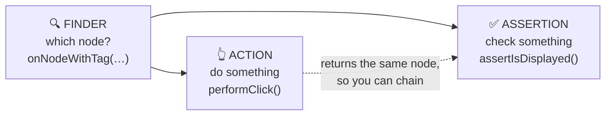
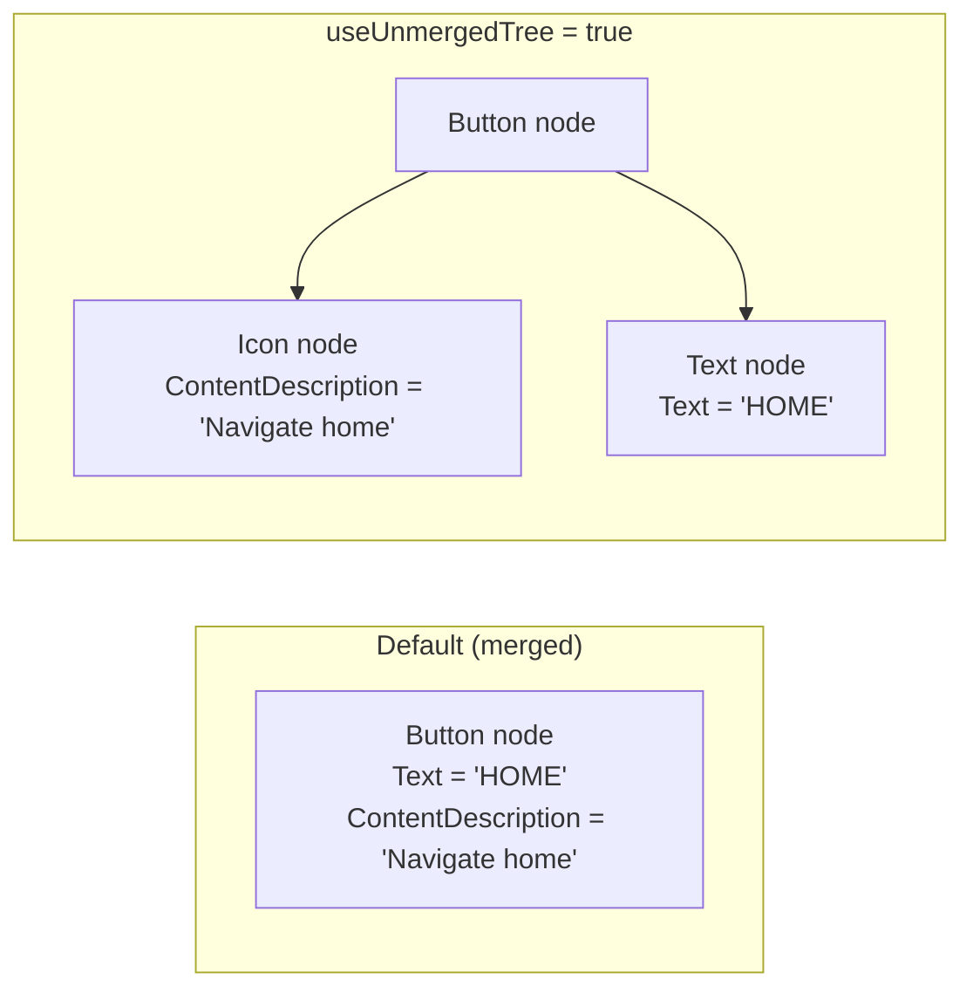
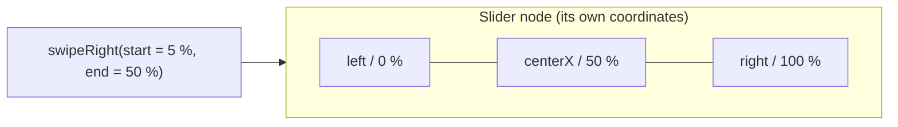

# 4 · Finders, Actions, Assertions

Every line in a Compose test is one of three things:



```kotlin
rule.onNodeWithTag("play")        // finder   → SemanticsNodeInteraction
    .performClick()               // action   → returns the same interaction
    .assert(hasContentDescription("Pause"))  // assertion
```

---

## 4.1 Finders: locating nodes

### Single-node finders (must match exactly one)

| Finder | Example | Use when |
|---|---|---|
| `onNodeWithTag(tag)` | `onNodeWithTag("action_mute")` | **Default choice.** Tags are stable |
| `onNodeWithText(text)` | `onNodeWithText("Settings")` | Visible text is the point of the test |
| `onNodeWithText(text, substring = true)` | `onNodeWithText("Da Nang", substring = true)` | Partial text |
| `onNodeWithContentDescription(desc)` | `onNodeWithContentDescription("Close clock")` | Icon-only buttons |
| `onNode(matcher)` | `onNode(hasText("OK") and hasClickAction())` | Combinations |
| `onRoot()` | `onRoot().printToLog("TAG")` | Debugging, screenshots |

### Multi-node finders

```kotlin
rule.onAllNodesWithTag("spot_card")             // all matches
    .assertCountEquals(4)
rule.onAllNodes(hasClickAction())[0].performClick()  // by index
val nodes = rule.onAllNodes(hasClickAction()).fetchSemanticsNodes()  // raw data for custom checks
```

### Matchers: build your own description

| Matcher | Matches nodes that… |
|---|---|
| `hasTestTag("x")` | have test tag `x` |
| `hasText("x")`, `hasText("x", substring = true)` | show text `x` |
| `hasContentDescription("x")` | have accessibility label `x` |
| `hasStateDescription("x")` | have state description `x` ("Muted", "Playing") |
| `hasClickAction()`, `hasScrollAction()` | are clickable / scrollable |
| `isEnabled()`, `isNotEnabled()` | are enabled / disabled |
| `isSelected()`, `isOn()`, `isOff()` | are selected / toggled on / off |
| `isFocused()` | have focus |
| `hasProgressBarRangeInfo(info)` | are progress bars with this value |
| `hasParent(m)`, `hasAnyAncestor(m)`, `hasAnyDescendant(m)` | have relatives matching `m` |

Combine them with `and`, `or` and `!`:

```kotlin
rule.onNode(hasTestTag("spot_navigate_c1") and hasClickAction())
rule.onAllNodes(hasClickAction() and !hasText("Cancel"))
```

### Custom matcher

```kotlin
fun hasTestTagPrefix(prefix: String) = SemanticsMatcher("TestTag starts with '$prefix'") { node ->
    node.config.getOrNull(SemanticsProperties.TestTag)?.startsWith(prefix) == true
}

rule.onAllNodes(hasTestTagPrefix("spot_card_")).assertCountEquals(4)
```

*(In this project: `testing/Matchers.kt`, used by `FavoriteSpotsTest`.)*

### Merged vs unmerged tree

A clickable element **merges** its children's text and labels into itself, so a button shows up as
one node:



- Usually you want the merged tree (the default).
- To reach a child *inside* a button or card, add `useUnmergedTree = true`:

```kotlin
rule.onNodeWithTag("weather_icon", useUnmergedTree = true).assert(hasContentDescription("Rain"))
```

---

## 4.2 Actions: interacting like a user

### Clicks and keys

```kotlin
node.performClick()
node.performTouchInput { longClick() }
node.performTouchInput { doubleClick() }
node.performKeyInput { pressKey(Key.Enter) }           // keyboard / D-pad (needs focus; chapter 5)
```

### Gestures with `performTouchInput`

Inside `performTouchInput { }` you work in the node's own coordinates: `left`, `right`, `top`,
`bottom`, `center`, `centerX`, `width`, `height`, `percentOffset(x, y)`.

```kotlin
// Swipe pages (Pi-Dash luxury clock)
rule.onNodeWithTag("luxury_clock_pager").performTouchInput { swipeUp() }

// Drag a slider thumb from 5 % to 50 % of its width (Pi-Dash media player)
rule.onNodeWithTag("media_slider").performTouchInput {
    swipeRight(startX = left + width * 0.05f, endX = left + width * 0.5f, durationMillis = 400)
}

// Tap at 80 % across
rule.onNodeWithTag("media_slider").performTouchInput { click(percentOffset(0.8f, 0.5f)) }

// Fully manual gesture
node.performTouchInput {
    down(center)
    moveBy(Offset(200f, 0f))
    up()
}
```



### Scrolling lists

A `LazyColumn` only composes the items that are **visible**. Off-screen items don't exist yet, so
you must scroll to them first:

```kotlin
rule.onNodeWithTag("spots_list")
    .performScrollToNode(hasTestTag("spot_card_r3"))    // scrolls until it exists and is visible
rule.onNodeWithTag("spot_navigate_r3").performClick()

rule.onNodeWithTag("spots_list").performScrollToIndex(10)
rule.onNodeWithTag("some_item").performScrollTo()       // for non-lazy scrollable containers
```

### Text fields

```kotlin
rule.onNodeWithTag("search_field").performTextInput("coffee")
rule.onNodeWithTag("search_field").performTextReplacement("fuel")
rule.onNodeWithTag("search_field").performTextClearance()
rule.onNodeWithTag("search_field").performImeAction()   // presses the keyboard's action key
```

### Accessibility actions (no touch event)

```kotlin
node.requestFocus()                                      // focus (D-pad / rotary scenarios)
node.performSemanticsAction(SemanticsActions.OnClick)    // what TalkBack does
```

---

## 4.3 Assertions: checking results

### Common assertions

| Assertion | Passes when |
|---|---|
| `assertExists()` / `assertDoesNotExist()` | Node is / isn't in the tree |
| `assertIsDisplayed()` / `assertIsNotDisplayed()` | Node is / isn't visible on screen |
| `assertTextEquals("a", "b")` | Node's texts are exactly these |
| `assertTextContains("abc")` | Text contains this |
| `assertContentDescriptionEquals("x")` | Accessibility label equals this |
| `assertIsEnabled()` / `assertIsNotEnabled()` | Enabled / disabled |
| `assertIsSelected()` / `assertIsNotSelected()` | Selected (tabs, chips) |
| `assertIsOn()` / `assertIsOff()` | Toggle state |
| `assertIsFocused()` | Has focus |
| `assertHasClickAction()` | Clickable |
| `assertWidthIsAtLeast(64.dp)`, `assertHeightIsEqualTo(48.dp)` | Size |
| `assert(matcher)` | Any matcher from 4.1 |
| `assertCountEquals(n)` | (on `onAllNodes…`) exactly `n` nodes |

```kotlin
rule.onNodeWithTag("chip_coffee").assertIsSelected()
rule.onNodeWithTag("chip_all").assertIsNotSelected()
rule.onAllNodesWithTag("spots_list").assertCountEquals(0)   // list removed → empty state
rule.onNodeWithTag("action_home").assertWidthIsAtLeast(64.dp)
```

### `assertExists` vs `assertIsDisplayed`

| | `assertExists` | `assertIsDisplayed` |
|---|---|---|
| Node in the semantics tree | required | required |
| Node visible on screen | not required | **required** (inside the visible window, not zero size) |
| Use for | "it's there, maybe off-screen" | "the user can see it" |

### Checking callbacks and ViewModel calls

UI assertions check the screen. To check that **something was called**, record it:

```kotlin
val calls = mutableListOf<String>()
rule.setContent { DashboardScreen(state, DashboardActions(onToggleMute = { calls += "mute" })) }
rule.onNodeWithTag("action_mute").performClick()
assertEquals(listOf("mute"), calls)                    // plain JUnit assertion
```

With MockK (chapter 6): `verify(exactly = 1) { repository.play() }`.

---

## 4.4 Putting it together: a list test

From `FavoriteSpotsTest`: selecting the *Coffee* chip shows only coffee places.

```kotlin
@Test
fun categoryChip_coffeeSelected_listShowsOnlyCoffeeSpots() {
    rule.setContent { SpotsScreen(state, onCategorySelected = …, onNavigate = {}) }

    // Act
    rule.onNodeWithTag("chip_coffee").performClick()

    // Assert: chip state
    rule.onNodeWithTag("chip_coffee").assertIsSelected()
    rule.onNodeWithTag("chip_all").assertIsNotSelected()

    // Assert: only coffee cards are composed…
    val ids = rule.onAllNodes(hasTestTagPrefix("spot_card_")).fetchSemanticsNodes()
        .map { it.config[SemanticsProperties.TestTag] }
    assertTrue(ids.all { it in coffeeCardTags })

    // …and every coffee card is reachable by scrolling
    coffeeCardTags.forEach { tag ->
        rule.onNodeWithTag("spots_list").performScrollToNode(hasTestTag(tag))
        rule.onNodeWithTag(tag).assertIsDisplayed()
    }
}
```

---

### 🏋️ Exercises

1. Find the "Close clock" button by content description and assert it is clickable.
2. In a `LazyColumn` of 50 items, scroll to item 40 and click it.
3. Assert that every clickable node on a screen is at least 48dp tall (hint:
   `onAllNodes(hasClickAction()).fetchSemanticsNodes()` and `node.size`).

Next: [5 · State, timing and animations →](05-state-timing-animations.md)
