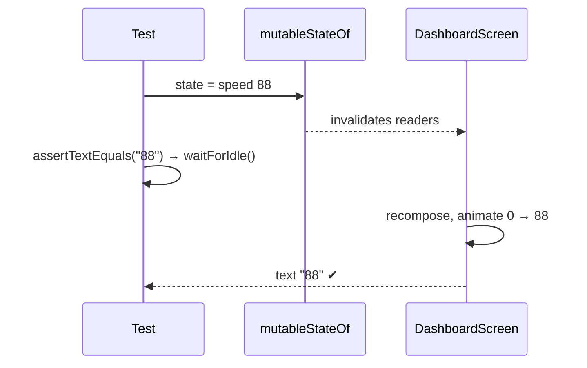
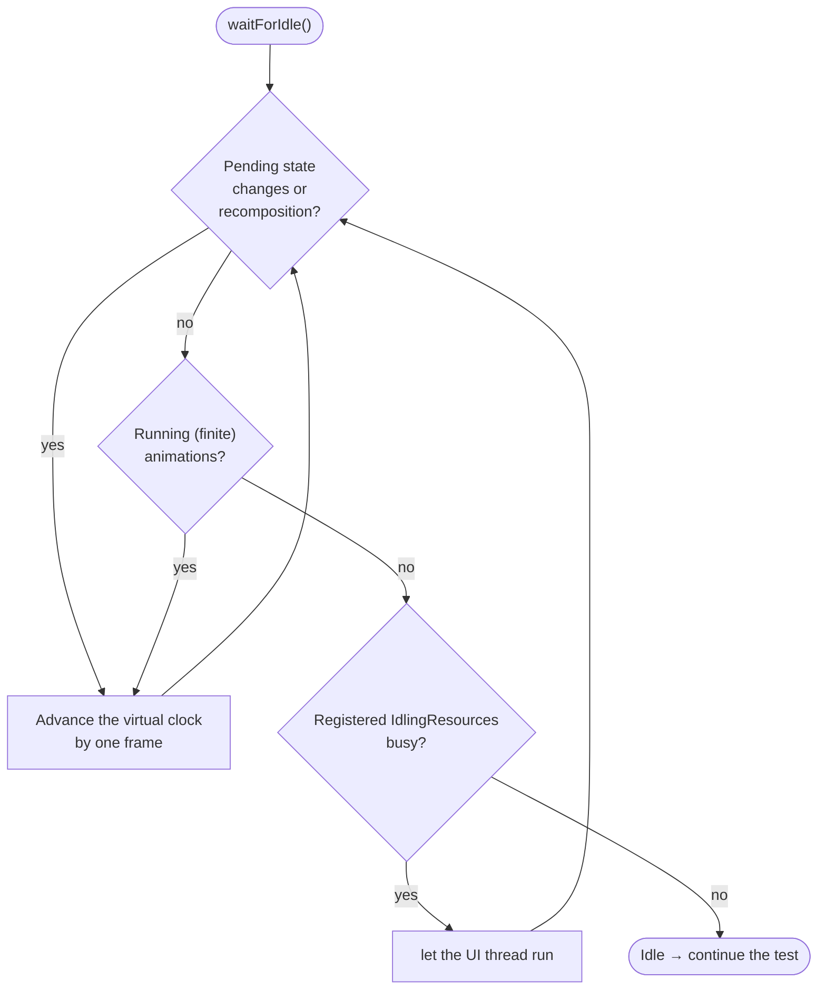
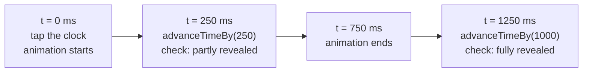
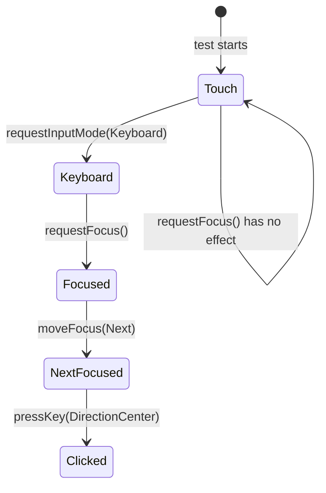

# 5 · State, Timing and Animations

UIs change over time: state updates, recompositions, animations and background work. This chapter
explains how tests keep up, and what to do in the few cases where they can't on their own.

---

## 5.1 Driving the UI with state

Because composables take state as parameters, a test can **change the state while the test is
running** and check that the UI follows. Use `mutableStateOf`:

```kotlin
@Test
fun speedometer_stateChanges_updatesDisplayedSpeed() {
    var state by mutableStateOf(DashboardUiState(trip = TripData(speedKmh = 0)))
    rule.setContent { DashboardScreen(state, DashboardActions()) }
    rule.onNodeWithTag("speed_value").assertTextEquals("0")

    state = state.copy(trip = TripData(speedKmh = 88))     // change state from the test

    rule.onNodeWithTag("speed_value").assertTextEquals("88") // UI followed
}
```



> **One `setContent` per test.** You can't call it twice. To show different content within one
> test, switch a `mutableStateOf` inside a single `setContent`.

---

## 5.2 How tests wait: `waitForIdle` and the test clock

Before every finder, action and assertion, the rule calls **`waitForIdle()`**: it blocks until
Compose has nothing left to do.



Key point: **animations use a virtual clock (`mainClock`)**. In tests it is fast-forwarded frame by
frame, so a 500 ms animation completes in a few real milliseconds, the same way every time.

| What | Handled automatically? |
|---|---|
| Recomposition after a state change | ✅ |
| `animate*AsState`, `AnimatedVisibility`, `AnimatedContent` (finite) | ✅ waits for the end |
| `rememberInfiniteTransition` (never ends) | ✅ not waited for |
| Coroutines that suspend on Compose frames | ✅ |
| Your own threads, network, database, `delay()` timers | ❌ see 5.4 |

---

## 5.3 Testing an animation half-way: controlling the clock

Sometimes you need to check a moment *during* an animation. Turn off auto-advance and move time
yourself:

```kotlin
@Test
fun expandAnimation_midway_isPartiallyRevealed() {
    rule.setContent { ClockHost() }
    rule.mainClock.autoAdvance = false          // ① take control of time

    rule.onNodeWithTag("nav_clock").performClick()
    rule.mainClock.advanceTimeBy(250)           // ② 250 ms into a 750 ms reveal

    val f = revealFraction()                    // read a custom semantics value
    assertTrue(f > 0.05f && f < 0.99f)          // ③ part-way

    rule.mainClock.advanceTimeBy(1_000)         // ④ jump past the end
    assertEquals(1f, revealFraction(), 0.001f)
}
```



| API | Effect |
|---|---|
| `mainClock.autoAdvance = false` | Time moves only when you say so |
| `mainClock.advanceTimeBy(ms)` | Move forward `ms` milliseconds (runs frames) |
| `mainClock.advanceTimeByFrame()` | Move one frame |
| `mainClock.autoAdvance = true` | Back to normal |

*(Real example: `LuxuryClockTest.expandAnimation_midway_isPartiallyRevealed`.)*

---

## 5.4 When automatic waiting is not enough

### Case A: a callback arrives *after* the gesture

Some components report results from a coroutine that runs after the gesture finishes. The Material3
`Slider`'s `onValueChangeFinished` is one. If you read the result straight after
`performTouchInput`, it may still be `null`:

```kotlin
// ❌ flaky: the drag-end coroutine may not have run yet
dragSlider()
assertNotNull(seekedTo)

// ✅ runOnIdle: wait for idle, then read on the UI thread
dragSlider()
val fraction = rule.runOnIdle { seekedTo }
assertNotNull(fraction)
```

### Case B: waiting for a condition (data loading, network)

```kotlin
rule.waitUntil(timeoutMillis = 5_000) {
    rule.onAllNodesWithText("Da Nang City").fetchSemanticsNodes().isNotEmpty()
}
```

(Newer versions add helpers such as `waitUntilExactlyOneExists(hasText("Da Nang City"))`.)

### Case C: work Compose can't see

For background work that Compose doesn't know about (your own threads, OkHttp, Room), register an
Espresso `IdlingResource` with `rule.registerIdlingResource(...)`, so `waitForIdle` waits for it
too. Even better, **replace the real data source with a fake** in UI tests (chapter 6), so there is
nothing to wait for.

### Case D: clocks, timers and auto-hide

A `LaunchedEffect` that loops with `delay()` (a clock ticking every second, controls that hide
after 4 s) makes tests unpredictable. This project's solution:

1. **Inject the time** so tests can freeze it: `timeSource: () -> LocalDateTime`.
2. **Tick through the infinite-animation API**, which Compose tests switch off automatically:

```kotlin
LaunchedEffect(Unit) {
    while (true) {
        withInfiniteAnimationFrameMillis { }   // under test: never resumes → no ticking
        time.value = source()
        delay(1_000)
    }
}
```

```kotlin
// In the test: a frozen clock
private val fixedTime = { LocalDateTime.of(2026, 10, 31, 10, 9, 30) }
rule.setContent { LuxuryClockScreen(onClose = {}, timeSource = fixedTime) }
rule.onNodeWithTag("luxury_clock_time").assertTextEquals("10:09")   // always passes
```

*(See `ui/clock/ClockTime.kt` → `rememberTickingTime`.)*

---

## 5.5 Focus, keyboard and D-pad

In **touch mode** (the default), ordinary clickable elements **cannot receive focus**. Real
keyboards, D-pads and rotary knobs switch Android into **keyboard mode**. Do the same in tests:

```kotlin
lateinit var inputMode: InputModeManager
lateinit var focusManager: FocusManager
rule.setContent {
    inputMode = LocalInputModeManager.current
    focusManager = LocalFocusManager.current
    DashboardScreen(state, actions)
}
rule.runOnIdle { inputMode.requestInputMode(InputMode.Keyboard) }   // ① keyboard mode

rule.onNodeWithTag("action_home").requestFocus()                    // ② focus
rule.runOnIdle { focusManager.moveFocus(FocusDirection.Next) }      // ③ "rotate the knob"
rule.onNodeWithTag("action_emergency").assertIsFocused()

rule.onNodeWithTag("action_emergency")
    .performKeyInput { pressKey(Key.DirectionCenter) }              // ④ "press the knob"
```



*(This project wraps steps ① to ③ as `rule.enableRotaryInput()` and `rule.rotate(n)`; see
chapter 7.)*

---

## 5.6 Test settings that differ between devices

The device's font size, language and theme can change what your test sees. The test Pi runs at
**1.8× font size**, which made text wider and truncated it. Pin these settings in your tests:

```kotlin
rule.setContent {
    val density = LocalDensity.current
    CompositionLocalProvider(LocalDensity provides Density(density.density, fontScale = 1f)) {
        MyAppTheme(darkTheme = true) { MyScreen() }
    }
}
```

Newer Compose versions also offer `DeviceConfigurationOverride` (font scale, locale, layout
direction, dark mode, forced size) for testing *variants* on purpose.

---

### 🏋️ Exercises

1. Write a test that changes a `mutableStateOf<Boolean>` from `false` to `true` and asserts a
   `AnimatedVisibility` panel appears.
2. With `autoAdvance = false`, check that the panel's fade-in is not finished after 50 ms (hint:
   expose progress through semantics, or check `assertExists` without `assertIsDisplayed`).
3. Make a screen that shows the current time testable by injecting a time source.

Next: [6 · ViewModels and navigation →](06-viewmodels-and-navigation.md)
