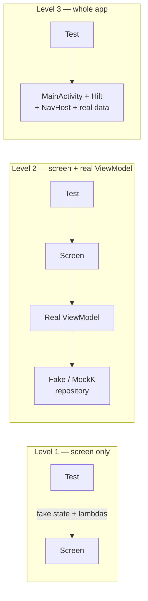
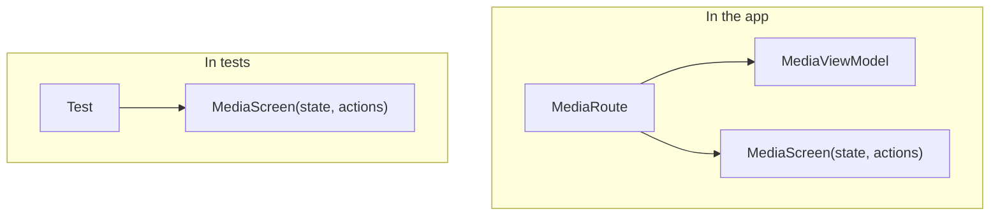
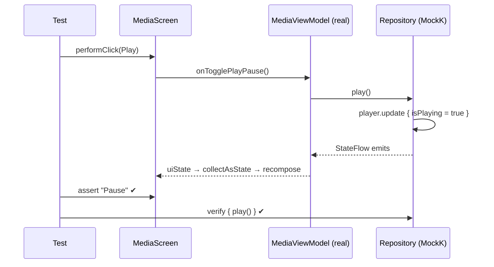

# 6 · Testing with ViewModels and Navigation

So far we have rendered screens with **hand-made state**. Real apps get state from a ViewModel,
which gets it from repositories. This chapter shows three levels of realism, and when to use each.



| Level | Speed & stability | What it proves | This project |
|---|---|---|---|
| 1 · Screen only | ⭐⭐⭐ | UI shows state correctly, sends the right events | Most tests (`DashboardScreenTest`) |
| 2 · Screen + ViewModel | ⭐⭐ | Events reach the ViewModel and its new state reaches the UI | `MediaCompanionTest`, `FavoriteSpotsTest` |
| 3 · Whole app | ⭐ | Real wiring (DI, navigation, Activity) | Covered by the manual checklist |

**Recommendation:** write most tests at level 1, a few at level 2 for the important flows, and
very few at level 3.

---

## 6.1 Prerequisite: a screen that can be rendered without its ViewModel

Split each screen into a **route** (connects the ViewModel) and a **screen** (pure UI):

```kotlin
// Route: used by the app, owns the ViewModel
@Composable
fun MediaRoute(vm: MediaViewModel = hiltViewModel()) {
    val state by vm.uiState.collectAsStateWithLifecycle()
    MediaScreen(state, MediaActions(vm::onTogglePlayPause, vm::onSkipNext, vm::onSkipPrevious, vm::onSeek))
}

// Screen: used by the app AND by tests, knows nothing about ViewModels
@Composable
fun MediaScreen(state: MediaState, actions: MediaActions) { /* … */ }
```



---

## 6.2 Level 2: a real ViewModel with a fake repository

Create the ViewModel **yourself** in the test, giving it a fake or mocked data source:

```kotlin
@Test
fun playPause_tapped_togglesStateAndCallsViewModel() {
    // Given: a MockK repository whose state the test controls
    val player = MutableStateFlow(MediaState(track = TestData.track))
    val repository = mockk<MediaRepository>(relaxed = true) {
        every { mediaState } returns player
        every { play() } answers { player.update { it.copy(isPlaying = true) } }
        every { pause() } answers { player.update { it.copy(isPlaying = false) } }
    }
    val viewModel = MediaViewModel(ObserveMediaStateUseCase(repository), MediaControlUseCase(repository))

    rule.setContent {
        val state by viewModel.uiState.collectAsState()          // ← observe the ViewModel
        MediaScreen(state, MediaActions(onTogglePlayPause = viewModel::onTogglePlayPause))
    }
    rule.onNodeWithTag("media_play_pause").assert(hasContentDescription("Play"))

    // When
    rule.onNodeWithTag("media_play_pause").performClick()

    // Then: the repository was called and the UI updated
    verify(exactly = 1) { repository.play() }
    rule.onNodeWithTag("media_play_pause").assert(hasContentDescription("Pause"))
}
```



Important details:

| Detail | Why |
|---|---|
| `collectAsState()` inside `setContent` | Without it the UI never sees the ViewModel's updates (reading `.value` once doesn't subscribe) |
| `relaxed = true` mock | Methods you don't stub return defaults instead of throwing |
| Fakes vs MockK | A hand-written **fake** (`object : SpotsRepository { override fun spots() = flowOf(list) }`) is simpler when you only need data; use **MockK** when you also want `verify { }` |
| `SavedStateHandle(mapOf("category" to "COFFEE"))` | Simulates navigation arguments for ViewModels that read them |

A fake repository example (from `FavoriteSpotsTest`):

```kotlin
val repository = object : SpotsRepository {
    override fun spots() = flowOf(TestData.spots)
}
val vm = SpotsViewModel(FilterSpotsUseCase(repository), SavedStateHandle())
```

---

## 6.3 Testing navigation

You don't need the whole app to test navigation logic. Build a small `NavHost` with **the real
route table** and simple placeholder screens:

```kotlin
private lateinit var navController: NavHostController

@Before
fun setUp() {
    rule.setContent {
        navController = rememberNavController()
        NavHost(navController, startDestination = Routes.DASHBOARD) {
            composable(Routes.DASHBOARD) { Text("Dashboard") }
            composable(Routes.MEDIA) { Text("Media") }
            composable(Routes.SPOTS) { entry -> Text("Spots:${entry.arguments?.getString("category")}") }
        }
    }
}

@Test
fun railReturnsToDashboard_afterQuickStopOpenedSpots() {
    rule.runOnIdle { navController.navigateToTopLevel(Routes.MEDIA) }
    rule.runOnIdle { navController.navigateToTopLevel(Routes.DASHBOARD) }
    rule.runOnIdle { navController.navigate(Routes.spots(SpotCategory.COFFEE)) }
    rule.onNodeWithText("Spots:COFFEE").assertIsDisplayed()

    rule.runOnIdle { navController.navigateToTopLevel(Routes.DASHBOARD) }

    rule.onNodeWithText("Dashboard").assertIsDisplayed()
    rule.runOnIdle {
        assertEquals(listOf(Routes.DASHBOARD), navController.currentBackStack.value.mapNotNull { it.destination.route })
    }
}
```

> **Real story:** this exact test was written after a bug where the navigation rail stopped
> working. The test failed against the buggy code and passed after the fix, so the bug can't come
> back unnoticed. Write a test that **fails first** for every bug you fix.

Note `runOnIdle { … }`: navigation calls must run on the UI thread, and `runOnIdle` does that after
waiting for idle.

---

## 6.4 Level 3: the whole app (brief)

To launch your real `MainActivity` with Hilt:

```kotlin
@HiltAndroidTest
class AppFlowTest {
    @get:Rule(order = 0) val hilt = HiltAndroidRule(this)
    @get:Rule(order = 1) val rule = createAndroidComposeRule<MainActivity>()
    // …replace real modules with test modules via @TestInstallIn
}
```

This needs a custom test runner (`HiltTestApplication`) and test DI modules, so it's more setup.
Start with levels 1 and 2. They catch most bugs at a fraction of the cost.

---

### 🏋️ Exercises

1. Write a fake `WeatherRepository` that emits one `Weather` and render the dashboard with a real
   `DashboardViewModel`. Assert the location text appears.
2. Using MockK, verify that tapping *Next* calls `repository.skipNext()` exactly once.
3. Add a test proving the Spots screen pre-selects *Gas Station* when the ViewModel gets
   `category = GAS_STATION` from `SavedStateHandle`.

Next: [7 · Patterns that scale →](07-patterns-that-scale.md)
