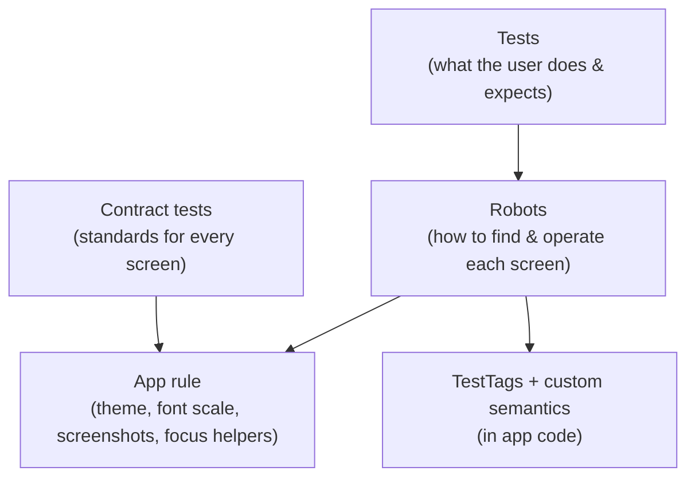
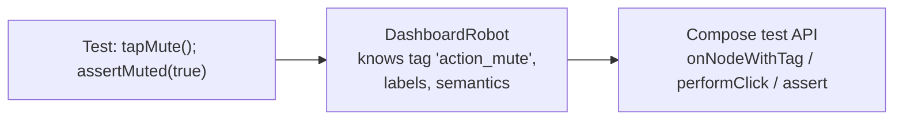
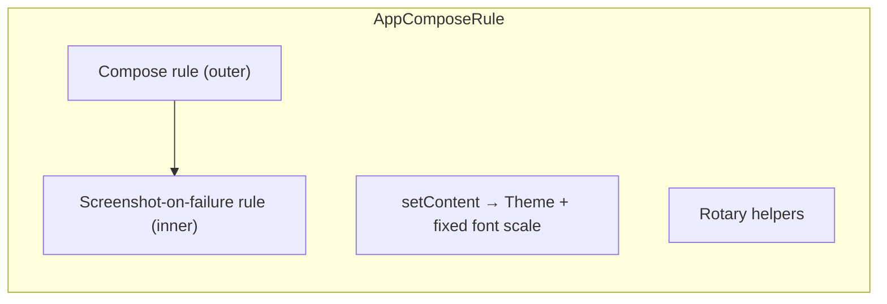
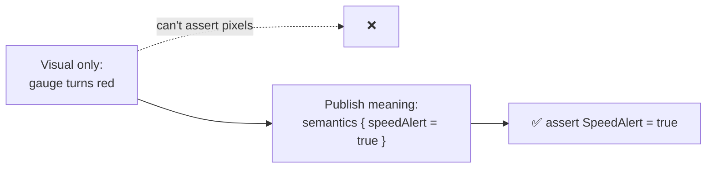
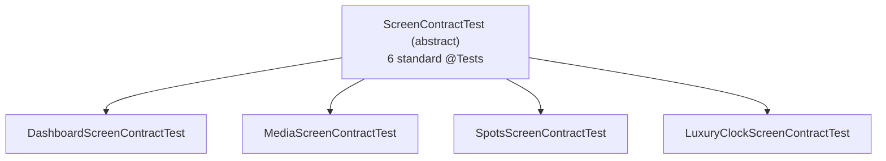

# 7 · Patterns That Scale

Ten tests are easy. With a hundred, three problems appear:

| Problem | Symptom | Pattern that fixes it |
|---|---|---|
| Selectors everywhere | Renaming one tag breaks 30 tests | **Test tags object** + **robots** |
| Copy-pasted setup | Every class repeats theme, font scale and screenshot setup | **One custom rule** |
| Forgotten standards | A new screen ships an unlabelled 40dp button | **Contract tests** |
| Visual-only state | "Is the gauge red?" can't be asserted | **Custom semantics** |
| Hard-to-debug failures | "Node not found", but what was on screen? | **Screenshot on failure** |

This project implements all five. Use them as templates (see also
[COMPOSE_TEST_STANDARD.md](../COMPOSE_TEST_STANDARD.md) and `doc/templates/`).



---

## 7.1 Keep all test tags in one object

```kotlin
// app/src/main/.../ui/components/TestTags.kt   (MAIN source set, used by app AND tests)
object TestTags {
    const val ACTION_MUTE = "action_mute"
    const val SPEED_VALUE = "speed_value"
    fun spotCard(id: String) = "spot_card_$id"          // dynamic tags for list items
}

// app code
GlowButton(..., modifier = Modifier.testTag(TestTags.ACTION_MUTE))
// test code
rule.onNodeWithTag(TestTags.ACTION_MUTE)
```

No typos, rename-safe, and you can see at a glance what is testable.

---

## 7.2 Robots: hide the *how*, show the *what*

A **robot** (also called a screen object) is a class per screen that knows the tags and gestures,
so tests read like user stories:

```kotlin
// Without a robot
rule.onNodeWithTag("action_mute").performClick()
rule.onNodeWithTag("action_mute").assert(hasContentDescription("Unmute audio"))
rule.onNodeWithTag("action_mute").assert(hasStateDescription("Muted"))
rule.onNodeWithTag("action_mute").assert(SemanticsMatcher.expectValue(DashSemantics.GlowActive, true))

// With a robot
rule.dashboard {
    tapMute()
    assertMuted(true)
}
```

How to write one:

```kotlin
class DashboardRobot(private val rule: ComposeContentTestRule) {

    fun launch(actions: DashboardActions = DashboardActions(), state: @Composable () -> DashboardUiState) {
        rule.setContent { DashboardScreen(state(), actions) }
    }

    // Verbs: one per user action
    fun tapMute() = rule.onNodeWithTag(TestTags.ACTION_MUTE).performClick()

    // Checks: each verifies EVERYTHING about one state
    fun assertMuted(muted: Boolean) {
        val node = rule.onNodeWithTag(TestTags.ACTION_MUTE)
        node.assert(hasContentDescription(if (muted) "Unmute audio" else "Mute audio"))
        node.assert(hasStateDescription(if (muted) "Muted" else "Sound on"))
    }
}

// Small DSL entry point
fun ComposeContentTestRule.dashboard(block: DashboardRobot.() -> Unit) {
    DashboardRobot(this).block()
}
```



Rules of thumb:
- Tests never call `onNodeWithTag` directly; only robots do.
- Name verbs after user intent (`tapMute`, `selectCategory`, `dragProgressTo`), not implementation.
- One `assertX` per *state*, checking every aspect of it.

*(Project robots: `androidTest/.../robots/`; shared base: `testing/BaseRobot.kt`.)*

---

## 7.3 One custom rule for every test class

Instead of repeating setup in each class, wrap `createComposeRule()` once:

```kotlin
@get:Rule
val rule = piDashComposeRule()
```

In this project that single rule:
1. Wraps content in the app theme.
2. Pins font scale to 1.0 (device settings can't break tests).
3. Saves a **screenshot when a test fails**.
4. Provides `enableRotaryInput()` and `rotate(n)` for focus tests.



*(Source: `testing/AppComposeRule.kt`, `testing/Screenshots.kt`.)*

Screenshot-on-failure in a nutshell:

```kotlin
class ScreenshotOnFailureRule(private val compose: ComposeContentTestRule) : TestWatcher() {
    override fun failed(e: Throwable, d: Description) {
        val bitmap = compose.onRoot().captureToImage().asAndroidBitmap()
        TestStorage().openOutputFile("screenshots/${d.testClass.simpleName}_${d.methodName}.png")
            .use { bitmap.compress(Bitmap.CompressFormat.PNG, 100, it) }
    }
}
```

It must run *inside* the Compose rule (`RuleChain.outerRule(compose).around(screenshot)`), so the
UI still exists when the failure is reported.

---

## 7.4 Custom semantics: make visual state testable

The speed gauge is drawn on a `Canvas`. Its red "over the limit" colour is pixels, which a test
can't read. Solution: **publish the meaning** as a semantics property.

```kotlin
// 1. Declare a key (app code)
object DashSemantics {
    val SpeedAlert = SemanticsPropertyKey<Boolean>("SpeedAlert")
}
var SemanticsPropertyReceiver.speedAlert by DashSemantics.SpeedAlert

// 2. Set it where the visual is drawn
NeonArcGauge(modifier = Modifier.semantics { speedAlert = trip.isSpeeding })

// 3. Assert it in the test
rule.onNodeWithTag(TestTags.SPEED_GAUGE)
    .assert(SemanticsMatcher.expectValue(DashSemantics.SpeedAlert, true))
```



Use the same idea for anything visual that carries meaning: focus rings, "active" glows,
animation progress.

---

## 7.5 Contract tests: standards for every screen, for free

Some checks apply to **every** screen: it renders in both themes, every button has a label,
every touch target is big enough, keyboard focus reaches every control. Write them once in an
abstract base class:

```kotlin
abstract class ScreenContractTest {
    @get:Rule val rule = createComposeRule()
    @Composable abstract fun Content()                         // each screen fills this in

    @Test fun contract_clickablesHaveAccessibleLabels() {
        rule.setContent { Content() }
        rule.onAllNodes(hasClickAction()).fetchSemanticsNodes().forEach { node ->
            val label = node.config.getOrNull(SemanticsProperties.ContentDescription)
                ?: node.config.getOrNull(SemanticsProperties.Text)
            assertTrue("Unlabelled control at ${node.boundsInRoot}", !label.isNullOrEmpty())
        }
    }

    @Test fun contract_clickablesMeetTouchTarget() {
        rule.setContent { Content() }
        val minPx = with(rule.density) { 48.dp.toPx() }
        rule.onAllNodes(hasClickAction()).fetchSemanticsNodes().forEach { node ->
            assertTrue("Too small: ${node.size}", node.size.width >= minPx && node.size.height >= minPx)
        }
    }
}

// Each screen: 3 lines → all standard tests
class SettingsScreenContractTest : ScreenContractTest() {
    @Composable override fun Content() = SettingsScreen(sampleState, onBack = {})
}
```



Because the checks look at **all** clickable nodes, a button added next month is checked
automatically. This project's version also saves screenshots of each screen in dark, light and
large-font mode. A deliberately bad screen (32dp, unlabelled, unfocusable button) failed 4 of the 6
contract tests, as intended.

---

## 7.6 Shared test data

Put representative data in one place:

```kotlin
object TestData {
    val track = MockMediaCatalog.tracks.first()
    val clearWeather = Weather(30, WeatherCondition.CLEAR, "Nha Trang", 55)
    val dashboard = DashboardUiState(trip = TripData(speedKmh = 72), weather = clearWeather)
}
```

---

## 7.7 What a test looks like with all patterns applied

```kotlin
@RunWith(AndroidJUnit4::class)
class DashboardScreenTest {

    @get:Rule
    val rule = piDashComposeRule()                       // theme + font + screenshots + rotary

    @Test
    fun muteAndTheme_toggled_reflectNewSettingsState() = rule.dashboard {
        // Given
        var settings by mutableStateOf(SystemSettings(isDarkTheme = true, isMuted = false))
        launch(DashboardActions(
            onToggleMute = { settings = settings.copy(isMuted = !settings.isMuted) },
            onToggleTheme = { settings = settings.copy(isDarkTheme = !settings.isDarkTheme) },
        )) { TestData.dashboard.copy(settings = settings) }

        // When
        tapMute()
        tapTheme()

        // Then
        assertMuted(true)
        assertDarkTheme(false)
    }
}
```

Short, readable, and resilient to UI changes.

---

### 🏋️ Exercises

1. Write a `SettingsRobot` with `toggleNotifications()` and `assertNotificationsOn(Boolean)`.
2. Add a contract test class for one of your screens and see which standards it violates.
3. Expose a custom semantics property `IsLoading` on a progress view and assert it in a test.

Next: [8 · Running tests and reports →](08-running-and-reports.md)
