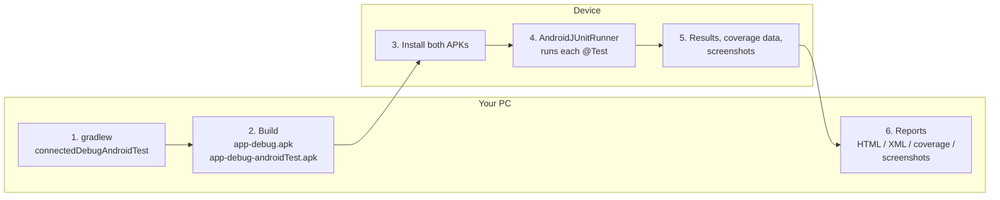
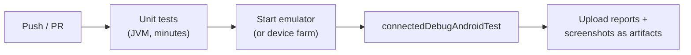

# 8 · Running Tests and Reading Reports

## 8.1 The whole pipeline



---

## 8.2 Ways to run

### From Android Studio

| What to run | How |
|---|---|
| One test | ▶ in the gutter next to the `@Test` method |
| One class | ▶ next to the class name |
| All UI tests | Right-click `app/src/androidTest/java` → *Run 'Tests in …'* |
| Re-run failed only | *Run* panel → "Rerun Failed Tests" button |
| Debug (breakpoints) | 🐞 instead of ▶ |

### From the terminal (Gradle)

```powershell
# All UI tests on the connected device
.\gradlew :app:connectedDebugAndroidTest

# One class
.\gradlew :app:connectedDebugAndroidTest "-Pandroid.testInstrumentationRunnerArguments.class=com.pidash.companion.DashboardScreenTest"

# One method
.\gradlew :app:connectedDebugAndroidTest "-Pandroid.testInstrumentationRunnerArguments.class=com.pidash.companion.DashboardScreenTest#speedometer_overSpeedLimit_raisesAlert"

# Several classes
.\gradlew :app:connectedDebugAndroidTest "-Pandroid.testInstrumentationRunnerArguments.class=com.pidash.companion.LuxuryClockTest,com.pidash.companion.LuxuryClockScreenContractTest"

# A whole package
.\gradlew :app:connectedDebugAndroidTest "-Pandroid.testInstrumentationRunnerArguments.package=com.pidash.companion"

# Local unit tests (no device, fast)
.\gradlew :app:testDebugUnitTest
```

> **PowerShell tip:** keep the quotes around `-P…=…` arguments.
> **Several devices?** Set `$env:ANDROID_SERIAL = "<serial>"` first.

### Directly with adb (APKs already installed)

```powershell
.\gradlew :app:installDebug :app:installDebugAndroidTest
adb shell am instrument -w -e class com.pidash.companion.DashboardScreenTest `
    com.pidash.companion.test/androidx.test.runner.AndroidJUnitRunner
# → OK (6 tests)
```

Useful for quick re-runs and scripting. It produces no HTML report; output goes to the terminal.

---

## 8.3 Reading the reports

| Report | Path | Open with |
|---|---|---|
| UI test results | `app/build/reports/androidTests/connected/debug/index.html` | Browser |
| UI test raw XML (for CI) | `app/build/outputs/androidTest-results/connected/debug/*.xml` | CI tools |
| Unit test results | `app/build/reports/tests/testDebugUnitTest/index.html` | Browser |
| Failure screenshots | `app/build/outputs/connected_android_test_additional_output/debugAndroidTest/connected/<device>/screenshots/` | Image viewer |
| Screen gallery (contract tests) | `…/connected/<device>/screens/` | Image viewer |
| Merged code coverage | `app/build/reports/coverage/merged/html/index.html` | Browser |

```powershell
start app\build\reports\androidTests\connected\debug\index.html
```

> Opening `index.html` inside VS Code shows the raw HTML. Open it in a **browser** instead.

The HTML report has three levels: **summary** (counts, success rate, duration) → **class** →
**test** (stack trace and logcat for failures).

---

## 8.4 Code coverage

Coverage shows which lines of app code your tests executed. Enable it for debug builds:

```kotlin
android {
    buildTypes {
        debug {
            enableUnitTestCoverage = true
            enableAndroidTestCoverage = true
        }
    }
}
```

```powershell
.\gradlew :app:createDebugAndroidTestCoverageReport    # UI tests only
.\gradlew :app:createDebugUnitTestCoverageReport       # unit tests only
.\gradlew :app:jacocoMergedReport                      # this project: both merged
```

Unit tests mostly cover ViewModels and logic, and UI tests mostly cover composables, so only a
**merged** report shows the full picture. This project's merged baseline was **83 % of lines**.
(Setup details: [HOW_TO_RUN_TESTS.md §5](../HOW_TO_RUN_TESTS.md).)

---

## 8.5 Running in CI (outline)



Typical CI steps:
1. `./gradlew testDebugUnitTest` (fast gate).
2. Start an emulator (for example with a GitHub Actions Android emulator action), or use a device farm.
3. `./gradlew connectedDebugAndroidTest`.
4. Always upload `app/build/reports/` and `app/build/outputs/connected_android_test_additional_output/`,
   especially when tests fail.

---

## 8.6 Good habits

| Habit | Why |
|---|---|
| Run the single test you're working on, then the whole class, then everything | Fast feedback |
| Run the full suite before pushing | Catches side effects |
| A test that fails *sometimes* is a bug | Usually missing synchronisation (chapter 5) or shared state |
| Never use `Thread.sleep` | Slow and still flaky; use `waitUntil` / `runOnIdle` |
| Keep the device awake and unlocked | A locked screen can make tests fail |
| `connectedDebugAndroidTest` uninstalls the app | Run `installDebug` afterwards if you need it |

Next: [9 · Troubleshooting →](09-troubleshooting.md)
