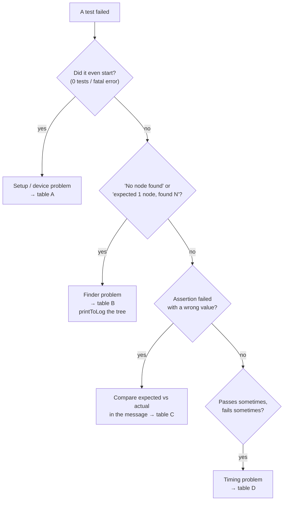

# 9 · Troubleshooting

Real problems, most of them met while building this project, with causes and fixes.

## Diagnose in this order



First, always:
1. Read the **whole** failure message: it prints the node's actual semantics.
2. Look at the **failure screenshot** if your setup saves one (chapter 7).
3. Print the tree: `rule.onRoot().printToLog("DEBUG")` (and with `useUnmergedTree = true`).

---

## A · Setup and device problems

| Symptom | Cause | Fix |
|---|---|---|
| Every test fails with `NoSuchMethodException: android.hardware.input.InputManager.getInstance` | Espresso older than 3.7 on Android 16 | `androidTestImplementation("androidx.test.espresso:espresso-core:3.7.0")` |
| `No connected devices!` | Device disconnected / wireless debugging port changed | `adb connect <ip:port>`, `adb devices` |
| `More than one device` | Several devices/emulators | `$env:ANDROID_SERIAL = "<serial>"` |
| `Unable to resolve activity for Intent … ComponentActivity` | `ui-test-manifest` missing, or testing a **release** build | `debugImplementation("androidx.compose.ui:ui-test-manifest")`; run the `debug` variant |
| `Test execution failed with fatal error! Finished 0 tests` | Instrumentation crashed on start (seen once right after `clean`) | Re-run; check `adb logcat -b crash` |
| Build error "requires compileSdk 37" | Newer libraries need a newer SDK | Install the SDK platform; raise `compileSdk` |
| `NoSuchMethodError` / `ClassNotFoundException` at runtime | App APK and test APK from different code versions | Re-install **both** (`installDebug installDebugAndroidTest`) |
| App gone after tests | `connectedDebugAndroidTest` uninstalls it | `.\gradlew :app:installDebug` |

## B · "Node not found" / wrong number of nodes

| Symptom | Cause | Fix |
|---|---|---|
| `No node found that matches TestTag = 'x'` | Tag not set, or set on a different element | Add `Modifier.testTag("x")` to the right composable; check spelling (use a `TestTags` object) |
| Tag exists but not found inside a button/card | Children are **merged** into the clickable parent | `onNodeWithTag("x", useUnmergedTree = true)` |
| List item not found | `LazyColumn` hasn't composed it (off-screen) | `onNodeWithTag("list").performScrollToNode(hasTestTag("item_42"))` |
| `Expected exactly '1' node but found '2'` | Matcher too broad (e.g. same text twice) | Use a tag, or combine matchers (`hasText("OK") and hasClickAction()`) |
| Node found, wrong one asserted | `testTag` placed *after* `clearAndSetSemantics` in the modifier chain | Put the test tag on a wrapper node, or before `clearAndSetSemantics` |
| Node in a dialog/popup not found | Usually fine (dialogs are searched) unless it isn't open yet | Make sure the action that opens it ran; `waitUntil` if it opens asynchronously |

## C · Assertion failed with a wrong value

| Symptom | Cause | Fix |
|---|---|---|
| Text differs only in case (`HOME` vs `Home`) | UI uppercases labels | Assert the displayed text, or assert by tag + content description |
| Texts truncated / layout differs only on one device | Device font scale (the test Pi uses 1.8×) or locale | Pin font scale in tests (chapter 5.6) |
| `assertIsDisplayed` fails but node exists | Off-screen, zero size, or hidden behind clipping | Scroll to it; check its size; use `assertExists` if visibility isn't the point |
| `assertTextEquals` fails on a node with several texts | Merged node has multiple text values | `assertTextEquals("10:09", "SAT 31 OCT")` with all values, or `assertTextContains` |
| `requestFocus()` / `assertIsFocused` fails | Touch input mode: clickables aren't focusable | Switch to keyboard mode first (chapter 5.5) |
| Value from a callback is `null` | Callback arrives after the gesture (coroutine) | Read it inside `rule.runOnIdle { … }` |
| Drag/swipe does nothing | Gesture started at the very edge, or too short | Start inside the component (`left + width * 0.05f`); use `durationMillis` |
| Mock state never shown in UI | Reading `viewModel.uiState.value` once in `setContent` | Use `collectAsState()` inside `setContent` |

## D · Flaky tests (pass sometimes)

| Symptom | Cause | Fix |
|---|---|---|
| Fails at random with timing-related values | Real clocks/timers (`delay` loops, `System.currentTimeMillis`) | Inject a time source; freeze it in tests (chapter 5.4) |
| Data sometimes not loaded yet | Background work Compose can't see | Fakes instead of real data; or `waitUntil` / `IdlingResource` |
| Order-dependent failures | Shared mutable state between tests (singletons) | Create fresh state per test; avoid static mutable data |
| `Thread.sleep` "fixes" it | Hides a synchronisation bug | Remove the sleep; fix synchronisation |

## E · Tooling quirks

| Symptom | Cause | Fix |
|---|---|---|
| `uiautomator dump` fails ("could not get idle state") | Continuous animations never let UI Automator idle | Not a Compose-test issue: Compose tests ignore infinite animations. For adb tools, tap by coordinates |
| Mermaid diagrams show as code | Viewer lacks Mermaid support | VS Code extension *Markdown Preview Mermaid Support*, or view on GitHub |
| Deprecation warning on `createComposeRule` | Newer Compose recommends the `junit4.v2` rule | Safe to keep; migrate later in one place if you use a custom rule |

---

## Debugging snippets

```kotlin
// What does the test see?
rule.onRoot().printToLog("DEBUG")
rule.onRoot(useUnmergedTree = true).printToLog("DEBUG")

// Everything about one node
rule.onNodeWithTag("x").printToLog("DEBUG")

// Inspect all clickables
rule.onAllNodes(hasClickAction()).fetchSemanticsNodes().forEach {
    Log.d("DEBUG", "${it.config} @ ${it.boundsInRoot}")
}

// Pause to look at the device (debugging only, never commit this)
Thread.sleep(10_000)
```

Filter Logcat by the tag (`DEBUG`) in Android Studio, or run `adb logcat -s DEBUG`.

Next: [10 · Failures detected and prevented →](10-failures-detected-and-prevented.md) · [Guide index](README.md) · [Cheat sheet](cheat-sheet.md)
