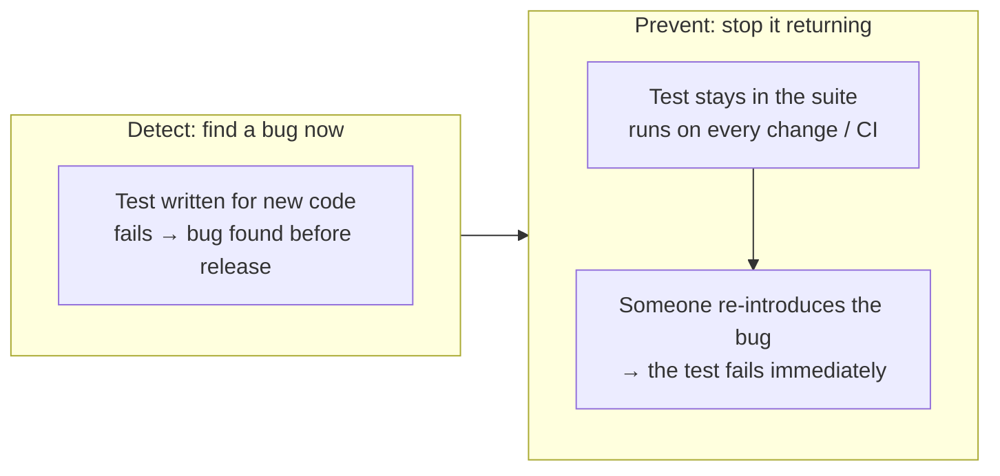
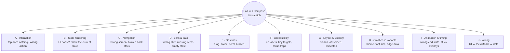
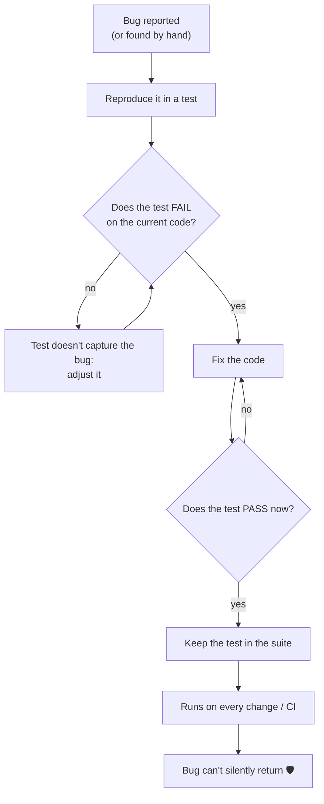
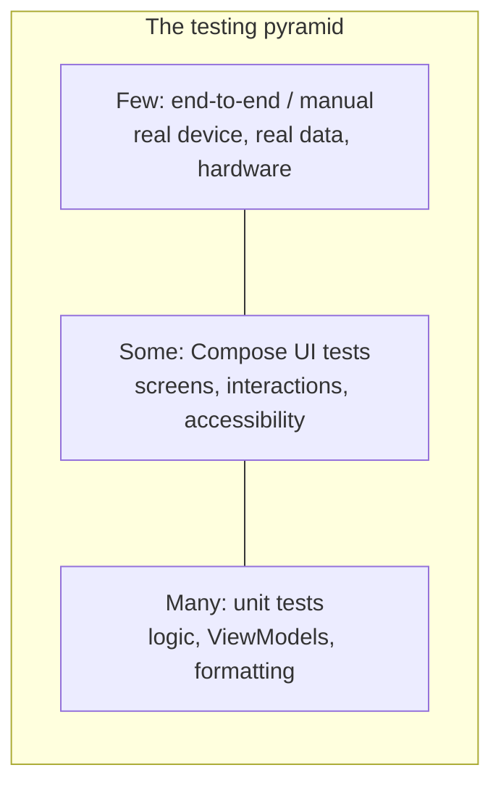

# 10 · What Failures Compose Tests Detect and Prevent

Chapters 1 to 9 explained *how* to write Compose tests. This chapter explains *why*: which kinds of
bugs they catch, how each one is caught, and how a test keeps a fixed bug from coming back.



---

## 10.1 The failure catalogue



---

### A · Interaction failures: "I tapped it and nothing happened"

| Failure | Example | How the test catches it |
|---|---|---|
| Button not wired | `onClick = {}` left over from a prototype | `performClick()` then assert the callback ran |
| Wrong action fired | *SOS* calls `navigateHome()` | Record callbacks in a list, compare with the expected list |
| Fired twice / wrong order | Double callback on one tap | `assertEquals(listOf("home", "sos", …), calls)` |
| Disabled when it shouldn't be | Button greyed out after a refactor | `assertIsEnabled()` |
| Tap falls through an overlay | Tapping the clock overlay presses a dashboard button underneath | Tap the overlay, assert no dashboard callback ran |

```kotlin
// DashboardScreenTest.controls_tapped_invokeMatchingCallbacksInOrder
assertEquals(listOf("home", "sos", "mute", "theme", "stop:COFFEE"), calls)
```

---

### B · State-rendering failures: "the data changed but the screen didn't"

| Failure | Example | How the test catches it |
|---|---|---|
| UI ignores state updates | Speed stays at 0 while state says 88 | Change `mutableStateOf`, assert the new text |
| Wrong formatting | `65_000 ms` shown as `65:00` instead of `1:05` | `assertTextEquals("1:05")` |
| Toggle shows the wrong state | Muted, but icon still says "Mute" | `assert(hasStateDescription("Muted"))` |
| Wrong conditional UI | No "over limit" alert at 97 km/h in an 80 zone | Custom semantics `SpeedAlert = true` |
| Missing loading/empty states | Null weather crashes or shows blank | Render with `weather = null`, assert "Weather unavailable" |

```kotlin
// DashboardScreenTest.speedometer_overSpeedLimit_raisesAlert
state = state.copy(trip = TripData(speedKmh = 97, speedLimitKmh = 80))
assertSpeedAlert(true)
```

---

### C · Navigation failures: "I can't get back" / "wrong screen"

| Failure | Example | How the test catches it |
|---|---|---|
| Back stack corrupted | After a certain sequence, the rail stops working | Drive the real `NavController`, assert the back stack |
| Wrong argument passed | *Coffee* quick stop opens Spots with all categories | Assert the `SpotsViewModel` pre-selects `COFFEE` |
| Wrong destination | *Media* rail item opens Spots | Assert the destination's content is displayed |

> **Real case in this project.** We first noticed the rail freezing by hand on the device: after
> *Media → Drive → Coffee quick stop → Go*, tapping *Drive* did nothing. The cause was the
> navigation options restoring the stack that had just been removed. We then wrote
> `NavigationTest`, ran it against the **old** code to confirm it **fails**, and kept it after the
> fix. That bug can no longer come back without the build turning red.

---

### D · List and data failures

| Failure | Example | How the test catches it |
|---|---|---|
| Filter returns wrong items | *Coffee* chip still shows gas stations | Collect rendered tags with a prefix matcher, check every one |
| Items unreachable | Last spot can't be scrolled to | `performScrollToNode(...)` then `assertIsDisplayed()` |
| Wrong sort order | Farthest spot first | Compare ViewModel output order with the expected order |
| Missing empty state | Empty category shows a blank list | `assertEmptyState()` |
| Selection state wrong | Two chips selected at once | `assertIsSelected()` / `assertIsNotSelected()` for all chips |

---

### E · Gesture failures

| Failure | Example | How the test catches it |
|---|---|---|
| Drag doesn't seek | Slider moves but playback position doesn't change | `swipeRight(...)`, assert the seek callback ≈ 0.5 |
| Tap-to-seek wrong | Tapping at 80 % seeks to 20 % | `click(percentOffset(0.8f, 0.5f))`, assert ≈ 0.8 |
| Page swipe broken | Swipe up doesn't change the clock | `swipeUp()`, assert the page tag and "Clock 2 of 3" |
| Swipe back broken | Swipe down skips a page | `swipeDown()`, assert the previous page |

---

### F · Accessibility failures: the ones people rarely test by hand

| Failure | Example | How the test catches it |
|---|---|---|
| Icon-only button without a label | Close "✕" unreadable by TalkBack | Contract test: every clickable has a description or text |
| Touch target too small | 32dp button on a car screen (standard: 64dp) | Contract test: every clickable ≥ minimum size |
| Control unreachable by D-pad / rotary knob | A button that can never get focus | Contract test: focus traversal visits every clickable |
| State not announced | Toggle has no state description | `assert(hasStateDescription(...))` |
| Selection not announced | Chips without the selected property | `assertIsSelected()` |

> **Real case in this project.** To prove the contract tests work, we ran them on a deliberately bad
> screen with one 32dp, unlabelled, unfocusable button. **4 of the 6 contract tests failed**, with
> messages naming the exact element and its bounds; the good button passed. Every screen now
> inherits these checks automatically, so a careless new button fails the build.

---

### G · Layout and visibility failures

| Failure | Example | How the test catches it |
|---|---|---|
| Critical control missing | Mute button removed by a layout change | `assertIsDisplayed()` on every critical control |
| Pushed off-screen | Larger font pushes SOS out of view | `assertIsDisplayed()` (checks visible bounds), contract test at max font size |
| Wrong size | Overlay doesn't cover the full screen | Compare node size with the root size |
| Text truncated | Location name cut off | `GetTextLayoutResult` → `hasVisualOverflow` (see [capabilities](../COMPOSE_TEST_CAPABILITIES.md#32-detecting-truncated-text-)) |

---

### H · Crashes in variants and edge cases

A crash during composition fails the test immediately, so simply **rendering** a screen in each
variant is a valuable test.

| Failure | Example | How the test catches it |
|---|---|---|
| Crash in light theme | A colour token missing in the day palette | Contract: `contract_rendersInLightTheme` |
| Crash / broken layout at large font size | Text measurement assumption fails | Contract: `contract_rendersAtMaxFontScale` |
| Crash on edge data | `null` weather, empty list, zero duration | Render with that data; assert the fallback UI |
| Crash with long text | Very long place name | Render with a long name; assert it's displayed |

---

### I · Animation and timing failures

| Failure | Example | How the test catches it |
|---|---|---|
| Animation ends in the wrong state | Reveal stops at 90 % | Manual clock: assert `RevealFraction == 1` after the duration |
| Animation doesn't start | Clock opens instantly or not at all | Assert a partial value mid-animation (`advanceTimeBy(250)`) |
| Overlay never removed | Closed clock still blocks touches | After close, `assertDoesNotExist()` |
| Animated value never settles on the target | Speed shows 87 instead of 88 | `assertTextEquals("88")` (the test waits for the end) |

---

### J · Wiring failures between layers

| Failure | Example | How the test catches it |
|---|---|---|
| Event never reaches the ViewModel | Callback not passed to the screen | Real ViewModel + MockK: `verify { repository.play() }` |
| ViewModel update never reaches the UI | Screen reads `.value` once instead of collecting | Click, then assert the UI changed (fails without `collectAsState`) |
| Navigation argument ignored | `SavedStateHandle` key misspelled | Construct the ViewModel with the argument, assert the pre-selection |

---

## 10.2 How a fixed bug is prevented from returning

The most valuable habit: **every bug fix comes with a test that fails without the fix.**



| Step | Example (rail navigation bug) |
|---|---|
| Reproduce | Media → Drive → Coffee quick stop → Drive should show the Dashboard |
| Confirm it fails | Run against the old navigation code → ❌ "Dashboard is not displayed" |
| Fix | Remove `saveState`/`restoreState` from rail navigation |
| Confirm it passes | ✅ |
| Keep | `NavigationTest.railReturnsToDashboard_afterQuickStopOpenedSpots` |

---

## 10.3 Where Compose tests sit among other safeguards



| Layer | Catches best | Misses |
|---|---|---|
| Unit tests | Calculation, sorting, state logic | Anything on screen |
| **Compose UI tests** | Categories A–J above | Pixel looks, other apps, real hardware |
| Screenshot tests | Colour, spacing, visual regressions | Behaviour |
| Manual / end-to-end | Real audio, real maps app, performance, feel | Repetitive regressions (people forget) |

### What Compose tests will NOT catch

To keep expectations honest (full list: [COMPOSE_TEST_CAPABILITIES.md](../COMPOSE_TEST_CAPABILITIES.md)):

| Not caught | Example from this project | Caught instead by |
|---|---|---|
| Wrong colour / ugly layout | Gauge glow too bright | Screenshot review (the contract gallery), screenshot tests |
| Real system effects | Mute actually silencing the speaker | Manual check with `dumpsys audio` |
| Other apps | Maps app not installed | Manual check (we show a snackbar) |
| Performance | 89 % janky frames on the rectangular clock | Measured with `dumpsys gfxinfo`; fixed with GPU layer caching |
| Bugs in code the tests don't exercise | — | Coverage report shows the gaps |

---

## 10.4 Checklist: which tests should a new screen have?

| ✔ | Test | Catches |
|---|---|---|
| ☐ | Contract test (3 lines) | F, H, parts of G |
| ☐ | Renders correctly for the main states (loading / data / empty / error) | B, H |
| ☐ | Each control fires the right callback | A |
| ☐ | Each state change updates the UI | B |
| ☐ | Gestures (drag, swipe, scroll) produce the right result | E |
| ☐ | One test with the real ViewModel for the main flow | J |
| ☐ | Navigation in and out | C |
| ☐ | A regression test for every bug fixed | prevents all of the above returning |

---

### ✅ Check your understanding

1. A designer changes the SOS button to 40dp. Which test fails, and why is that good?
2. You fix a bug where the Spots list showed nothing for *Food*. What should you do before
   merging the fix?
3. Can a Compose test tell you the speed gauge became the wrong shade of red?

<details><summary>Answers</summary>

1. The contract test `contract_clickablesMeetMinimumTouchTarget`. The automotive standard (64dp)
   is enforced automatically, before drivers ever see it.
2. Write a test that selects *Food* and asserts the food cards appear, confirm it **fails** without
   your fix, then keep it.
3. Not by colour. It can check the *meaning* (`SpeedAlert = true`); the exact shade needs a
   screenshot test or a human.
</details>

Back to: [Guide index](README.md) · Previous: [9 · Troubleshooting](09-troubleshooting.md)
