# Compose UI Testing: A Beginner's Guide

A step-by-step course for developers who have **never written a Jetpack Compose UI test**.
By the end you will be able to make your screens testable, write tests that click, type, swipe
and check your UI, run them on a device or emulator, and read the results.

The examples are generic, so you can apply them to **your own app**. Each one is also linked to
real, working code in this project (Pi-Dash), so you can open a real file and see it run.

> **Viewing the diagrams:** they use [Mermaid](https://mermaid.js.org/). They render on
> GitHub/GitLab. In VS Code, install the *Markdown Preview Mermaid Support* extension and open the
> preview with `Ctrl+Shift+V`.

## Learning path

```mermaid
flowchart LR
    A["1 · Concepts<br/>what a Compose test is"] --> B["2 · Setup<br/>dependencies & folders"]
    B --> C["3 · First test<br/>write · run · read"]
    C --> D["4 · Finders, actions,<br/>assertions"]
    D --> E["5 · State, timing,<br/>animations"]
    E --> F["6 · ViewModels &<br/>navigation"]
    F --> G["7 · Patterns that scale<br/>robots, contracts"]
    G --> H["8 · Running, reports,<br/>coverage, CI"]
    H --> I["9 · Troubleshooting"]
    I --> J["10 · Failures detected<br/>& prevented"]
```



| # | Chapter | You will learn | Time |
|---|---|---|---|
| 1 | [Concepts](01-concepts.md) | Where tests run, the semantics tree, the find → act → assert loop | 20 min |
| 2 | [Setup](02-setup.md) | Gradle dependencies, folder layout, device connection | 20 min |
| 3 | [Your first test](03-first-test.md) | Make a composable testable, write a test, run it, read the result, debug it | 45 min |
| 4 | [Finders, actions, assertions](04-finders-actions-assertions.md) | The complete toolbox, with examples and a cheat sheet | 45 min |
| 5 | [State, timing and animations](05-state-timing-animations.md) | How tests wait, controlling time, async pitfalls | 40 min |
| 6 | [ViewModels and navigation](06-viewmodels-and-navigation.md) | Testing screens with real ViewModels, fakes, MockK, NavHost | 40 min |
| 7 | [Patterns that scale](07-patterns-that-scale.md) | Test tags, robots, custom semantics, contract tests, screenshots | 40 min |
| 8 | [Running tests and reports](08-running-and-reports.md) | Gradle, Android Studio and adb; reports, coverage, CI | 30 min |
| 9 | [Troubleshooting](09-troubleshooting.md) | Real errors and how to fix them | reference |
| 10 | [Failures detected & prevented](10-failures-detected-and-prevented.md) | Which bugs Compose tests catch (10 categories), real cases from this project, regression-test workflow, what they can't catch | 30 min |
| — | [Cheat sheet](cheat-sheet.md) | One page with the most-used APIs | reference |

## Prerequisites

- Basic Kotlin (functions, lambdas, classes) and basic Jetpack Compose (`@Composable`,
  `Modifier`, `remember`, `mutableStateOf`).
- Android Studio, or the Android SDK + JDK 17 or newer.
- A device or emulator. This project uses a Raspberry Pi 4 running Android 16; any phone or
  emulator works the same way.

## The one-minute version

```kotlin
class GreetingTest {
    @get:Rule val rule = createComposeRule()                  // 1. a rule that hosts Compose

    @Test fun button_click_showsGreeting() {
        rule.setContent { GreetingScreen() }                  // 2. put your UI on screen
        rule.onNodeWithText("Say hello").performClick()      // 3. find + act
        rule.onNodeWithText("Hello, driver!").assertIsDisplayed() // 4. assert
    }
}
```

```powershell
.\gradlew :app:connectedDebugAndroidTest      # 5. run on the connected device
```

Every chapter below explains one part of these lines in depth.

## Where to look in this project

| What | File |
|---|---|
| Simple screen tests | `app/src/androidTest/.../DashboardScreenTest.kt` |
| Gestures (drag, tap at position) | `app/src/androidTest/.../MediaCompanionTest.kt` |
| Lists, filtering, scrolling | `app/src/androidTest/.../FavoriteSpotsTest.kt` |
| Focus / keyboard / rotary | `app/src/androidTest/.../AccessibilitySemanticsTest.kt` |
| Animation timing, swipes between pages | `app/src/androidTest/.../LuxuryClockTest.kt` |
| Navigation | `app/src/androidTest/.../NavigationTest.kt` |
| Reusable framework (rule, robots, contracts) | `app/src/androidTest/.../testing/` |

Related project docs: [How Compose testing works (mechanism)](../HOW_COMPOSE_TESTING_WORKS.md),
[What it can and cannot test](../COMPOSE_TEST_CAPABILITIES.md),
[Project test standard](../COMPOSE_TEST_STANDARD.md), [How to run tests](../HOW_TO_RUN_TESTS.md).
