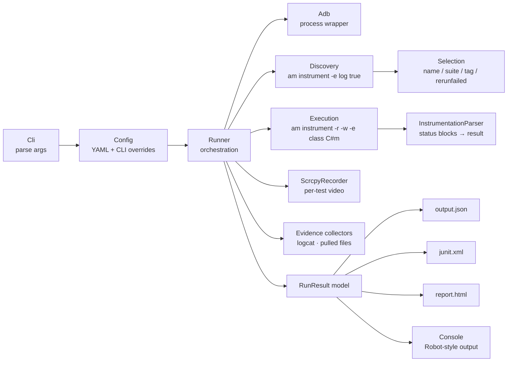
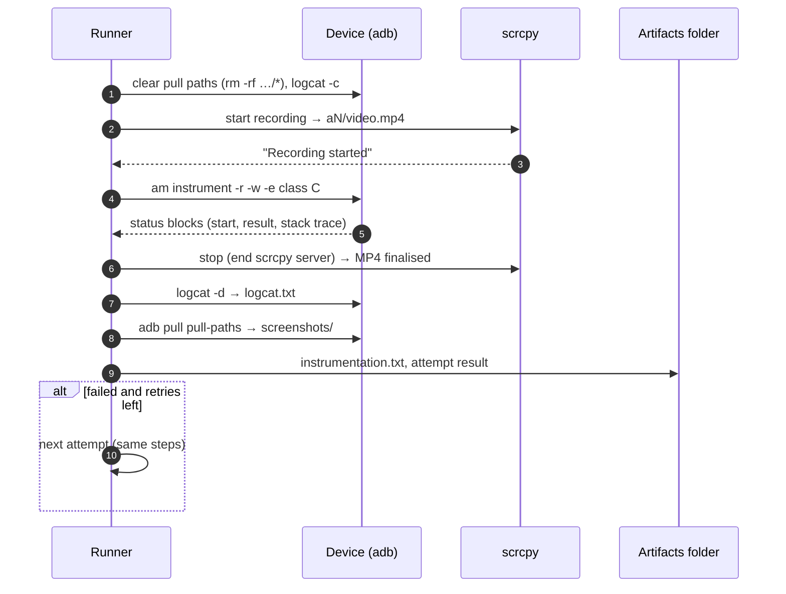
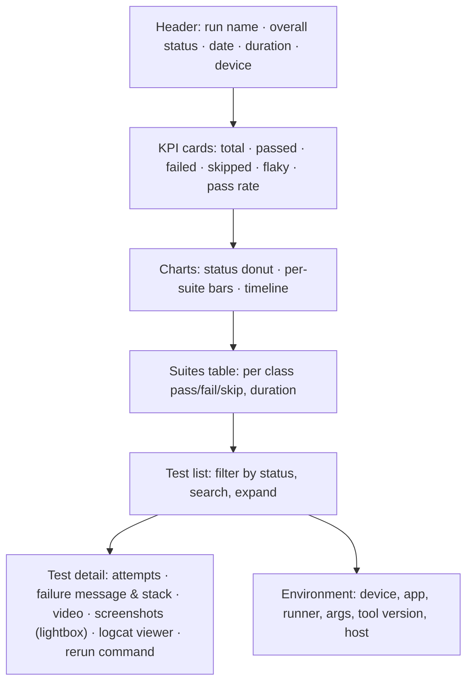

# ATR — Android Test Runner: Design

**ATR** is a standalone command-line runner for Android instrumented tests (Compose UI tests,
Espresso, plain AndroidJUnit). It runs tests **one test case at a time**, records **evidence per
test** (video, screenshots, logcat, raw instrumentation output) and produces a **professional,
self-contained HTML report**, plus machine-readable JSON and JUnit XML. The command-line style
mirrors Robot Framework (`--test`, `--suite`, `--include`, `--exclude`, `--rerunfailed`).

## 1. Goals and non-goals

| Goals | Non-goals (v1) |
|---|---|
| Run any instrumented test APK against any app, no changes to the app required | Building APKs (Gradle stays responsible) |
| Select tests like Robot Framework: by name, suite (class), tag (annotation), previous failures | Parallel execution across many devices (sharding) |
| One video, logcat and screenshot set **per test case and attempt** | Cloud device farms |
| Professional report: dashboard, suites, per-test detail with evidence, timeline | iOS |
| Retries with flaky-test detection | |
| CI-friendly: JUnit XML, JSON, exit code = number of failed tests | |
| Easy install: one zip, works on Windows / macOS / Linux with Java 17+ and adb | |

## 2. Context: why a custom runner

The Gradle runner (`connectedAndroidTest`) gives a basic report and no per-test video. Marathon
(open source, GPL-2.0) is a strong general-purpose runner, but in this project:

- its built-in recording uses `screenrecord`, which fails on devices without a hardware video
  encoder (Raspberry Pi: `Encoder failed (err=-38)`); its screenshot mode returned empty files;
- it has no hook to start/stop an external recorder per test, so we could only record the whole
  run and link time ranges;
- its report could not show our own screenshots without post-processing.

Because ATR runs **one test per `am instrument` invocation**, it knows exactly when every test
starts and ends, so it can wrap each test with an external recorder and collect evidence precisely.

## 3. Options considered

| Decision | Options | Choice | Why |
|---|---|---|---|
| **Language / runtime** | PowerShell script · Node.js · Python · Kotlin/JVM | **Kotlin/JVM CLI** | Android developers always have a JDK (Gradle needs one); cross-platform; typed; testable with JUnit; same language as the apps |
| **Packaging** | Gradle plugin · fat JAR · zip distribution | **Zip distribution** (`bin/atr`, `bin/atr.bat`, `lib/*.jar`) via Gradle `application` plugin | Runs on its own, like Marathon/Robot; independent of the app's AGP/Gradle versions; a Gradle plugin can wrap it later |
| **Test discovery** | Parse dex bytecode of the test APK · ask the device (`am instrument -e log true`) | **Ask the device** | Exact same view as AndroidJUnitRunner (handles filters, parameterised tests, custom runners); no dex parser |
| **Execution granularity** | One instrumentation for all tests · one per class · **one per test** | **One per test** | Clean per-test boundaries for video/logcat/screenshots; isolation (a crash affects one test); natural single-test reruns. Cost: ~1–2 s process start per test |
| **Video** | `screenrecord` on device · Marathon · **scrcpy on host** | **scrcpy per test** (optional) | Uses software encoders when no hardware encoder exists; starts *before* the test and stops after it, so no frames are lost; gracefully disabled when scrcpy is absent |
| **Tags** | Custom metadata files · **JUnit annotations** | **Annotations** via the runner's `annotation` / `notAnnotation` filters, with aliases in the config (`Smoke: com.app.Smoke`) | Standard Android mechanism, no extra tooling |
| **Report** | Static multi-page site · **single self-contained HTML** + artifact folder | **Single `report.html`** (inline CSS/JS, data embedded as JSON) | Opens offline from any folder or CI artifact; no server; artifacts linked by relative paths |
| **Config format** | CLI only · properties · JSON · **YAML** | **YAML file + CLI overrides** | Readable, comment-friendly, same convention as Marathon |
| **Results format** | **JSON** (`output.json`) + **JUnit XML** | both | JSON is the source of truth (report regeneration, `--rerunfailed`); JUnit XML for CI tools |

## 4. Architecture



| Component | Responsibility |
|---|---|
| `Cli` | Sub-commands `run`, `list`, `report`, `init`, `version`; option parsing; help |
| `Config` | Loads `atr.yml`, resolves relative paths against the config file, applies CLI overrides |
| `Adb` | Runs `adb` with timeouts, captures output; device info, install, shell, pull, logcat |
| `Discovery` | Lists tests through the runner itself (`-e log true`), honouring tag filters |
| `Selection` | Robot-like filtering: glob patterns (`*`, `?`), case-insensitive, on test and suite names; previous failures |
| `InstrumentationParser` | Parses `am instrument -r` output (multi-line values, status codes, crashes) |
| `ScrcpyRecorder` | Starts scrcpy recording, waits for "Recording started", stops it cleanly so the MP4 is finalised |
| `Runner` | Install → discover → select → for each test: prepare device, record, execute, collect, retry |
| `Reports` | JSON, JUnit XML, HTML (template + embedded data), console |

## 5. Execution flow per test



Status mapping (from AndroidJUnitRunner status codes):

| Code | Meaning | ATR status |
|---|---|---|
| `0` | OK | **PASS** |
| `-2` | Assertion / test failure | **FAIL** |
| `-1` | Error | **ERROR** |
| `-3` | Ignored | **SKIP** |
| `-4` | Assumption failure | **SKIP** |
| no result / process crash / timeout | — | **ERROR** |

A test that fails and then passes on retry is **PASS + flaky**.

## 6. Command-line interface

```text
atr run    [-c atr.yml] [selection] [execution options]
atr list   [-c atr.yml] [selection]                 # dry run: show what would run
atr report -I results/output.json [-d dir]          # regenerate report.html / junit.xml
atr init   [atr.yml]                                # write a commented config template
atr version

Selection (repeatable, combined like Robot Framework):
  -t, --test PATTERN       test name: method, Class#method or pkg.Class#method; * and ? allowed
  -s, --suite PATTERN      test class: simple or fully-qualified name; * and ? allowed
  -i, --include TAG        only tests with this tag (annotation alias or FQN)
  -e, --exclude TAG        skip tests with this tag
  -R, --rerunfailed FILE   only the tests that failed in a previous output.json

Execution:
      --serial SERIAL      device (default: config, else the only connected device)
      --retries N          extra attempts for failed tests
      --timeout SECONDS    per-test timeout
      --video MODE         always | on-failure | never
  -a, --arg KEY=VALUE      extra instrumentation argument (repeatable)
      --no-install         use APKs already on the device
  -d, --outputdir DIR      results folder
  -N, --name NAME          run name shown in the report
```

Exit code (as Robot Framework): `0` all passed, `1–250` number of failed tests, `252` invalid
usage, `255` unexpected error.

## 7. Outputs

```text
<outputdir>/
├── report.html            self-contained report (open in a browser)
├── output.json            full results (source for `atr report` and `--rerunfailed`)
├── junit.xml              CI format
└── artifacts/t<NNN>-<Class>-<method>/a<n>/   short names: Windows adb fails on paths > 260 chars
    ├── video.mp4          scrcpy recording of this attempt
    ├── logcat.txt
    ├── instrumentation.txt
    └── files/…            files pulled from the device (e.g. screenshots)
```

### Report layout



## 8. App integration contract (optional)

ATR works with any instrumented test APK. Apps can opt in to richer evidence:

| Feature | How |
|---|---|
| Screenshots in the report | Tests save images into a device folder listed in `artifacts.pullPaths` (Pi-Dash: `/sdcard/Android/data/<app>/files/test-screenshots`) |
| Behaviour switches | Any `instrumentationArgs` (Pi-Dash: `evidenceScreenshots`, `observeStepMs`, `observeHoldMs`) |
| Tags | JUnit annotations on test classes/methods; aliases in `tags:` |

## 9. Risks and mitigations

| Risk | Mitigation |
|---|---|
| Per-test process start adds ~1–2 s per test | Acceptable for evidence-rich runs; `--video never` and no observation args for speed |
| scrcpy startup (~1–2 s) | Recording starts and is confirmed *before* the test begins, so nothing is lost |
| Device disconnects mid-run | Test marked ERROR with the adb message; run continues; exit code reflects it |
| Hanging test | Per-test timeout kills the instrumentation and force-stops the app |
| Very large logcat | Stored as a file; the report shows a searchable viewer, not inline text |

## 9a. Robot Framework integration

Projects whose other tests run with Robot Framework want one Robot report. Options considered:

| Option | Verdict |
|--------|---------|
| **A. ATR writes a Robot `output.xml`; `rebot` merges it** | **Chosen.** No Python in ATR, nothing to maintain per test, works with every existing Robot pipeline |
| B. Python keyword library that calls ATR per test | Only needed to mix Android UI steps into Robot test flows; JVM startup per test; can be added on top of A |
| C. Robot calls `adb am instrument` directly | Loses retries, per-test video, logcat and screenshots |

`RobotXmlReport` maps run → suite (with metadata), class → suite, method → test, tag aliases → tags,
attempts → keywords `ATR.Run Instrumentation Test`. Evidence goes into HTML messages (`<video>`, ``,
links), with paths relative to the XML file. ERROR maps to FAIL with an `ERROR:` prefix, and flaky
tests get the tag `flaky`. Schema 5 (RF 7) is the default; `--robot-legacy` writes schema 4 (RF 6).
Verified with Robot Framework 7.5 `rebot` (both schemas) and a merged run of ATR and Robot tests on
the Pi.
## 10. Future work

Sharding across several devices · Gradle plugin wrapper · trend history across runs · Allure export ·
screenshot diffing · Robot keyword library (option B above).
